# Zettlr-LYH User Manual

Zettlr-LYH is a personal branch of the open-source Markdown editor Zettlr. It keeps every Zettlr feature and adds its own: a Files section organized as an opening-history tree, a live Pandoc PPTX slide preview with export, attribute editing for Pandoc slides, a standalone Export to HTML, calculation of bracketed physical-quantity formulas, a JSON and JSON Lines viewer, a read-only PDF viewer, quotes copied from a PDF with a link back to their page in the format of the Obsidian plugin PDF++, a cache of unsaved changes that survives restarts, in-place rendering of HTML, images that can be selected and resized by dragging, tracked changes that record your edits with your author name and can be accepted or rejected, a title in the middle of the menu bar that shows the active file with its folders, notes created with Ctrl+N that ask for a file name only when you save them, a JEV Search panel that queries the TypeSafe online service's Jev model to find which passages of the current document match a description, and various editing and display adjustments. This manual covers only what differs from Zettlr; everything else behaves as in Zettlr and is documented at https://docs.zettlr.com.

## Installation and running

### Requirements

- Windows. The branch is used and tested on Windows only; the PPTX features depend on Windows-only components.
- Git. You need it to clone the repository, and every start of the program runs `git rev-parse` to read the commit hash of the source folder. A copy of the repository downloaded as a ZIP file has no Git history and therefore cannot start; clone the repository instead.
- Node.js 22.12.0 or newer, which the Electron version used by this branch requires. The setup script described below installs the current Node.js LTS release when Node.js is missing or older than version 22.
- corepack. It supplies the Yarn version pinned in the `packageManager` field of `package.json`, so Yarn does not need to be installed separately; every Yarn command below is written as `corepack yarn …`. corepack comes with Node.js. If the command `corepack` is not found, install it with `npm install --global corepack`.
- An internet connection for the first setup, which downloads the dependencies, the Electron binaries, and Pandoc.

### Installing and starting

Zettlr-LYH runs from its source folder in development mode; there is no installer. The commands below are written for PowerShell.

1. Clone the repository and change into its folder:

   ```powershell
   git clone https://github.com/liyuanhe211/Zettlr-LYH.git
   cd Zettlr-LYH
   ```

2. Download Pandoc once:

   ```powershell
   & "$env:ProgramFiles\Git\bin\bash.exe" scripts/get-pandoc.sh win32 x64
   ```

   The command uses the Bash that comes with Git for Windows to download Pandoc 3.10.1 from its GitHub releases and saves it as `resources\pandoc-win32-x64.exe`. Every start of the program looks for this file. When it is missing, the program tries to download it by running `bash.exe`, which a standard Git for Windows installation does not put on the PATH, and the start then fails. Instead of running the command, you can also download `pandoc-3.10.1-windows-x86_64.zip` from https://github.com/jgm/pandoc/releases/tag/3.10.1 yourself, take `pandoc.exe` out of it, and save it as `resources\pandoc-win32-x64.exe` in the repository folder.

3. Set up the remaining components and start the program, either with the setup script (recommended) or by hand, as described in the next two sections.

The first start compiles the whole program before the main window opens, which takes noticeably longer than later starts. Keep the terminal open while you work; closing it ends the program. To start the program again later, run the setup script again, or run `corepack yarn start` in the repository folder.

The development server listens on port 3000. That port must be free when you start the program, and it must not be changed: with any other port, every reload of the interface opens a new tab in the system browser.

#### Setup with the script

Run the following in the repository folder:

```powershell
powershell -ExecutionPolicy Bypass -File scripts\start-sandbox.ps1
```

`-ExecutionPolicy Bypass` is needed because Windows does not run PowerShell scripts under its default execution policy. The script checks the following, in this order, and installs or repairs whatever is missing:

1. Node.js, at least major version 22. If it is missing or older, the script downloads the installer of the current Node.js LTS release from nodejs.org, checks it against the published SHA-256 checksum, and installs it.
2. corepack. If it is missing, the script installs it with npm.
3. Git. If it is missing, the script downloads and installs the current Git for Windows release.
4. The dependencies in `node_modules`, installed with `corepack yarn install`.
5. The Electron binaries in `node_modules\electron\dist`. When they are missing or belong to a different Electron version than the one the dependencies ask for, the script deletes the folder and downloads the matching version.

Installing Node.js or Git needs administrator rights, so Windows shows a consent dialog for each of them. Nothing else in the script needs administrator rights. When all five are in place, the script runs `corepack yarn start`. If a step fails, the script prints the error, also saves it to `%TEMP%\Zettlr_LYH_setup\start-sandbox-failure.log`, and does not start the program.

The script accepts two switches:

- `-CheckOnly` reports which of the five components are missing and exits without repairing or starting anything. It can be run while the program is running.
- `-RepairOnly` installs or repairs whatever is missing and exits without starting the program.

When the script installed Node.js or Git, a terminal that was already open does not yet find them; open a new terminal before running `node`, `corepack`, or `git` yourself.

#### Setup by hand

Run the following in the repository folder:

1. `corepack yarn install` installs the dependencies. If corepack asks whether it may download Yarn, answer yes.
2. `node node_modules/electron/install.js` downloads the Electron binaries into `node_modules\electron\dist`. This step cannot be skipped: the repository's `.yarnrc.yml` disables install scripts (`enableScripts: false`), so `corepack yarn install` never runs Electron's own download, and a freshly cloned repository has no Electron binaries without it. After an update of the source folder changes the Electron version, delete `node_modules\electron\dist` and run this command again; binaries of a different version stop the program with "Version mismatch between V8 binary and snapshot" before it shows anything.
3. `corepack yarn start` compiles the program and opens its main window.

### Where settings and data are kept

The running instance stores its settings and data in `resources\test-cfg` inside the repository folder, not in the usual `%APPDATA%\Zettlr`. The configuration file is `resources\test-cfg\config.json`; the cache of unsaved changes, the PPTX preview cache, the daily logs (folder `logs`), and the error log (folder `runtime-errors`, see "Notices and the error log") are in the same data folder.

Do not edit `config.json` by hand while the program is running. The program holds the configuration in memory and writes the whole file back about one second after any setting changes, silently overwriting manual edits. Close the program first, edit the file, then start the program again.

### Running beside an installed Zettlr

Zettlr-LYH can run at the same time as an installed official Zettlr. It uses its own data folder, and on Windows its windows form their own taskbar group with the Zettlr icon (see "Taskbar icons on Windows"). The last item of the Help menu, the greyed-out entry "LYH's Unofficial Build", identifies this branch.

### Updates

Zettlr-LYH does not check for updates. It never contacts the official Zettlr update server, never shows an "Update available" dialog, and has no other update source configured.

- The Help menu has no "Check for updates" item.
- Preferences → General shows under "Updates" only the text "Zettlr-LYH does not check for updates from the official Zettlr. An update source for Zettlr-LYH has not been set up yet." There is no "Automatically check for updates" checkbox, and Preferences → Advanced has no option for beta releases.
- The guide shown at first start has no page about updates.
- The settings `system.checkForUpdates` and `checkForBeta` in the configuration file, and the environment variable `ZETTLR_DISABLE_UPDATE_CHECK`, have no effect.
- While `system.checkForUpdates` is on (the default), the log records once per program run, at the verbose level: "No update source configured for Zettlr-LYH; update checks are off."

Because nothing is checked, the program will not tell you when Zettlr publishes a new version or a security fix. Changes from Zettlr reach this branch only when they are merged into its source folder by hand.
### Taskbar icons on Windows

On Windows, the windows of Zettlr-LYH form their own taskbar group and show the Zettlr icon.

When the launcher `Zettlr_LYH.exe` (see "Opening files from Windows Explorer") is in the repository folder, the windows also name it, with the display name "Zettlr-LYH", as the program that a pinned taskbar button starts. According to Microsoft's documentation, pinning a Zettlr-LYH window (right-click its taskbar button and choose "Pin to taskbar") should therefore pin the launcher, so that the pinned button starts Zettlr-LYH through `Zettlr_LYH.exe`. This follows the documented behavior of Windows and has not been confirmed in practice. Without the launcher in the repository folder, the windows name no program for a pinned button.

The console window that the launcher opens to run `corepack yarn start` is a separate, classic console window titled "Zettlr_LYH - corepack yarn start", even when Windows Terminal is set as the default terminal application. It has its own taskbar button with the Command Prompt icon, apart from the Zettlr-LYH windows. The launcher file itself keeps its own icon.

Windows takes these settings from each window when the window is created. If the Zettlr-LYH windows still show the Electron icon, quit Zettlr-LYH completely, close its console window if it is still open, and start the program again through `Zettlr_LYH.exe`; reloading the interface is not enough. A taskbar button pinned earlier can keep showing the Electron icon. In that case, right-click it, choose "Unpin from taskbar", start Zettlr-LYH, and pin the new window again with "Pin to taskbar".

The Start menu contains an entry named "Electron". Electron creates it automatically for the program's Windows notifications and keeps it up to date. It is not a shortcut for starting Zettlr-LYH.

### Things not to do while the program runs

- Do not start a second `corepack yarn start` in the same repository folder.
- Do not run any packaging or build command in the repository folder. The running instance is served from the same folder, and a build replaces the files it uses, breaking it on the spot.

### Additional requirements for the PPTX features

The Pandoc PPTX preview and Export to PPTX need the following on the same computer. Everything else in Zettlr-LYH works without them.

- Desktop Microsoft PowerPoint for Windows. The preview drives an invisible PowerPoint instance to render slide images and measure text overflow.
- Anaconda Python 3.13, installed at the fixed location the program expects, with the `pywin32` and `python-pptx` packages.
- pandoc.
- The external conversion script `%USERPROFILE%\.claude\skills\PPT-Maker-NotesInTheScales-Pandoc-LYH\scripts\Convert_Markdown_Deck.py` together with the Markdown-to-PPTX renderer it uses.
- The default PowerPoint template (`.potx`) at the fixed location that the conversion script also uses. A document may name a different template; see "Choosing a template" below.

## Opening files from Windows Explorer

The small launcher program `Zettlr_LYH.exe` opens Markdown files from Windows Explorer directly in Zettlr-LYH. It lives in the repository folder but is a local helper and is not part of the published repository content. To use it, choose "Open with" then "Choose another app" on a Markdown file in Explorer and select `Zettlr_LYH.exe` (optionally as the default app for that file type). Other file types that Zettlr-LYH opens, such as `.jsonl` files, can be associated with `Zettlr_LYH.exe` the same way. Once a file type is associated with the launcher, every way Windows opens such a file goes through it: double-clicking the file in Explorer, or typing the file's full path into the Run dialog (Win+R).

After `Zettlr_LYH.exe` has been replaced by a newer copy, Windows may forget that it was chosen as the default app, and the file type opens in another program again. If that happens, choose "Open with" then "Choose another app" on such a file once more, select `Zettlr_LYH.exe`, and choose "Always".

When you open one or more files through the launcher:

- If Zettlr-LYH is already running, the files open in the running window, and that window comes to the front; if it is minimized, it is restored first. Opening the launcher without a file also brings the running window to the front. If a window that stays on top of all others (such as a security-software message) holds the foreground at that moment, the Zettlr-LYH window may remain behind it; the files still open.
- If Zettlr-LYH is not running, the launcher opens a console window titled "Zettlr_LYH - corepack yarn start" that runs `corepack yarn start` in the repository folder. The files open once the program finishes starting. The console window has its own taskbar button with the Command Prompt icon (see "Taskbar icons on Windows"). If starting fails, the console window stays open so you can read the error. If the console window itself cannot be opened, an error box titled "Zettlr_LYH launcher" appears, beginning with "Could not start the console host".
- If another launcher is already starting the program, or port 3000 is already in use, the launcher waits and retries every two seconds, for up to five minutes. If the program still cannot be reached, it shows an error box titled "Zettlr_LYH launcher".

Files that arrive while the program is still starting are held and opened as soon as startup finishes.

## Recent files

On Windows, File → "Recent files" shows the ten most recently visited files, followed by a separator and "Show All Recent Files…". Click a file name to reopen it. When the history is empty, the submenu contains only "Show All Recent Files…". The submenu updates immediately: opening a file, switching tabs, or clearing the history changes it right away. The complete history keeps up to 1,000 distinct files, with the most recent visit first. Opening a file or activating its tab moves it to the top without adding a duplicate. Files inside and outside open workspaces are included. Unsaved notes created with Ctrl+N are excluded until they are saved under a final file name.

The history is saved between program runs and records visits within Zettlr-LYH. Opening a file in another program or opening a folder in Windows does not add it. If there is no saved history, the list starts empty; files activated during session restoration can enter it. Files already discarded from the saved history cannot be recovered through this list. The history and menu limits have no preference setting.

### Using the Recent Files window

1. Choose File → "Recent files" → "Show All Recent Files…". The independent Recent Files window shows the complete history, with each file name and full path.
2. Type into Search to filter by any part of the full path. Matching ignores letter case and keeps the recent-visit order.
3. Click a row to select it, then click Open or press Enter. You can also double-click a row to open that file directly.

The file opens in the main window from which you invoked the menu. Invoking the menu again reuses the Recent Files window and makes that main window the opening target. If the target has closed, another available main window is used. The Recent Files window stays open after a successful open. You can move it, resize it, and close it independently with its close control, Esc, or the close-window keyboard command.

Open is disabled when no file is selected. While an opening request is pending, it reads "Opening…" and prevents another open request. The window shows "Loading recent files…" while loading, "No recent files." for an empty history, and "No matching recent files." when the search has no matches. Its footer shows the number of matching files and the total. Visits and clearing update an open window immediately; a selection is kept by file path if it remains in the filtered list, and otherwise is cancelled.

### Clearing the history

The history is cleared from the Recent Files window; the Recent files submenu has no Clear item.

1. Open the Recent Files window with File → "Recent files" → "Show All Recent Files…".
2. Click "Clear History…", the leftmost button at the bottom of the window. It is disabled when the history is empty.
3. A dialog titled "Clear Recent Files" asks "Remove all N files from the recent files history?" (with one file: "Remove the 1 file from the recent files history?") and adds "The files themselves are not changed." Choose "Clear" to empty the history, or "Cancel" to keep it. "Cancel" is the default button, so Enter and Esc both keep the history.

"Clear" empties the complete history of up to 1,000 files, including those outside the ten shown in the menu. The Recent Files window stays open and shows "No recent files."; the text in Search is kept, and the selection is cancelled. The Recent files submenu then contains only "Show All Recent Files…". Clearing cannot be undone. It does not close tabs, delete files, remove the separate 200-item Files history in the sidebar, or clear Windows' general recent items.

[Manual pending] Add a screenshot showing the Show All Recent Files… menu entry and the Recent Files window with Search, full paths, a selected row, Open, and the Clear History… button, and one of the "Clear Recent Files" confirmation dialog.

### Errors and platform limits

Files that have moved, been deleted, or become inaccessible can remain in the history. Opening them displays an error in the Recent Files window.

| Message | What to do |
|---|---|
| "No main window is available to open this file." | Open a main window, invoke Show All Recent Files… from it, and try again. |
| "The file no longer exists or cannot be accessed." | Check that the file still exists at the shown path and that you can access it. |
| "The file could not be opened in Zettlr." | Check that the file is accessible and supported, then try opening it from the main window. |
| "The file could not be opened. Check that it still exists and is accessible." | Check the path and access permissions, then try again. |
| "The target main window was closed while opening the file." | Invoke Show All Recent Files… from an available main window and retry. |
| "This file is not in the current recent history." | Select a file from the updated list; the history may have changed during the request. |
| "Unable to load recent files. Please reopen this window to try again." | Close and reopen the Recent Files window. |
| "Unable to open this recent file. Please try again." | Retry the open request. |
| "Unable to clear the recent files history. Please try again." | Click "Clear History…" again. If the message repeats, close and reopen the Recent Files window. |

On macOS, Recent files uses the system's native recent-document menu, and the submenu description above does not apply. On Linux, the application history lasts for the current program run. Loading changes to this feature requires quitting and restarting the development instance completely; reloading a window is insufficient.

## The file title in the menu bar

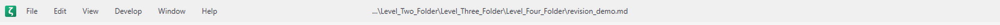

On Windows, the menu bar at the top of the main window shows the active tab's file in its middle. When there is enough room, it shows the full path, including every parent folder, with parts separated by `\`. For example, `D:\Notes\Plans\plan.md` appears in full in a wide window.

- As the window becomes narrower, the title omits the outermost folder one at a time. An omitted path starts with `…\`, as in the picture above. It can eventually show just the parent folder and file name, then the bare file name. When even the file name does not fit, its end is cut off with an ellipsis.
- The title is centered on the window. When there is not enough room to center it there, it is centered in the free space between the last menu and the window buttons instead.
- Without an open file, no title is shown. For a note created with Ctrl+N, the title shows only its tab name, without folders (see "Unsaved notes created with Ctrl+N").
- You can drag the window by its title, and double-clicking it maximizes or restores the window, as anywhere else in the menu bar.
- The window title in the taskbar and in Alt+Tab stays as it is.

There are no settings for this title.

Known limitations:

- Hovering over the title does not show the full path.
- As the window is made narrower, the title can keep the same number of folders over a range of medium widths before it drops one. In a very narrow window, it moves into the space between the menus and the window buttons and is no longer centered on the window.
- The title appears only in the main window on Windows. macOS and the other windows, such as Preferences, do not show it.
- Unsaved changes are not marked in the title.

## The toolbar


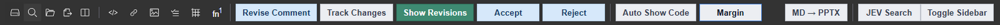

The screenshots show the whole toolbar, without labels, in a wide window while MD → PPTX is off for the active document, so the Pandoc buttons are hidden. Track Changes, Show Revisions, Accept, and Reject, to the right of Revise Comment, belong to track changes; see [Tracking changes](#tracking-changes). The six Pandoc editing and export buttons appear only while MD → PPTX is selected for the active document. The light-blue buttons perform actions.

[Manual pending] A labelled screenshot of the toolbar is still to be taken.

From left to right, the toolbar holds the following controls. Text buttons are at least 100 pixels wide; icon buttons are 28 × 28 pixels.

| Control | Kind | What it does |
|---|---|---|
| File manager / global search (tooltips "Toggle File Manager" and "Search across all files") | Icon buttons | As in Zettlr. |
| Open workspace… | Icon button | As in Zettlr. |
| Export (tooltip "Export to HTML") | Icon button | When the active file is a Markdown file, exports it immediately to a standalone HTML file without a dialog (see "Export to HTML"). For any other file, opens Zettlr's Export dialog. |
| Split editor right | Icon button | With one editor pane, opens a second view of its active file to the right. With several panes, merges their tabs into one pane (see "Split view"). The icon is a frame divided into two equal, empty columns. |
| Insert comment, Insert link, Insert image, Insert task list, Insert table, Insert footnote | Icon buttons | As in Zettlr; each can be hidden in the preferences. |
| Revise Comment | Text button | Marks text for revision. With text selected, it wraps the text as `[selected text{}]`; without a selection, it inserts an empty mark `[{}]` at the cursor. In both cases the cursor ends up between the curly braces, so you can type your comment right away, for example `[What is passed over too quickly{This sentence carries too little; go straight to the next one}]`. With several selections or cursors, each one gets its own mark. The focus returns to the editor. Shortcut: Ctrl+R in the editor (on macOS Cmd+R). Tooltip: "Wrap the selection in [ ] with a {comment} slot for revision comments, or insert [{}] without a selection (Ctrl+R)". See "Marking text for revision". |
| Track Changes | Toggle text button | Turns the recording of your insertions and deletions as tracked changes on or off. Grey when off (the default), green when on. If no author name is set yet, clicking it first asks for one. Shares its setting with Preferences → Editor → "Track changes" → "Track changes". Tooltip: "Record insertions and deletions as tracked changes with your author name". See "Tracking changes". |
| Show Revisions | Toggle text button | Shows tracked changes in color; when off, the editor shows the text as if all changes were accepted. Green when on (the default), grey when off. Shares its setting with Preferences → Editor → "Track changes" → "Show revisions". Tooltip: "Show tracked changes; when off, show the text as if all changes were accepted". |
| Accept | Text button | Accepts the tracked change at the cursor, or all tracked changes in the selection, then moves to the next one. Tooltip: "Accept the tracked change at the cursor or in the selection, then move to the next one". |
| Reject | Text button | Rejects the tracked change at the cursor, or all tracked changes in the selection, then moves to the next one. Tooltip: "Reject the tracked change at the cursor or in the selection, then move to the next one". |
| Auto Show Code | Toggle text button | Sits to the right of Reject, separated by a vertical line. Controls whether a cursor or selection touching a rendered element shows its Markdown source. Grey when off (the default), green when on. Shares its setting with Preferences → Editor → "Auto Show Code"; see "Showing Markdown source while editing". |
| Margin | Drag control | Directly to the right of Auto Show Code, without a separator. Press and drag it left or right to change the left and right margins of the text in Markdown editors; a simple click does nothing. Reads `Margin: N px` while you drag. Greyed out in distraction-free mode. Its tooltip shows the current values for a single pane and for split panes. See "Adjusting the editor margins". |
| MD → PPTX | Toggle text button | Opens or closes the Pandoc PPTX preview for the active Markdown document. Grey when off, green when the preview of the current document is open. Has no effect on other file types. |
| Insert Div | Text button | Opens a small dialog that inserts a Pandoc fenced div. |
| Insert Span | Text button | Opens a small dialog that inserts a Pandoc bracketed span. |
| Insert Two Columns | Text button | Splits the selected lines into a two-column fenced div for slides; tooltip "Split the selection into a two-column fenced div for slides (text on the left, image lines on the right)". |
| Attributes | Toggle text button | Opens or closes the Pandoc Attributes panel; green while the panel is open. |
| Sync Scroll | Toggle text button | Turns synchronized scrolling between the editor and the PPTX preview on or off; grey when off, green when on. |
| Export to PPTX | Text button | Saves the document if needed and converts it to a PowerPoint file next to it. Reads "Exporting…" while an export runs. |
| Export result | Text | Appears to the right of Export to PPTX after an export and shows its outcome, shortened with an ellipsis when longer than 260 pixels. |
| JEV Search | Toggle text button | Opens or closes the JEV Search panel to the right of the editor (see "JEV Search"). Grey when the panel is closed, green while it is open. Tooltip: "Toggle the JEV Search panel, which finds the passages of the current document that match a description". |
| Toggle Sidebar | Toggle text button | Shows or hides the sidebar on the right side of the window, the same as View → "Toggle Sidebar" (Ctrl+Shift+0, on macOS Cmd+Shift+0). Grey while the sidebar is hidden, green while it is shown, regardless of how it was opened or closed. Tooltip: "Toggle Sidebar", in the language of the interface. |

Thin vertical separator lines divide the toolbar into groups. From left to right:

1. The strip of five touching square icon buttons (File manager, global search, Open workspace…, Export, Split editor right).
2. A separator, then the six insert icon buttons (comment, link, image, task list, table, footnote).
3. A separator, then Revise Comment, Track Changes, Show Revisions, Accept, and Reject, with no separators between them.
4. A separator, then Auto Show Code, directly followed by Margin.
5. A stretchable space that fills all remaining width and pushes everything after it to the right end. MD → PPTX follows it, together with the Pandoc buttons and the export result that appear with it.
6. A separator, then JEV Search and Toggle Sidebar, touching each other.

If all six insert icon buttons are hidden in the preferences, the separator after them disappears too, so two separator lines never stand next to each other.

The height of a separator depends on its neighbors. Each side is judged by the nearest control that is shown; hidden controls are skipped. When the control on either side shows text (a text button, the export result, or Margin), the separator is as tall as the text buttons. When neither side shows text, the separator is a short line 18 pixels high. In the arrangement above, only the separator between the five icon buttons at the left end and the insert icon buttons is short. When all six insert icon buttons are hidden, that separator stands next to Revise Comment and becomes tall as well.

Double-clicking a separator line does the same thing as double-clicking the empty toolbar background: on macOS, when the window has no separate title bar, it maximizes the window; on other systems it does nothing.

The grey-or-green toggles (Track Changes, Show Revisions, MD → PPTX, Sync Scroll, Auto Show Code, JEV Search, Toggle Sidebar) show state; the light-blue buttons (Revise Comment, Accept, Reject, Insert Div, Insert Span, Insert Two Columns, Attributes, Export to PPTX) perform actions.

MD → PPTX and Auto Show Code remain available independently of each other. Insert Div, Insert Span, Insert Two Columns, Attributes, Sync Scroll, Export to PPTX, and the export result text appear only while MD → PPTX is selected for the active document. Insert Div and Insert Span also respect their shared button visibility setting. Switching documents updates the group to match that document's preview; hiding the group preserves the Attributes panel's open state and the Sync Scroll choice.

The toolbar has no buttons for writing statistics, the tag cloud, opening the settings, creating a new file, the previous or next file, the document information text, or an available update. Open the preferences through the menu instead (on Windows: File → Preferences…), and create a new note with Ctrl+N (see "Unsaved notes created with Ctrl+N"). The checkboxes "Open settings", "New file", "Previous file", "Next file", the word/character counter, and "Display Pomodoro timer" under Preferences → Appearance → Toolbar buttons have no effect.

The toolbar also has no Pomodoro timer and no indicator for long-running tasks. The Pomodoro timer cannot be started anywhere in the program. Tasks that Zettlr runs in the background, such as indexing the files again after a workspace is opened or closed, or an export started from Zettlr's Export dialog, still run, but their progress is not shown.

Revise Comment is described under "Marking text for revision"; Track Changes, Show Revisions, Accept, and Reject under "Tracking changes"; Auto Show Code under "Showing Markdown source while editing"; Margin under "Adjusting the editor margins"; Insert Div, Insert Span, and Insert Two Columns under "Inserting fenced divs, spans, and columns"; Attributes under "Editing Pandoc attributes"; MD → PPTX, Sync Scroll, and Export to PPTX under "Pandoc PPTX preview and export"; JEV Search under "JEV Search".

When the window is too narrow to fit every control in one row, the main-window toolbar wraps onto a second row, or onto more rows if needed. The controls keep their order, and the editor moves down so that the toolbar never covers it. Controls that continue on a further row start at its left edge. Once the window is wide enough again, the toolbar returns to a single row. A typical case is a window about 1600 pixels wide with MD → PPTX on: the Pandoc buttons that no longer fit move to the second row, together with the controls after them.


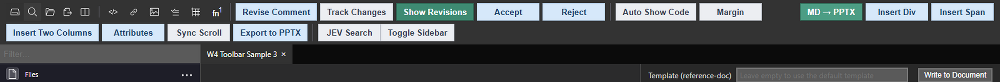

Only the main window's toolbar wraps. Toolbars in other windows, such as the log window, stay in one row and scroll sideways when they do not fit.

## Tracking changes

When Track Changes is on, your insertions and deletions in a Markdown document are kept as tracked changes, each with your author name and the time, rather than modifying the text directly. Later you, or someone else, can accept or reject each change. Show Revisions controls whether tracked changes appear in color or whether the editor shows the text as if all of them were accepted.

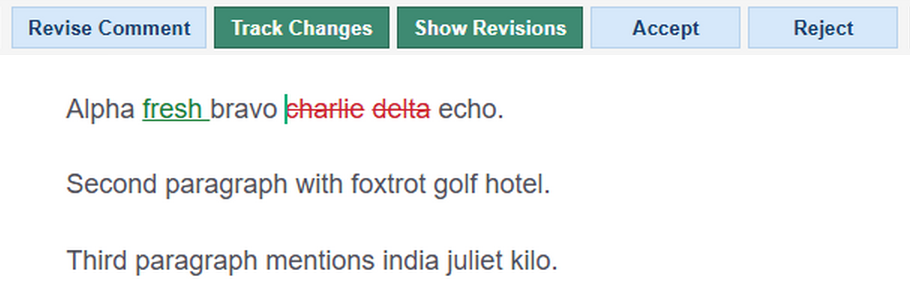

The four buttons sit directly to the right of Revise Comment in the toolbar (see "The toolbar"). Track Changes and Show Revisions are switches that are grey when off and green when on; Accept and Reject are light-blue action buttons.

### Turning Track Changes on and the author name

- Click "Track Changes" in the toolbar, or tick Preferences → Editor → "Track changes" → "Track changes". The two controls share one setting, which applies to all editors and is kept across restarts. It is off by default. Track Changes has no keyboard shortcut.
- Every tracked change records the author name set under Preferences → Editor → "Track changes" → "Revision author". It is empty by default.
- When the author name is empty and you click the toolbar button, a dialog titled "Revision author" asks for it first, with the text "Enter the author name recorded with your tracked changes."
- The text field comes pre-filled with a suggested name, already selected so that typing replaces it. On Windows the suggestion is the display name of your Windows account; if the display name is empty or cannot be read, the login name is used instead. On macOS and Linux the suggestion is your login name. If neither name can be read, the field stays empty.
- Keep or edit the name and press OK or Enter: the name is saved and Track Changes turns on. The suggested name is saved only when you press OK. Press Cancel or Escape to save nothing and leave Track Changes off. OK is unavailable while the field is empty.
- Ticking the checkbox in Preferences does not ask for a name. While no name is set, new changes are recorded with the author "Unknown author".

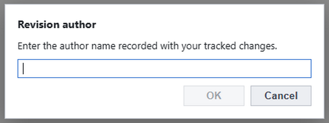

[Manual pending] A screenshot of the "Revision author" dialog with a suggested placeholder account name filled in and selected is still to be taken.

### What is recorded while Track Changes is on

Tracked changes are stored in the Markdown text as Pandoc spans, so they remain in the file and are understood by other programs that read Pandoc Markdown:

- An insertion is written as `[inserted text]{.insertion author="<name>" date="<YYYY-MM-DDTHH:MM:SSZ>"}`, a deletion as `[deleted text]{.deletion author="<name>" date="<YYYY-MM-DDTHH:MM:SSZ>"}`. The time is in UTC.
- When you delete text that someone else inserted, both changes are kept, one inside the other: `[[text]{.insertion author="<other name>" …}]{.deletion author="<your name>" …}`.
- Quotation marks and backslashes in the author name are escaped; line breaks and tabs in it are replaced by spaces.

While Track Changes is on, editing works as follows:

- Text you type goes into an insertion. Typing in one go extends the same insertion, which keeps the time of its first character.
- Backspace or Delete on ordinary text does not remove it. The text becomes part of a deletion, and the cursor jumps in front of or behind it.
- Deleting text that you inserted yourself removes it directly. When an insertion becomes empty, its markup disappears as well.
- Typing over selected text produces a deletion followed by an insertion. A single undo restores the original text and the selection.
- Text typed with an input method, for example Chinese Pinyin, stays unmarked while you compose it. When you finish composing, the finished text is recorded as one insertion, without any letters of the phonetic input.
- The arrow keys and Backspace skip the hidden brackets and attribute blocks of tracked changes (see "Moving the cursor, deleting, and copying").

Edits in these places are applied directly and never recorded: fenced code blocks, inline code, the YAML front matter, the text between the curly braces of a Revise Comment mark, and Revise Comment itself (see "Marking text for revision").

### How tracked changes are shown

With Show Revisions on (the default), inserted text is green and underlined and deleted text is red and struck through, as in the picture at the start of this chapter. The brackets and attribute blocks are hidden. The author and time are not shown, and there is no tooltip.

With Show Revisions off, the editor shows the text as if all changes were accepted: deleted text is hidden entirely, and inserted text appears as ordinary text without color. The tracked changes remain in the file.

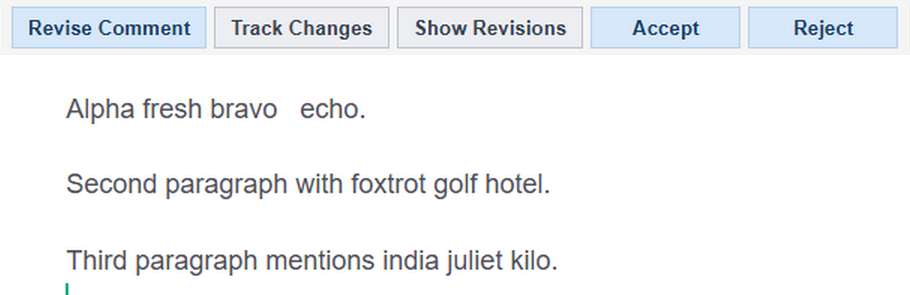

Whether the cursor reveals the Markdown source of a tracked change depends on the other switches:

- While Track Changes is on, the source is never shown in preview mode, even when the cursor is inside a change.
- While Track Changes is off and Auto Show Code is on, moving the cursor into a change shows its complete source.
- While Auto Show Code is off, the source is shown only when the exception "Tracked changes" under Preferences → Editor → "Auto Show Code" is ticked; it is off by default (see "Showing Markdown source while editing").
- Raw mode always shows the source.

### Moving the cursor, deleting, and copying

In preview mode the brackets and attribute blocks of tracked changes are hidden, and with Show Revisions off the deleted text is hidden as well. Whether Track Changes is on or off, the cursor treats this hidden text as follows:

- The cursor never stops inside hidden text. Every press of an arrow key moves the cursor visibly on the screen. With Show Revisions off, one press crosses a whole hidden deletion. Selecting with the mouse works as usual.

While Track Changes is off, Backspace and Delete never remove hidden text:

- Next to a tracked change, they remove the neighboring visible character instead of a hidden bracket or attribute block.
- Removing the last visible character of a tracked change removes the whole change, including its markup.
- With Show Revisions off, Backspace directly behind a hidden deletion removes the visible character in front of the deletion and keeps the deletion.

While Track Changes is on, Backspace and Delete follow the rules in "What is recorded while Track Changes is on".

Copying and cutting (Ctrl+C, Ctrl+X, or the menus) depend on Show Revisions:

- With Show Revisions on, a selection that covers only part of a tracked change puts the selected visible text of that change on the clipboard, without brackets, attribute block, or author name. A tracked change that lies wholly inside the selection is copied as its Markdown source, so it stays a tracked change when you paste it elsewhere.
- With Show Revisions off, the clipboard receives the text with all changes accepted.
- Cutting removes the original text from the document; while Track Changes is on, the removal is recorded as a deletion.

In raw mode, and for a tracked change whose source is currently shown, the cursor, deleting, and copying work on the Markdown source as usual.

### Accepting and rejecting changes

- Accepting an insertion keeps its text and removes the markup. Accepting a deletion removes the text together with the markup.
- Rejecting an insertion removes it entirely. Rejecting a deletion turns its text back into ordinary text. Rejecting your deletion of someone else's insertion restores that insertion.

There are two ways to accept or reject:

- **The toolbar buttons "Accept" and "Reject"** handle the tracked change at the cursor, or every tracked change in the selection. The cursor then moves to the start of the next change's text; when there is no further change, it stays where it is. When the cursor is not on a tracked change, the document is not changed and the text of the next change is selected, so that a second click handles it. With a split view, the buttons work in the editor pane that last had focus.
- **The context menu** of the editor text, of a link, an image, or a citation contains the following items after a separator line at its end, as long as the document contains tracked changes:
  - On a tracked change: "Accept Change" and "Reject Change".
  - Without a selection: "Accept All Changes" and "Reject All Changes".
  - With a selection that touches tracked changes: "Accept Changes in Selection" and "Reject Changes in Selection", which handle only those changes.

  When there is nothing to accept or reject, these items do not appear, and a document without tracked changes has the usual context menu.

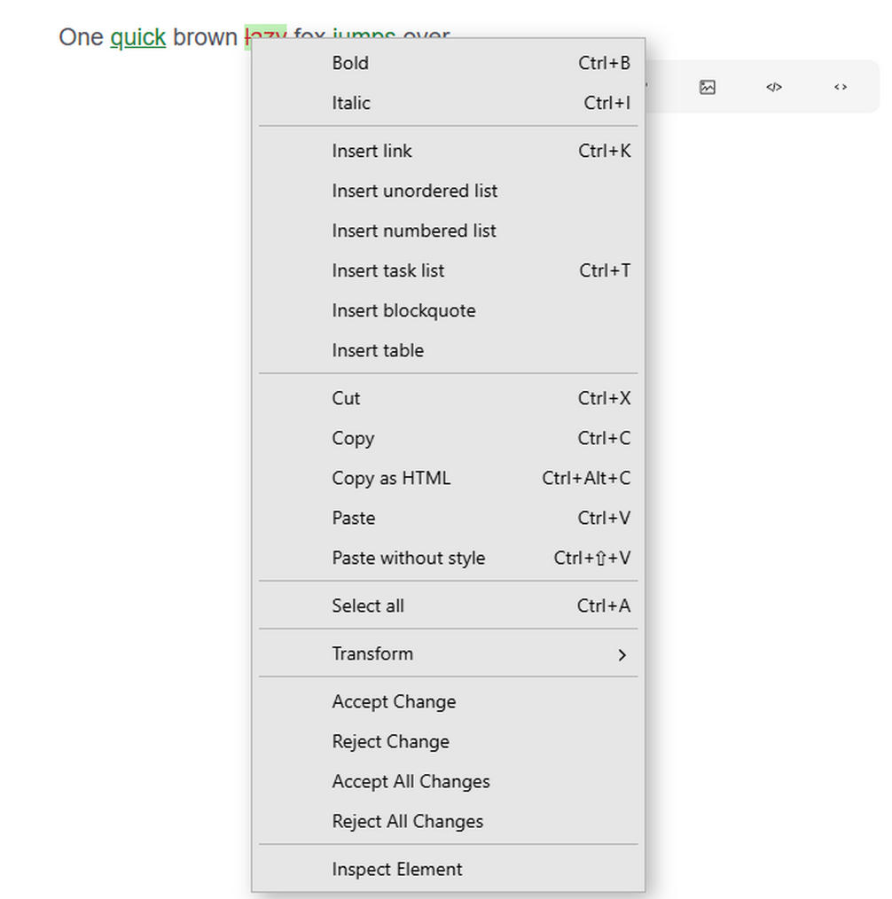

Each accept or reject, from either place, can be undone with a single undo.

### Tracked changes in exports

Exports never change the document itself.

- **Export to HTML**: with Show Revisions on, insertions are green and underlined and deletions red and struck through, in the colors of the editor, with their own colors in the dark theme. Hovering over a change shows "Inserted by <author> on <date> <time>" or "Deleted by <author> on <date> <time>", or "Unknown author" when no author was recorded. With Show Revisions off, the HTML file contains the text with all changes accepted.
- **Zettlr's Export… dialog**: a Word (docx) export keeps the tracked changes, and Word shows them as its own tracked changes. Textbundle and Textpack also keep them unchanged. Every other format, including Simple PDF, is exported with all changes accepted.
- **Pandoc PPTX preview and Export to PPTX**: both use the text with all changes accepted, so deleted text never appears on the slides.

### Messages

When the toolbar cannot save a choice, a dialog titled "Zettlr" shows one of the following messages, and the setting stays as it was (see "Notices and the error log"):

| Message | Meaning |
|---|---|
| Could not save Track Changes. The setting was not changed. | Clicking Track Changes could not save the new state. |
| Could not save Show Revisions. The setting was not changed. | Clicking Show Revisions could not save the new state. |
| Could not save the revision author or Track Changes. Track Changes was not turned on. | After you confirmed the "Revision author" dialog, the name or the switch could not be saved. |

### Known limitations of tracked changes

- Paragraph breaks, markers at the start of a line (such as list or heading markers), and table separators are not recorded. When you type Markdown syntax characters, such as a backtick or an unpaired square bracket, some of them are not recorded. Edits inside table cells are not recorded.
- The author name cannot contain `}`.
- Ticking "Track changes" in Preferences does not ask for an author name.
- On Windows, the suggested name in the "Revision author" dialog can appear about a second after the dialog opens the first time, because the program reads the display name of your account first. If reading it takes longer than five seconds, the login name is suggested instead. The name is read once per program run, so a display name changed in the meantime is only suggested after a restart.
- While Track Changes is off, cutting only part of a tracked change leaves its markup broken in the document, even though the clipboard receives clean visible text. Ctrl+Z restores the markup.
- While Track Changes is on and Show Revisions is off, the first Backspace directly behind a hidden deletion only moves the cursor in front of the deletion, so nothing seems to happen. The second press deletes the character in front of it.
- Export commands you define yourself receive the original file, with the tracked changes unprocessed.
- In Export to HTML, the tooltip shows the time in your local time zone, while the file stores it in UTC.
- The menus that appear when you click a rendered image, citation, or similar element do not contain the accept and reject items; right-click the text instead.

## Tabs and file names

### File names instead of titles

Tabs, the file manager, and the window title show a document's file name without its extension, not the document's title or first heading. This is the default of the "Filename only" setting under Preferences → File Manager; choose another option there to show titles or headings again. Whether extensions appear follows the Zettlr setting for Markdown file extensions, which is off by default.

### The tab context menu

Right-clicking a tab opens Zettlr's tab menu with these additions:

- Right after "Pin tab" (or "Unpin tab" for a pinned tab), "Copy to Split View" and "Move to Split View" show the file in another editor pane; see "Copying or moving a tab to the split view".
- For a Markdown file, the menu ends with a separator and "Export to HTML", which exports that file (not necessarily the active one) to a standalone HTML file; see "Export to HTML".
- When the saved content of the file contains at least one bracketed physical-quantity formula, the menu also offers "Export Formula-Calculated Copy"; see "Exporting a formula-calculated copy".

The tab menu also works for files that do not belong to any open workspace.

### Returning to a document's reading position

When you switch from a Markdown document or another text file to a different tab and then return, the editor restores the reading position, cursor or selection, and folded sections from your last visit. The reading position is remembered separately for each document in each editor pane, so the same file can stay at different positions in two split panes.

The editor keeps your reading position even when the cursor is outside the visible area; returning to the tab does not scroll to that cursor. If you switch away again before the restored document has finished appearing, its remembered reading position is kept for your next visit.

Splitting a pane keeps the original pane at its current reading position and starts the new pane at the same position, with the same selection and folded sections. The two panes then remember their positions independently. Merging with "Split editor right" or "Split Editor Right" keeps the reading position of the pane you used last.

An explicit navigation action, such as jumping to a line, choosing a heading in the outline of the right sidebar, or locating a search result, takes you to that destination. The position you leave after navigating is remembered for the next visit. This behavior works automatically, with no setting to enable. Text reading positions are held in memory for the current window and are not saved across application restarts. PDF and formatted JSON views use their own reading-position behavior, described in their respective sections.

### Scrolling the tab bar

When more tabs exist than the tab bar can show, turning the mouse wheel over the tab bar scrolls the tabs sideways. Holding Ctrl (Cmd on macOS) while turning the wheel leaves the tab bar alone.

### Closing a tab with the middle mouse button

Clicking a tab with the middle mouse button (pressing the mouse wheel) closes that tab when you release the button. The click does nothing else. It does not start the auto-scroll mode where moving the mouse scrolls the window until the next click, so the mouse works normally right after the tab closes.

### Moving a tab into a new window

Drag a document tab and release it outside every Zettlr-LYH window, for example over the desktop or over the window of another program. A new Zettlr-LYH window opens containing only this document.

- The new window has the same size as the window you dragged the tab from. It is placed so that the tab lies roughly under the pointer; if it would reach beyond the screen, it is moved back onto the screen.
- The tab closes in the original window. If it was the only tab there, the original window stays open with an empty editor. If it was the only tab of one editor pane while the window has other panes, that pane closes.
- Unsaved changes, the pinned state of the tab, and the reading position go with the document.
- Pressing Esc while dragging cancels the drag, and no window is created.

Releasing the tab inside any Zettlr-LYH window behaves as in Zettlr, for example reordering the tabs or splitting the editor (see "Dragging a tab to the edge of an editor pane"). There is no setting for this behavior.

Known limitations:

- The new window appears about a quarter of a second after you release the mouse button.
- A minimized or hidden Zettlr-LYH window does not count as a window: releasing the tab where such a window would be opens a new window.
- This has been checked only on Windows.

### Renaming a file with F2

Press F2, or choose File → "Rename file", to rename the file of the active tab. A rename field opens below the tab. It shows the file name with its extension, with the part before the last dot selected. Press Enter to rename the file; press Escape or click elsewhere to cancel. In the file manager, "Rename file" in the context menu of a file row, which shows F2 as its shortcut, turns the name of that row into a rename field.

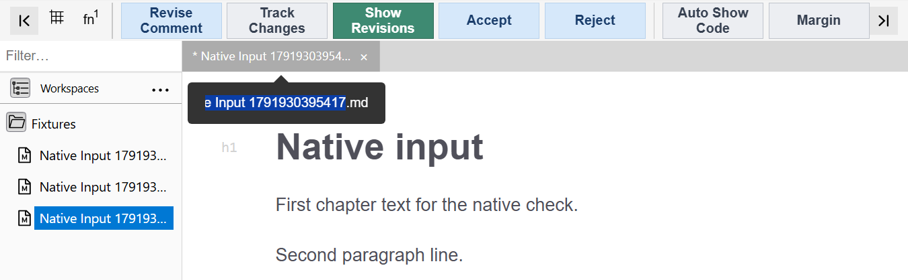

Files with unsaved changes cannot be renamed; see the known limitations at the end of the next section. A note created with Ctrl+N can be renamed and stays a note; see "Renaming a note".

### Renaming a file by clicking it again

As in Windows Explorer, you can rename a file by clicking its name once more when it is already active or selected. Wait about half a second after the click; a second click within that time counts as a double-click and does not trigger renaming.

- **In the tab bar.** Click the active tab of the editor pane you are working in, anywhere except its close button; the pin of a pinned tab counts as part of the tab. If no second click follows within about half a second, the rename field that F2 opens appears below the tab. It shows the file name with its extension, with the part before the last dot selected. Press Enter to rename the file; press Escape or click elsewhere to cancel.
- **In the file manager.** Click the name of a file row that is already selected. After about half a second, the name turns into the rename field that "Rename file" in the row's context menu opens. This works in the Files section (including grey unopened files and the notes under "Unsaved Files"), in the Workspaces section, and in the file list.

Clicking an inactive tab only switches to it, and clicking an unselected file row only selects or opens it, as usual.

This also works for a note created with Ctrl+N, both in the tab bar and on its row under "Unsaved Files". The note is renamed in place and, after the rename, is still a note listed under "Unsaved Files"; see "Renaming a note".

The rename does not start in these cases:

- The row is a folder row or the "Unsaved Files" row.
- You click the icon at the start of the row, the expand arrow, the eye button, or empty space in the row instead of the name.
- You double-click. A double-click on a grey unopened file still opens it.
- The pointer moves more than 4 pixels while the button is held, or you start dragging the tab or the row.
- You release the button outside the tab or the name, or on the tab's close button.
- You hold Ctrl, Shift, Alt, or the Windows key (Cmd on macOS) while clicking.
- During the wait, you press any key or any mouse button, the window loses focus, or another tab becomes active or another file is selected.
- The click brings the window to the front: a click within half a second after the window receives focus does not count.

F2, switching tabs with a click, closing a tab with the middle mouse button, the context menus, dragging tabs to reorder them, and the close button all work as usual. There is no setting for this behavior.

Known limitations:

- The half-second wait is fixed and does not follow the double-click speed set in Windows.
- A file with unsaved changes cannot be renamed. Confirming a new name shows "Cannot rename file: Please save your changes first."; save the file first.
- A note created with Ctrl+N is not subject to that restriction: it is renamed in place without saving and stays a note (see "Renaming a note"). In the file manager, the rename field for a note starts with the text of its tab rather than its file name.

### Reopening a closed tab

Press Ctrl+Shift+T (Cmd+Shift+T on macOS), or choose Window → "Reopen Closed Tab", to bring back the tab you closed most recently. Each further press reopens the one closed before that, so repeated presses bring tabs back in reverse order. When nothing is left to reopen, the shortcut does nothing and no message appears.

These closings are remembered:

- Closing a tab yourself: with Ctrl+W or Window → "Close Tab", with the close button or the middle mouse button on the tab, and with "Close other tabs" or "Close all tabs" in the tab context menu. A close that you cancel in a dialog about unsaved changes is not remembered.
- A tab replaced by the next file you open while "Avoid opening files in new tabs if possible" under Preferences → General is on.
- A tab whose document had unsaved changes and was closed because its file was deleted on disk. A tab closed for that reason without unsaved changes is not remembered.
- A tab closed with "Close window(s)" in the Windows dialog (see "Managing open documents with the Windows dialog").

The program remembers at most the 30 most recent closings; older ones are dropped. The list exists only while the program runs and is empty after every start.

A reopened tab returns to the editor pane where it was closed, at its former position in the tab bar, and it is pinned again if it was pinned. If that editor pane no longer exists, the tab opens in the editor pane you used last in the active window, right after the active tab; it is pinned again if it was pinned, but its former position is not restored. A remembered tab whose file is already open in that editor pane is skipped without a message, and the next one is reopened instead.

What the reopened tab shows depends on the file:

- **The file still exists.** It opens as usual. If you closed it with unsaved changes and chose "No" in the dialog about saving, the dialog "Unsaved Changes Found" asks whether to open the version with those changes or the file from disk (see "The cache of unsaved changes").
- **The file no longer exists, but its unsaved changes are in the cache.** The content comes back as an unsaved note, just like a note created with Ctrl+N (see "Unsaved notes created with Ctrl+N"), and a system notification says "<file name> no longer exists. Its content has been restored from the backup as an unsaved note." The cache entry is then removed, and any further remembered closings of the same file are dropped. When you save this note, the "Save file" dialog proposes the original folder and file name; if the original folder no longer exists, it proposes the original file name in the folder where the dialog usually starts. A name that ends in a Markdown extension, or in an extension of a file type the program opens as code (such as `.json`, `.yaml`, or `.tex`), is kept as typed; any other name receives `.md`.
- **The file no longer exists and nothing of it is in the cache.** The tab is skipped, a system notification says "Skipped a closed tab: <file name> no longer exists and has no backup.", and the next remembered tab is reopened in the same step. When several tabs are skipped at once, the notification reads "Skipped N closed tabs whose files no longer exist and have no backup:" followed by their file names.
- **The unsaved note cannot be written.** An error dialog titled "Could not reopen the closed tab" says "The content of <file name> could not be restored from the backup:" followed by the reason. The closed tab stays in the list, so you can press the shortcut again once the cause is fixed.

The shortcut can be changed under Preferences → Shortcuts → "Reopen Closed Tab". The command "Filter files" (Edit → "Filter files"), which moves keyboard focus to the filter field above the file manager, uses Ctrl+Shift+E (Cmd+Shift+E on macOS) by default, so it does not collide with this shortcut. A shortcut for "Filter files" that you set yourself under Preferences → Shortcuts stays as you set it.

[Manual pending] A screenshot of the Window menu with "Reopen Closed Tab" and of the "Reopen Closed Tab" field under Preferences → Shortcuts is still to be taken.

Known limitations of reopening closed tabs:

- Closing a whole editor pane with "Close leaf", moving a tab to another editor pane (by dragging it or with "Move to Split View"), and closing a window are not remembered.
- After the last tab of the only editor pane is closed, the program replaces that pane with a new one. Tabs closed in the old pane then reopen in the new pane after the active tab, not at their former positions.
- Pinned tabs cannot be closed with the close commands, so a tab comes back pinned only when it was pinned and its file was deleted on disk.
- When an unsaved note restored from the cache is saved under a name that is not a Markdown file, the editor keeps showing it as Markdown until you close the tab and open the file again.
- The original location of a restored note is known only until the program quits. After a restart, the note behaves like any other note created with Ctrl+N: the "Save file" dialog suggests a name from its first line.
- On Windows, Preferences → Shortcuts shows the default shortcut with the Windows key symbol `⊞` instead of Ctrl. The shortcut that works, and that the Window menu shows, is Ctrl+Shift+T. The same applies to the default shortcut of "Filter files".

### Managing open documents with the Windows dialog

The Windows dialog lists every file open in the current window, across all of its editor panes, and lets you switch to, save, close, or reorder several of them at once.

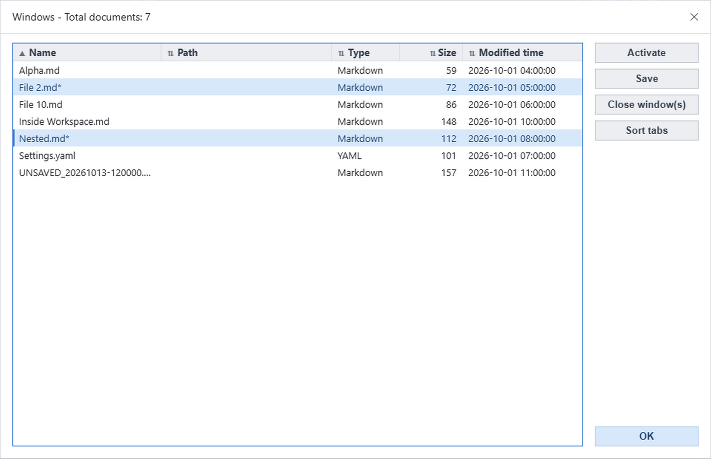

**Opening it.** Choose Window → "Windows…". The entry sits after "Next Tab", separated from it by a line, and right before "New window". It exists on Windows and on macOS and has no keyboard shortcut.

**What it shows.** The dialog covers the window, and its title reads "Windows - Total documents: N", where N is the number of open files. Each file has one row, even when it is open in several editor panes; an action on that row applies to the file in every pane of the window that shows it. Each row has these columns:

- **Name**: the file name with its extension. A file with unsaved changes ends in `*`.
- **Path**: the full path. A long path is cut off; hovering over it shows the whole path.
- **Type**: Markdown for Markdown and plain text files; LaTeX, YAML, JSON, or JSON Lines for those files; Dictionary for `.dic` files; Image for pictures; PDF for PDF files; for any other file, its extension in capital letters.
- **Size**: the size of the file on disk, in bytes.
- **Modified time**: when the file on disk was last changed, as year-month-day hours:minutes:seconds.

At first the rows follow tab order: the tabs of the first editor pane from left to right, then those of the next pane. A file open in several panes is listed at the place of its first tab. Click a column header to sort by that column in ascending order; click it again to switch between ascending and descending order. Name, Path, and Type are sorted alphabetically, with numbers in names compared by their value and without regard to letter case.

**Selecting rows.** Click a row to select it. Hold Ctrl (Cmd on macOS) and click to add or remove a row, and hold Shift and click to select every row between the last clicked row and this one. The Up and Down arrow keys move the selection; with Shift held they extend it. Ctrl+A (Cmd+A on macOS) selects all rows.

**The buttons.** They are on the right side of the dialog:

- **Activate** switches to the first selected document and closes the dialog. Double-clicking a row, or pressing Enter, does the same for that row. When the file is open in several panes, the dialog switches to the pane that last had the focus if that pane shows the file, and otherwise to the first pane that shows it.
- **Save** saves the selected documents that have unsaved changes, each once. Documents without changes are left alone.
- **Close window(s)** closes the selected files in every pane of this window; pressing Delete does the same. Tabs closed this way can be brought back with Ctrl+Shift+T (see "Reopening a closed tab"). How unsaved changes are handled is described below.
- **Sort tabs** puts the tabs of every editor pane into the order the dialog currently shows. Pinned tabs stay at the left end of their tab bar. Editor panes keep their places; tabs do not move between panes.
- **OK** closes the dialog. Pressing Escape, or clicking ✕ at the top right, does the same.

Activate, Save, and Close window(s) are greyed out while no row is selected.

The list updates while the dialog is open: closed tabs disappear, newly opened ones appear, and after saving the `*` goes away and size and time are read again.

**Closing files with unsaved changes.** When "Close window(s)" closes a single file with unsaved changes, it asks the same question as closing its tab, with the buttons Yes, No, and Cancel; Cancel keeps the file open in all its panes.

When it closes several files at once, the files are handled in the order the dialog lists them, and each file with unsaved changes is asked about in turn. The question shows the file name and has five buttons:

- **Save** saves the file and then closes it. If the file on disk has changed in the meantime, the dialog about the external change takes over (see "Checks before saving and when a file is opened again"), and the file stays open.
- **Don't Save** closes the file without saving. Its unsaved changes go into the cache of unsaved changes, are kept for 14 days, and are offered again when you open the file (see "The cache of unsaved changes").
- **Cancel**, or pressing Escape, keeps this file open and goes on with the next one.
- **Keep All** keeps this file and every later file with unsaved changes open without asking again. Later files without unsaved changes are still closed.
- **Discard All Changes** closes this file and every later file with unsaved changes without saving and without asking again. Their unsaved changes go into the cache of unsaved changes, as with Don't Save.

In both cases:

- Pinned tabs are never closed. A file that is open only in pinned tabs is skipped; unpin its tab first to close it.
- A file that is still open in another window is closed here without a question, because its document stays open there.
- An unsaved note created with Ctrl+N is closed with its own question, file by file, as when you close its tab (see "Closing a note").
- The files that stay open remain selected in the dialog.

Closing a single tab outside the dialog always asks the Yes / No / Cancel question.

**Resizing the dialog.** The dialog opens at 960 × 620 pixels until you resize it. Point at any of its four edges or four corners; when the pointer turns into a resize arrow, hold the mouse button and drag. The dialog stays centered in the window, so its width and height change by twice the distance you move the pointer. It is at least 560 × 320 pixels and at most as large as the main window less 24 pixels on each side.

**Resizing the columns.** Drag the divider at the right edge of a column header (Name, Path, Type, Size, or Modified time). The divider is 6 pixels wide and is highlighted while the pointer is over it. A column is at least 40 pixels wide, and the other columns keep their widths. Until you first resize a column, the columns share the width of the table; from the first drag on, each column starts from the width it had on screen and keeps its own width in pixels, also when you resize the dialog. When the five columns together are wider than the table, a horizontal scroll bar appears. Dragging a divider does not sort the list; clicking anywhere else on a header sorts by that column.

**What the dialog remembers.** Each time you release the mouse button after resizing the dialog or a column, the size and the column widths are saved. The dialog opens with them the next time, in every main window and also after a restart.

Known limitations of the Windows dialog:

- Size and Modified time come from the file on disk. Unsaved edits in the editor are not reflected in them.
- "Close window(s)" does not close pinned tabs; they stay open. Unpin a tab first to close it.
- When the list is not sorted by any column, "Sort tabs" can still slightly reorder an editor pane that shares files with another pane, because each shared file takes the place of its first tab in every pane.
- The dialog lists only the tabs of the window in which it was opened.
- When the main window is smaller than the remembered size, the dialog is shown smaller to fit. The remembered size stays as it is and is used again once the window is large enough.
- The dialog cannot be moved. Its sort order and the selected rows are not remembered.
- There is no command to return to the default size and column widths.
- When the five columns together are narrower than the table, the space to their right stays empty.
- The rightmost 6 pixels of each column header are the divider for resizing; clicking there does not sort.
- The dialog has no settings.

## Split view

The editor area of a window can be divided into several editor panes side by side or one above the other. Each editor pane has its own tab bar. A file can be open in more than one editor pane at a time; all of its tabs then edit the same document, so text typed in one pane appears in the other at once.

[Manual pending] A screenshot of a window split into two editor panes showing the same file, with the "Split editor right" toolbar button and the View menu entries "Split Editor Right" and "Split Editor Down" visible, is still to be taken.

### Splitting the editor from the toolbar or the View menu

The toolbar and View menu provide these controls:

- Click "Split editor right" in the toolbar, the last of the five icon buttons at its left end.
- Choose View → "Split Editor Right".
- Choose View → "Split Editor Down".

The two View menu entries appear on Windows and on macOS, after "Toggle File Manager" and "Toggle Sidebar". Neither has a keyboard shortcut.

"Split editor right" and "Split Editor Right" switch between a single pane and a split view. With one pane, they open a second view of its active file to the right. If that pane has no active file, nothing happens. With several panes, they merge all tabs into the pane you used last and keep its active file selected. Each file appears only once in the merged tab bar, and a file pinned in any pane stays pinned. Files and unsaved edits remain open.

Repeated clicks alternate between one and two panes; they do not create a third pane. Clicks received while a split or merge is still being applied are ignored. This also applies when the toolbar button and menu command are used together.

For Markdown and other text files, the original pane keeps its reading position when split, and the new pane starts at the same position. Subsequent scrolling is independent in each pane. Merging keeps the reading position of the pane you used last; see "Returning to a document's reading position".

"Split Editor Down" splits the pane you used last and opens another view of its active file below it. If that pane has no active file, nothing happens. Tab copying, tab moving, and dragging tabs to pane edges use the behaviors described below.

### Copying or moving a tab to the split view

Right-click a tab and choose one of the two entries that follow "Pin tab" (or "Unpin tab") in the tab context menu:

- **Copy to Split View** opens the file in another editor pane and keeps the original tab.
- **Move to Split View** opens the file in another editor pane and closes the original tab. If this leaves the original pane without tabs, that pane closes as well.

Which pane receives the file depends on how many panes the window has:

- With a single pane, a new pane is split off to its right.
- With several panes, the file goes into the next pane; the last pane passes it on to the first. No new pane is created.

If the receiving pane already has a tab for the file, "Copy to Split View" just makes that tab active.

"Move to Split View" is greyed out for a pinned tab and when the tab is the only tab of the only editor pane in the window. "Copy to Split View" is always available.

### Dragging a tab to the edge of an editor pane

You can also split the editor by dragging a tab onto an edge of an editor pane, as in Zettlr. The dragged tab moves into the new pane.

### Known limitations of the split view

- The toolbar button and "Split Editor Right" merge any existing multi-pane layout into one pane. To add a pane to an existing split view, use "Split Editor Down" or drag a tab to a pane edge.
- The split commands have no keyboard shortcuts and no settings.
- If every pane is empty, merging shows one pane, but restarting before another document action saves the layout may restore the previous empty panes.
- A tab moved with "Move to Split View" cannot be brought back to its former editor pane with Ctrl+Shift+T; see "Reopening a closed tab".

## The file manager

### The opening-history tree in the Files section


The Files section of the left sidebar is an opening history arranged as a tree. Every file you open is recorded, and the recorded files appear inside the folder structure they have on disk. At each level, folders come before files, and each group is sorted by name in ascending order. On Windows, names use the same natural name comparison as Windows Explorer: numbers are compared numerically, so `Notes2.md` comes before `Notes10.md`, and letter case does not determine the order. A row that combines several nested folders is sorted by the first folder name shown in that row. The history keeps the 200 most recently opened files; Opening a file again updates which files are retained but does not move its row to the top.

The tabs that the program restores at startup count as opened files. Their files are added to the history right after the previous session has been restored, so they appear in the Files tree even if you have not opened them yourself since. Notes created with Ctrl+N and files inside an open workspace are not added, just as when you open such a file yourself, and neither are files of types the history does not record. A restored file that is already in the history keeps its place there; Files that are missing are added after the existing entries.


The Files section appears whenever the history contains at least one file or a note created with Ctrl+N is open in the window, including during startup before the workspaces have finished loading. The message "No open files or folders" appears only when the history and the list of workspaces are both empty and no such note is open.

The history records files of these types: `.md`, `.rmd`, `.qmd`, `.markdown`, `.txt`, `.mdx`, `.mkd`, `.tex`, `.latex`, `.yaml`, `.yml`, `.json`, `.jsonl`, and `.dic`.

How to use the tree:

- Click a file row to open the file. Hovering over a file row shows its full path.
- On Windows, a folder row with contents has a separate arrow before its system folder icon. The arrow points right when collapsed and down when expanded. Click the arrow or the folder row to expand or collapse it. Rows without contents keep the same arrow space so that their icons and names line up. When Windows appearance information is unavailable, and on other platforms, the folder icon acts as the expand/collapse button.
- Each folder row also has an eye button at its right end. The tooltip reads "Show files that have never been opened." Clicking it expands the folder and shows, in grey, every subfolder not yet shown and every unopened file of the types listed above. These rows are inserted among the history rows using the same folders-first name order. Clicking it again ("Hide files that have never been opened") returns to showing only opened files. Each folder's eye state is remembered across restarts.
- The tree expands automatically to the current document, which is highlighted, and to the five most recently opened files. At startup this happens right after the previous tabs have been restored; the workspace tree likewise expands step by step to the current document.
- Click a grey unopened file once to select it; double-click it to open it.
- Click the name of the selected file once more to rename it; see "Renaming a file by clicking it again".
- Moving through the tree with the arrow keys follows the order of the rows on screen.

Known limitations:

- Only the 200 most recently opened files are kept in the history; older entries drop out. When the history is full, some of the tabs restored at startup may not be added to it.
- File types outside the list above are not recorded and do not appear through the eye button.
- This tree uses ascending name order and has no sorting setting. It does not reproduce Windows Explorer's other sort choices or folder views.
- While names are being loaded, or if Windows name comparison is unavailable, the tree uses natural name sorting that can differ from Windows Explorer for some characters or leading zeros. If name comparison fails or the name cache becomes too large, this alternate order lasts until the window is reloaded.

For Windows name order and system icons to be available in the development instance, fully quit Zettlr-LYH and start it again. Reloading only the window is not sufficient.

### Unsaved Files: notes at the top of the Files section

While notes created with Ctrl+N are open in the window, the Files section begins with a row "Unsaved Files", above all drive and folder rows. Below it, each open note has a row that shows the same text as its tab. The notes are listed by editor pane and, within a pane, in tab order; a note open in several panes is listed once. Notes restored from the cache of unsaved changes (see "Reopening a closed tab") are listed as well. When no note is open, the "Unsaved Files" row is not shown. Its icon is the icon of the folder for unsaved notes.

How to use these rows:

- Click "Unsaved Files" or its icon to collapse or expand it. It expands again by itself when you create a new note. Whether it is collapsed is kept only until the window's interface is reloaded.
- Click a note's row to switch to its tab.
- Click a note's row with the middle mouse button to close the note's tabs in every editor pane of this window. As when closing the tab itself, you are asked whether to save the note, discard it, or cancel (see "Closing a note").
- Right-clicking "Unsaved Files" or a note's row opens no menu.
- With the arrow keys, these rows come first in the tree. When a note's row is selected with the keyboard, it is highlighted like any other file row. Left on a note's row collapses "Unsaved Files". Enter on the "Unsaved Files" row does nothing.

The filter field above the file manager also applies here: a note stays visible when its tab text or its file name contains the filter text, ignoring letter case. If no note matches, the whole "Unsaved Files" row is hidden.

When the Files section shows only the folders of the window's open tabs (heading "Files (Open Tabs)"), notes appear only under "Unsaved Files", not under the folder for unsaved notes.

A note leaves "Unsaved Files" as soon as it is saved under its final name, closed, or discarded. A saved note then appears in the opening-history tree under its new path.

Known limitations:

- Only the notes of the current window are listed.
- When the field "Folder for unsaved notes created with Ctrl+N" is empty, so that the default folder is used, no notes are listed.

[Manual pending] Add a screenshot of the Files section with the "Unsaved Files" row expanded above the drive rows, listing two notes, one of them active.

[Manual pending] The Files mode that shows only the folders of the window's open tabs, with the heading "Files (Open Tabs)", has no section of its own yet.

### Files with unsaved changes

In the Files section, the icon at the start of a file row is covered by a semi-transparent red-violet overlay while the file has unsaved changes, much like the unsaved-file icon of Notepad++. In the dark theme the overlay is a lighter pink. The overlay follows the same rule as the unsaved-changes mark on the file's tab: it appears as soon as the file is changed and disappears as soon as the file is saved. A note created with Ctrl+N therefore keeps the overlay until it is saved under its final name.

The overlay appears in the opening-history tree, on the note rows under "Unsaved Files", and in the mode that shows only the folders of the window's open tabs. Folder rows and the Workspaces section never get it. There is no setting for it.

Known limitation: on a file icon that is itself mostly red, the overlay is hard to notice.

[Manual pending] A screenshot of the Files section with a file row whose icon carries the unsaved-changes overlay, in the light and the dark theme, is still to be taken.

### Selection and ancestor folder highlighting

Selecting a file gives each of its visible ancestor folders a grey background, from its immediate parent to the top of the Files tree. A row that combines several nested folders participates in the same highlighting. The selected file keeps its own selection colour, and unrelated folders do not acquire a grey background merely because their names start with the same characters.

The highlight follows single-click selection of unopened files, files opened from the tree, arrow-key selection, and changes to the active document or editor pane. Moving the keyboard selection onto a folder clears the file selection and its ancestor backgrounds; leaving keyboard navigation restores the active document's selection. Filtering or collapsing a branch clears a temporary file selection that is no longer visible. Windows paths are matched without regard to letter case, and network-share paths remain distinct from local paths.

The grey ancestor backgrounds adapt to the light or dark theme. There is no separate setting for this behaviour.

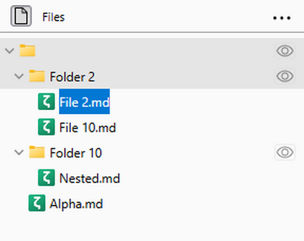

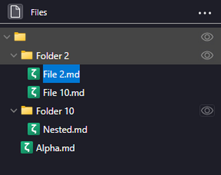

### Windows icons and spacing

Files uses Windows' built-in folder icon for folders and its unassociated-document icon for file names without a dot. Other file icons follow the Windows file associations rather than a fixed Markdown or code symbol; drive roots use the icon supplied by Windows. Returning focus to the window requests fresh icons. Windows icon information is cached for up to one minute, so after changing a file association, wait a minute and return to the window if the old icon remains visible. An unavailable individual icon uses a built-in symbol while the rest of the tree remains usable.

On Windows, the system font, small-icon dimensions, and half the native folder indentation determine the layout. Sizes are expressed in logical pixels, so Windows display scaling also scales the tree; a 16-pixel logical icon can use a 24-pixel image at 150% scaling. Row spacing follows the supplied Windows 10 Explorer reference. Exact visual agreement with Explorer under the same display settings still requires confirmation. Other platforms, or a Windows session in which system appearance information cannot be read, retain the existing tree layout. There are no separate Files font, icon-size, or spacing settings.

[Manual pending] Capture system file icons, folder arrows, and row spacing at matching Windows display scales after the isolated appearance checks have been run.

## The right sidebar

Open the right sidebar with the toolbar button "Toggle Sidebar" or View → "Toggle Sidebar" (Ctrl+Shift+0; Cmd+Shift+0 on macOS).

### The buttons at the top of the sidebar

A row of four text buttons of exactly equal width runs across the top of the sidebar. Each button shows one page of the sidebar:

| Button | Page |
|---|---|
| Outline | The headings of the active document; see "The document outline". |
| References | The references cited in the active document, as in Zettlr. |
| Related | Files related to the active document, as in Zettlr. |
| Attachments | The other files in the folder of the active document, as in Zettlr. |

The button of the page shown has a light blue background, a thick blue border, and bold text. When the sidebar is too narrow for the labels, they are shortened with an ellipsis; rest the pointer on a button to see its full name. The sidebar has a light grey frame around a white page. In the dark theme, frame and page are dark grey, and the button of the page shown has a dark blue background with a blue border. The page you choose is kept across restarts.

[Manual pending] A screenshot of the four buttons at the top of the right sidebar with Outline selected, in the light and the dark theme, is still to be taken.

### The document outline

The Outline page lists the headings of the active document. The document's title is not shown above the list. Each entry starts with a bullet in the accent color that shows the heading level: "•" for levels 1 and 4, "◦" for levels 2 and 5, and "▪" for levels 3 and 6. Two controls at the top of the page adjust the list:

| Control | Default | What it does |
|---|---|---|
| Show headings | Level 6 (all) | A compact drop-down list. Choose Level 1 through Level 6 (all) to show only headings at or above that depth. The depth comes from the Markdown heading syntax: `## 1.2.3 Methods` is a level-2 heading, regardless of the numbers in its text. |
| Wrap Headings | On | A switch button to the right of the level list, on the same line: mint green with a green bar at its left edge when on, grey with a grey bar when off; click it to switch. When on, long headings wrap onto several lines. When off, each entry stays on one line, with an ellipsis when it does not fit. Rest the pointer on an entry to see its complete plain-text title. |

These settings take effect immediately, apply to all documents, and are saved across restarts. They change only the list in the right sidebar, including the outlines of formatted JSON files; they do not change the document, the file manager, or the PDF viewer's own outline. Every conversation entry is at level 1, so choosing a heading depth keeps all its user-message entries visible.

The highlighted entry shows the section you are reading. What counts is the reading line, one third of the way down the visible part of the editor, not the cursor: the heading of the section that contains this line is highlighted. While the reading line is above the first heading, no entry is highlighted. Inside a hidden subsection, the nearest preceding visible heading is highlighted. When the highlighted entry lies outside the visible part of the outline, the outline scrolls by itself to show it; if you scroll the outline yourself, it is not pulled back.

Click a visible entry to go to its heading. The top of the heading line is placed one third of the way down the visible part of the editor, and the heading line is selected. In a split view, only the editor pane you are working in moves, even when another pane shows the same file. Other jumps to a line, such as those from the global search or from a PDF highlight, move every pane that shows the file.

Dragging a Markdown section onto a visible entry places it after that entry and its hidden subsections, before the next visible heading; at the last visible heading, it goes to the end of the document.

Known limitations:

- The sidebar does not show which document the outline belongs to.
- When the reading line falls on a tall element, such as an image or a table, the line that holds the element counts.
- The outlines of formatted JSON files and of conversation histories have no highlight, and with the same JSON file open in two editor panes, clicking an entry moves both panes.

[Manual pending] Screenshots of the Outline page are still to be taken: the level bullets, the "Wrap Headings" switch on and off, and the highlighted entry of the section being read.
## Editing

### Justified text

In the editor, the lines of a Markdown document are justified so that both edges of a paragraph line up with the edges of the text column; the last line of a paragraph stays left-aligned. Code files are not justified. Export to HTML uses the same justification.

### Equal white space on both sides of the text

In a Markdown file, the white space to the left of the text column matches the white space to its right. The narrow columns at the left edge of the editor (heading levels, folding markers, and line numbers when enabled) occupy part of the left white space rather than pushing the text rightward. The text column therefore keeps the same width it would have without these columns and stays centered at every font size, with or without line numbers, and in distraction-free mode.

When the left columns are very wide (for example, at a large font size with line numbers turned on), they need more room than the left white space provides. The text column then becomes slightly narrower, and the white space on both sides stays equal.

Code files, such as JSON files in the "Raw Text (Editable)" view, are not balanced this way.

Code blocks, inline code, and the cursor are drawn at the balanced position, also right after switching to another document. Right after the program starts, the cursor in the first editor that opens can appear slightly to the right of its actual position; it snaps to the right place as soon as you move it once.

### Adjusting the editor margins

The "Margin" control in the toolbar, directly to the right of Auto Show Code, sets the white space to the left and right of the text in Markdown editors. It is adjusted by dragging, not by clicking.

1. Press and hold the left mouse button on "Margin". The mouse pointer disappears, and a double-headed arrow marks the place where you pressed.
2. Move the mouse to the right to widen the margins and narrow the text column, or to the left to shrink them. Each pixel of mouse movement changes the margin on each side by one pixel. While you drag, the control reads `Margin: N px`, and every Markdown editor in the window follows at once.
3. Release the mouse button. The new value is saved, and other open windows pick it up.

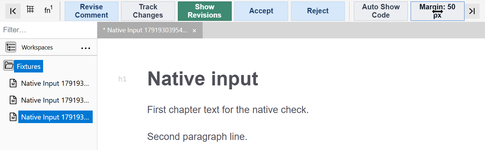
To cancel a drag, press Esc or switch to another window before you release the button. The margins return to their previous value, and nothing is saved. A simple click on "Margin" does nothing. The tooltip of the control shows the current value for a single pane and for split panes.

Two values are stored. One applies while the editor area shows a single pane, the other while it shows two or more panes, side by side or one above the other. Splitting the editor or merging its panes switches to the other value immediately. Each value applies to all files and all windows and is kept after a restart. Both are 50 pixels by default. The preferences have no field for them; they can be changed only by dragging "Margin".

The margin is never smaller than 0, and never so large that the text of a pane becomes narrower than 200 pixels. A drag stops at the largest margin that every visible pane of the window allows. When a window or pane becomes too narrow for the stored margin, the editor shows a smaller margin but keeps the stored value, so the margin returns once there is room again.

The margin applies only to Markdown files outside distraction-free mode:

- Code files, such as JSON files in the "Raw Text (Editable)" view, have no left or right margin.
- In distraction-free mode, the margins follow the width of the window as in Zettlr. "Margin" is greyed out and does not react to dragging.
- With a margin of 0, there is still white space on each side of the text, as wide as the narrow columns at the left edge of the editor, because the white space on both sides stays equal (see "Equal white space on both sides of the text").

"Margin" cannot be operated with the keyboard. If the system does not allow the program to hold the mouse pointer, the drag works with the normal pointer, which moves across the screen as you drag; in that case Esc does not cancel the drag, but switching to another window still does.

If the new value cannot be saved, the editors return to the previous value and a dialog titled "Zettlr" shows "Could not save the margin. The setting was not changed."; see "Notices and the error log".

The two screenshots below compare Margin 50 and Margin 80 in the same window.

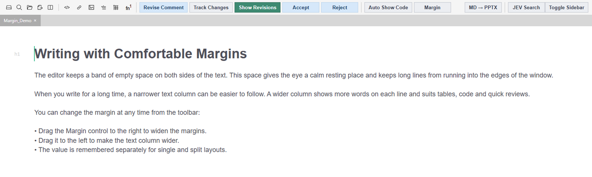

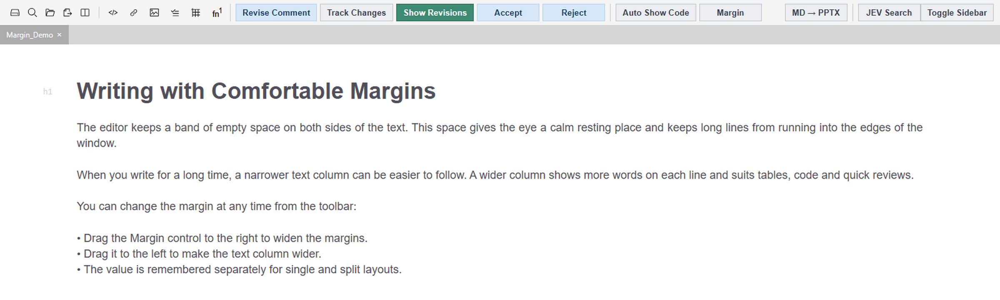

### Zooming the editor font with Ctrl and the mouse wheel

To make the text in the editor larger or smaller, point the mouse at the editor, hold Ctrl, and turn the mouse wheel. Turning the wheel up (away from you) makes the text larger, and turning it down makes it smaller. The key is Ctrl on macOS as well; Cmd with the wheel does not zoom. When Alt, Shift, or the Windows key (Cmd on macOS) is held together with Ctrl, the font size does not change and the pane scrolls as usual.

The gesture works in the editor, which shows Markdown documents and other text files, including the "Raw Text (Editable)" view of JSON files, and in the "Formatted (Read-Only)" view of JSON and JSON Lines files. The Preferences window, dialogs, the file manager, the sidebar, and the toolbar do not support it.

- Each notch of an ordinary mouse wheel changes the font size by one pixel. Touchpads and high-resolution wheels report many small movements; these are added up, and the size changes by one pixel each time they amount to one notch.
- The font size stays between 8 and 72 pixels. At either limit, turning the wheel further has no effect.
- The gesture changes the setting Preferences → Editor → "Font size" ("Font size in pixels:", 18 by default). They are the same setting: the box in Preferences shows the size reached with the wheel, and the next zoom starts from a value typed into the box. The size is saved automatically, is kept after a restart, and applies to every file, every editor pane, and every window.
- The width of the text column stays the same; only the text inside it becomes larger or smaller.
- The body text and all heading levels change in proportion, and so do footnote reference markers, the size label, caption, and open button on rendered images (see "Image sizes in the editor"), and the `:::` marks of fenced divs. The status bar of the editor, the buttons of the search and replace panel, tooltips, and the autocomplete list keep their size.
- Zooming never changes the content of a document; no file is modified.
- Export to HTML uses the editor font size at the time of the export, so the body text, the headings, and the footnote markers in the HTML file are larger or smaller in the same proportion; see "What the HTML file contains".

The box in Preferences also accepts values outside 8 to 72 pixels, and such a value takes effect. The first wheel step after that brings the size back into the range: from 100, for example, one step up gives 72 and one step down gives 71.

"Zoom in" (Ctrl+Plus) and "Zoom out" (Ctrl+-) in the View menu depend on Preferences → Advanced → "Zoom behavior". With "Resizes the whole GUI", the default, they scale the whole window and leave the font size setting as it is. With "Changes the editor font size", they change the same font size as the wheel, by one pixel per step, without the limits of 8 and 72 pixels. "Zoom behavior" has no effect on zooming with Ctrl and the mouse wheel.

[Manual pending] A screenshot of the same document at two font sizes, showing that the text column keeps its width, is missing; producing it needs a running copy of the program, which this update could not start.

### Image sizes in the editor

In preview mode, with image rendering turned on (Preferences → "Render images"), a Markdown image such as `` is shown in place of its source. Its size depends on the Pandoc attributes written directly after it, without a space, such as `{width=50%}`:

- Without a width, the image is shown at its natural size in pixels. If the image is wider than the text column, it is scaled down to exactly the column width, keeping its proportions. Small images are not enlarged, and tall images are not limited in height.
- With a width in percent, written as `{width=50%}` or `{w=50%}`, the image takes that share of the text column width. Small images are enlarged to reach it.
- A width in another unit, such as `{width=300px}` or `{width=8cm}`, sets that width, but the image never becomes wider than the text column.
- A height without a width, such as `{height=300px}` or `{h=300px}`, is a maximum. An image taller than that value is scaled down, keeping its proportions, and a smaller image keeps its natural size. A height in percent, such as `{height=50%}`, has no effect in the editor.
- With both a width and a height, the image is shown at exactly those dimensions, so it may look stretched.
- Widths and heights take effect only with one of the units `cm`, `mm`, `in`, `px`, `pt`, `pc`, `em`, `ex`, `ch`, `rem`, `vw`, `vh`, `vmin`, `vmax`, or `%`. A value without a unit, such as `{width=300}`, is ignored.

The attributes right after a rendered image are hidden, so the line shows only the image. Further blocks that repeat the first one exactly and follow it without a space, as in `{width=50%}{width=50%}`, are hidden together with it. The attributes reappear as soon as the cursor or a selection touches the image or the attributes; with the cursor inside a repeated block, all the attribute text appears. Whether a cursor directly next to them counts as touching depends on the setting for showing syntax when the cursor is adjacent. Attributes separated from the image by a space, as in ` {width=50%}`, and attributes that span several lines stay visible. A further block in braces that differs from the first one, or that is separated from it by a space, is shown as ordinary text. Repeated blocks already in a file are not removed automatically, and in Export to HTML and in exports made with Pandoc they appear as ordinary text.

While the mouse pointer is over an image, or while the image is selected (see "Selecting and resizing an image"), three overlays appear on it: a size label at the top left, the editable caption at the bottom, and a button at the top right that opens the image in another program. The size label shows the natural size of the image in pixels, followed by the width when one is written, for example `800×400 · 56%`. The overlays are hidden when the image is displayed smaller than 256 pixels wide or 128 pixels high.

Click the caption to edit it. The file changes only when the caption text actually changes: clicking the caption and then clicking elsewhere, or pressing Enter without changing anything, leaves the file as it is. A changed caption rewrites only the `` part of the image; the attributes after it stay exactly as written.

The settings under Preferences → Editor → "Image size" ("Restrict width to N %" and "Restrict height to N %") do not affect images in the editor. They only limit image sizes in files made with Export to HTML; see "Configuration reference".

These rules apply to Markdown images outside tables. They do not apply to images in table cells (see "Images in table cells") or to inline HTML `` elements, which follow their own `width` and `height` and are never wider than the editor (see "Rendering HTML in the editor").

[Manual pending] A screenshot comparing an image at its natural size with a wider image scaled down to the text column width is missing. Producing it requires a running copy of the program, which this update could not start.

### Selecting and resizing an image


The image was clicked and its right handle dragged to the left. The label now reads `800×400 · 56%`: the natural size of the image is 800 × 400 pixels, and the image takes 56% of the text column width. Because the image stands on a line of its own, it shrank on both sides and stays centered.

Click a rendered image to select it. The selected image gets an outline in the accent color, a resize handle appears in the middle of its left and right edges, and the overlays stay visible. Clicking an image does not show its source or move the cursor, so the image stays rendered. Clicking a different image selects that one instead. Images in table cells behave differently: a click opens the image in a viewer, and a double click shows its source. See "Viewing an image in a table cell".

To change the width, drag one of the handles with the left mouse button:

- Dragging the right handle to the right, or the left handle to the left, enlarges the image; dragging in the opposite direction shrinks it. A handle shows the tooltip "Drag to change the width".
- The width is measured as a share of the text column, in whole percent from 5% to 100%.
- An image on a line that contains only images is centered (see "Lines that contain only images are centered"), so it grows and shrinks on both sides at once. Any other image keeps its left edge in place.
- While you drag, the image changes size and the size label shows the new width.
- Pressing Esc during the drag cancels it. The image returns to its previous size, the document is not changed, and the image stays selected.

When you release the mouse button, the new width is written into the attributes directly after the image, and the image stays selected:

- An image without attributes receives `{width=NN%}`; for example, `` becomes `{width=56%}`.
- An existing `width` or `w` key is changed in place, keeping its spelling and quotation marks. Repeated width keys are reduced to one.
- Only the first block of attributes is changed. Repeated blocks after it, as in `{width=50%}{width=50%}`, stay as they are.
- If the attributes contain no width, `width=NN%` is added to them.
- A `height` or `h` key is removed so that the image keeps its proportions. All other attributes, the identifier, and the classes stay as they are. For example, `{#fig:a .big height=40%}` becomes `{#fig:a .big width=89%}`.
- The change is a single editing step; Ctrl+Z (Cmd+Z on macOS) undoes it. Releasing the button without moving the handle, or at the same width, changes nothing.

While an image is selected, the following actions are available:

| Action | Effect |
|---|---|
| Double-click the image, or press Enter while it is selected | Selects the whole source of the image together with its attributes, including repeated attribute blocks, when Auto Show Code is on or its Images exception is enabled. The line above the image keeps its place on screen. Otherwise the image stays rendered. |
| Delete or Backspace | Deletes the image together with its attributes, including repeated attribute blocks, and places the cursor where the image was. Ctrl+Z (Cmd+Z on macOS) restores it. |
| Esc | Ends the selection. |
| Click anywhere else in the editor, or press any other key | Ends the selection; the click or key then works as usual. A typed key acts at the cursor, which is still where it was before you clicked the image. |
| Press Shift, Ctrl, Alt, or Cmd on its own | Keeps the selection. |

Any change to the document or to the cursor position also ends the selection.

Selection and resizing are available whenever images are rendered, that is, in preview mode with "Render images" turned on. The Images exception under Preferences → Editor → "Auto Show Code" controls entering source by double-click or Enter when the main switch is off. Viewing the image, editing its properties, resizing it, and deleting it remain available.

Known limitations:

- Only Markdown images rendered in the editor can be selected and resized. Images in table cells and inline HTML `` elements cannot be selected or resized; clicking an image in a table cell opens the image viewer instead (see "Viewing an image in a table cell").
- Dragging always writes a percentage of the editor's text column. A width in another unit, such as `width=300px`, is replaced by the percentage.
- In a slide document, the PPTX renderer measures a percentage width against the box that holds the image (see "Editing Pandoc attributes"), so the image can take a different share of the slide than of the editor's text column.
- When the attributes are separated from the image by a space, as in ` {height=40%}`, dragging inserts a new `{width=NN%}` directly after the image and leaves the separated attributes in place.
- The selection does not end when keyboard focus leaves the editor. If you select an image, click into the sidebar, return to the editor with the keyboard, and press Delete, the still-selected image is deleted. Returning with a mouse click ends the selection first.

### Addresses that cannot be resolved

Some image and link addresses cannot be turned into a valid location, for example `https://` with nothing after it, or a web address whose host name contains a space. The editor handles them silently, without any message:

- A Markdown image outside tables with such an address is not rendered. Its Markdown source stays on the line as ordinary text.
- The context menu of an image with such an address does not contain "Open image" and "Open in File Browser". Only "Copy image to clipboard" is left, and it stays disabled as before.
- Opening a link with such an address does nothing.
- In the preview that appears when the pointer rests on a link to a file, an image with such an address does not load, and only that image is affected.
- In a raw HTML block, an `` element with such an address keeps its original address instead of having it removed.

Known limitation: an image in a table cell with such an address still ends up without an address, as before.

### Lines that contain only images are centered
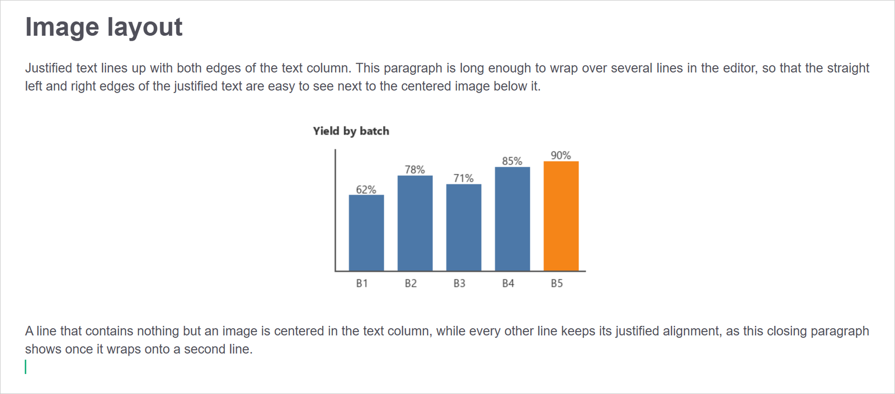

The paragraphs above and below the chart keep straight left and right edges, while the line that holds nothing but the image is centered.

When image rendering is on (Preferences → "Render images"), a line that contains nothing but rendered images is centered horizontally. Such a line may hold one image or several images side by side, Each image may be followed directly by Pandoc attributes such as `{width=50%}`, including when the same block is repeated exactly, as in `{width=50%}{width=50%}`. The line may start or end with spaces. All other lines keep their justified alignment, including images in list items or block quotes, images with text before or after them on the same line, images wrapped in a link, and images whose Markdown spans several lines.

When an image shows its source under the rules in "Showing Markdown source while editing", its line returns to justified alignment and is centered again once the cursor moves away. With Auto Show Code on, the setting for showing syntax when the cursor is adjacent also applies. With the main switch off, the Images exception must be enabled and the moving end of the selection must be inside the image's source. Turning image rendering off also turns the centering off.

Known limitations:

- When a space separates the image from its attributes, as in ` {width=50%}`, the attributes still apply to the image, but the line is not centered and the attribute text stays visible.
- A further block in braces that differs from the first one, as in `{width=50%}{width=40%}`, is shown as text, and the line is not centered.
- While the cursor is inside the attributes without touching the image itself, the attribute text appears to the right of the image and is centered together with it, so the image sits slightly left of center until the cursor moves away.
- The editor decides line by line, whereas Export to HTML decides paragraph by paragraph, so two cases look different: a text line followed by an image on the next line, joined by a single line break, has its image line centered in the editor but the whole paragraph uncentered in the export; two consecutive lines with one image each are centered separately in the editor but appear side by side and centered as a pair in the export.

### Showing Markdown source while editing

In preview mode, rendered elements can keep their formatting while you move the cursor and select text. The toolbar button "Auto Show Code", to the right of Reject, and the checkbox of the same name under Preferences → Editor control the same setting. It is off by default, and the choice is saved across restarts. Changing either control immediately updates the editors and the other control.

With the switch on, a cursor or selection touching an element shows its source. The setting "Show Markdown syntax when the cursor is adjacent or inside an element" also decides whether a cursor directly beside an element counts. With the switch off, source appears only for an enabled exception and only when the cursor, or the moving end of a selection, is actually inside that element. A selection that merely crosses it does not reveal its source. The remaining elements stay rendered. An untouched initial cursor at the start of a freshly opened document does not reveal its first element; moving away from a revealed element restores its rendering.

The exception checkboxes are in Preferences → Editor → "Auto Show Code":

| Exception | Default |
|---|---|
| Math ($...$ and $$...$$) | On |
| Inline code | On |
| Checkboxes in lists and tables | On |
| Headings | Off |
| Fenced code blocks | Off |
| Images | Off |
| Bold, italic, strikethrough, and highlights | Off |
| Links and wiki links | Off |
| Lists | Off |
| Blockquotes | Off |
| HTML blocks and inline tags | Off |
| Pandoc divs, spans, and attributes | Off |
| Admonitions and PDF quote callouts | Off |
| Citations and footnotes | Off |
| Horizontal rules | Off |
| Mermaid diagrams | Off |
| Embedded frames | Off |
| Calculated formulas ([[...]]) | Off |
| Tracked changes | Off |

Exceptions control source entry, and the usual rendering checkboxes still decide which elements are rendered at all. Checkboxes have their own exception, separate from Lists; this includes task markers at the start of a line and in table cells. Tables keep their existing cell editor, with no switch for showing a whole table as source. Image viewing, properties, resizing, and deletion remain available; outside tables, entering source by double-click or Enter follows the Images exception when the main switch is off.

While you drag a selection, elements keep the rendering they had when you pressed the mouse button. Their source display is updated when you release it. An element allowed to reveal source may change its size or the surrounding layout; source and rendered content need not have the same dimensions. Raw mode always shows the source and does not enlarge a selection to include formatting markers.

If the toolbar cannot save the choice, its state continues to reflect the saved value and a dialog titled "Zettlr" shows "Could not save Auto Show Code. The setting was not changed." See "Notices and the error log".

[Manual pending] Screenshots of the Auto Show Code toolbar button and Editor preferences, and a comparison of hidden syntax with source revealed by cursor entry, are needed; the available images do not show these states, and no running instance was opened for this manual update.

### Selecting Markdown source with hidden markers

When an element's syntax is hidden, selecting all the visible content of inline code, bold or italic text, strikethrough, a highlight, or a link includes its complete Markdown source in the actual selection. This includes the surrounding markers and a link's destination. For example, selecting all of the displayed word "Guide" in `[Guide](guide.md)` selects the entire `[Guide](guide.md)`. Selecting only part of "Guide" keeps that text range without adding formatting markers. Ordinary copying can use the visible text of an enabled element while keeping this source selection intact; see "Copying rendered elements".

A nonempty selection that reaches the left edge of heading text also includes its hidden heading prefix. The same rule preserves hidden quote prefixes, list markers, task checkboxes, and the indentation belonging to those prefixes. A single click places the cursor without enlarging it into a selection. Selecting all the content of a fenced code block whose syntax is hidden includes both fences and the language information after the opening fence.

Cutting, deletion, and dragging selected text use this actual source range, so handling a complete object also handles its markers. Ordinary copying follows the category settings described below. When source is already displayed, selecting the complete body alone does not add unselected markers: copy uses exactly the source characters selected. This also applies in Raw mode and when an element's rendering is turned off. A drag uses the source or rendered appearance present when the mouse button was pressed.

Moving a selection with the keyboard, such as Shift and an arrow key, can shrink it toward its anchor. When such a step would shrink the selection only for the markers of an element with hidden syntax to enlarge it again, the moving end of the selection instead jumps to the first position outside that element, so repeated steps keep shrinking the selection until it is empty. Dragging with the mouse is unaffected: a drag passing over an element with hidden syntax still selects the whole element.

Because a selection that contains the first character of an element's content must also contain its complete hidden markers, the moving end cannot stop between a hidden marker and the first character of the content. On a line whose prefix is hidden (a list item, a task item, a quote, or a heading), pressing Shift+Home selects to the beginning of the line, and the first press of the right arrow key moves the moving end to the second character of the line's text; further presses then move it one character at a time. Hidden inline markers, such as those of bold or italic text, inline code, and links, behave the same way in both directions.

With Auto Show Code off and a style's syntax hidden, an ordinary click at the front of the styled text places the cursor before its opening marker, so typing there adds text outside the style. A click at its back places the cursor before its closing marker, so typing there extends the styled text. The same rule applies when the style covers an entire line. Dragging from either edge selects text normally.

[Manual pending] A screenshot showing a complete rendered-text selection and its corresponding Markdown source range is needed; existing images do not show this comparison, and no running instance was opened for this manual update.

### Copying rendered elements

Preferences → Editor → "Copy rendered elements" controls ordinary copying with Ctrl+C (Cmd+C on macOS) and the editor's "Copy" context-menu command. Each checkbox is saved across restarts and updates open editors immediately. These settings apply when an element's Markdown syntax was hidden when you began selecting it. Source shown by Auto Show Code, a source-entry exception, a disabled renderer, or Raw mode is copied exactly as selected.

| Category | Default | Copied content when enabled |
|---|---|---|
| Inline code | On | The selected code text without its hidden backticks. |
| Headings | On | The selected heading text without its hidden heading prefix. |
| Bold | On | The selected text without its hidden bold markers. |
| Italic | On | The selected text without its hidden italic markers. |
| Code blocks | On | The selected body of one fenced code block, without its fences or language information. |
| Lists | Off | The selected list-item text without its hidden unordered-list prefix. Ordered-list numbers that are displayed remain literal. |
| Math (LaTeX without delimiters) | Off | The selected LaTeX expression without its outer `$` or `$$` delimiters. |
| Images (image data) | Off | PNG image data for one selected rendered image. |

Within one enabled text element, selecting its whole content or just part of it copies that selected text. For example, in `` `Guide.md` extra ``, selecting only `Guide.md` copies `Guide.md`, and selecting only `uid` copies `uid`. Selecting the code together with the following space or `extra` copies the corresponding Markdown, including its backticks. Selecting only the title in `# Heading` copies `Heading`; extending the selection into the next source line includes `# ` and the selected part of that line.

The smallest independently selected object determines the category. Selecting only a bold phrase inside a list uses Bold, even when Lists is off. Selecting the phrase together with other list-item text uses Lists. With nested formatting, markers are removed only for enabled categories whose syntax was hidden; a disabled inner category keeps its markers. Links, strikethrough, highlights, blockquotes, HTML, and other types absent from this list retain their selected Markdown.

A source newline usually makes a selection span more than one text object; wrapping caused by the editor's width does not. One fenced code block can contain multiple selected source lines, and they are copied as code without interpreting Markdown inside them. Extending the selection outside that block keeps the Markdown source. Visible indentation in an indented code block remains literal. Selected spaces, Unicode text, and body line breaks are preserved.

With Images enabled, select one rendered image by clicking it, or select its exact image range, then copy. The clipboard receives PNG image data rather than alt text or a link; directly attached image attributes belong to that image. A selection containing other text or several images keeps Markdown. With Images off, a selected image is copied as its Markdown source. Image copying does not change the image file, the document, or the selection. For local-image data copying after updating the program, fully restart Zettlr-LYH; reloading only the editor window is insufficient.

If an image cannot be loaded or converted, or writing image data is rejected, the program copies its Markdown source instead and reports "Could not copy image data. Copied Markdown source instead." If both image and text writes fail, it reports "Could not copy image data or the Markdown image source." Remote images whose server does not permit readable image data may require this fallback. Starting another copy, changing the selection or document, or disabling Images prevents a pending image conversion from replacing a newer result.

Cutting, deletion, and dragging continue to use the actual Markdown source selection. "Copy as HTML" is a separate explicit command and keeps its HTML behavior. Table row and cell copy commands keep their existing behavior. With no text or image selected, the editor's normal whole-line copy behavior remains available.

[Manual pending] Capture Preferences → Editor → "Copy rendered elements" with all eight category checkboxes and compare a single rendered-text selection with a mixed Markdown selection in an isolated instance.

### Inline code

In preview mode, the backticks around inline code and the dollar signs around math are hidden while the element is rendered. Inline code and Math are enabled exceptions by default, so entering them with the cursor shows their source even with Auto Show Code off. The backticks are then drawn in the code's color, with its background extending over them. Moving the cursor away hides them again. Untick the corresponding exception to keep the element rendered while the main switch is off.

### Text inside square brackets

In Markdown documents, ordinary text inside a matched pair of single square brackets appears green in the editor, including the brackets. For example, `[a note]` and `[{a note}]` are green. A pair can span several lines or empty lines, and nested pairs remain inside the same green passage. An unmatched bracket does not color the surrounding text; a completed pair inside it can still be green.

This color is only an editor display aid: the document text, copying, and exports stay as written. Links, tracked changes, code, formulas, and other elements with their own Markdown styling keep that styling instead. There is no setting for the bracket color.

### Blockquotes

In preview mode, with Preferences → Editor → "Render emphasis" turned on (the default), a blockquote (lines starting with `>`) is shown with a vertical bar at its left edge, indented on both sides, and on a background color. The settings for the indentation and the background are in Preferences → Editor → "Blockquotes", directly below "Image size":

- **"Indentation on each side (in em):"** How far the blockquote is indented on the left and on the right, in em (one em equals the current font size). The default is 2, and the allowed range is 0 to 10. The bar moves with the indentation; at 0, the bar sits at the left edge of the text column. The arrows on the box change the value in steps of 1, but you can type a fraction such as 1.5. A value typed below 0 or above 10 is clamped to the nearest limit, and the button next to the box resets the value to 2.
- **"Background color"**: one row for "Light mode" and one for "Dark mode", each with a color field and a **"Transparent"** checkbox. The default colors are light gray (`#f3f3f3`) in light mode and dark gray (`#2b2b2b`) in dark mode, and both checkboxes are off. With "Transparent" ticked, blockquotes have no background in that mode. The chosen color is kept, and it comes back when you untick the checkbox.

Changes take effect immediately in every open editor. When the program switches between light and dark mode, blockquotes pick up the background of the new mode at once. A blockquote inside another one (`> >`) is indented again by the same amount on each side.

Limitations:

- When source entry is allowed by Auto Show Code or the Blockquotes exception and the selection meets the rules in "Showing Markdown source while editing", the whole blockquote, including nested quotes, is shown as source, without the bar, the indentation, or the background. With both controls off, it keeps its rendered appearance.
- Quotes copied from a PDF (starting with `> [!PDF|<color>]`) and the quotes nested inside them are not affected by these settings; see "PDF quotes in the editor".
- The settings apply only to the editor. Export to HTML, Export to PPTX, and the other exports are not affected.
- While you are selecting text by dragging the mouse, the selection highlight inside a blockquote is hidden by the background.

[Manual pending] A screenshot of the "Blockquotes" group under Preferences → Editor and of a rendered blockquote with its indentation and background is missing; producing it needs a running copy of the program, which this update could not start.

### Bold, italic, and strikethrough next to Chinese, Japanese, and Korean text

Chinese, Japanese, and Korean text has no spaces between words, so emphasis often ends at a punctuation mark directly followed by more text, as in `**权威划分。**本`. Under strict CommonMark rules, such a `**` cannot close bold text, and the asterisks would stay visible. Zettlr-LYH treats a Chinese, Japanese, or Korean character directly outside the delimiters (including the punctuation marks and full-width symbols of these languages) like a space. Bold (`**…**`), italic (`*…*`), and strikethrough (`~~…~~`) therefore render normally next to these characters, for example in `**权威划分。**本`, `见**（附录）**说明`, `称为**“绑定文档”**里`, `*注意。*后文`, and `~~删除。~~后文`.

- Underscores inside a word do not produce emphasis, including between these characters: `变量_名称_中文` stays as written. Use asterisks for emphasis in such text.
- Where no such character stands directly next to the delimiters, the usual CommonMark rules apply; for example, `a**"b"**c` is not bold, while `some **bold.** text` is.
- Files made with Export to HTML follow the same rules. The PPTX preview and Export to PPTX convert the document with pandoc, which applies its own rules.

[Manual pending] A screenshot of bold text that ends in a Chinese punctuation mark, rendered in the editor, is missing; producing it needs a running copy of the program, which this update could not start.

### Rectangular selection

Hold Alt and drag with the mouse to select a rectangular block of text (a column selection). While Alt is held, the mouse pointer over the editor turns into a crosshair. This works in the main editor and in the program's smaller code editors.

### Inserting an HTML comment

When no text is selected, pressing Ctrl+/ (Cmd+/ on macOS) inserts an empty HTML comment `<!--  -->` and places the cursor between the two spaces, ready for typing.

### Marking text for revision

Revise Comment marks a passage you want to revise and leaves a slot for your comment. Click "Revise Comment" in the toolbar, or press Ctrl+R (Cmd+R on macOS) while the editor has focus:

- With text selected, the text is wrapped as `[selected text{}]`.
- Without a selection, an empty mark `[{}]` is inserted at the cursor.

In both cases the cursor lands between the curly braces so you can type your comment right away. For example, marking "What is passed over too quickly" and typing a comment gives `[What is passed over too quickly{This sentence carries too little; go straight to the next one}]`.

- The selected text itself is not changed, including any brackets or braces it contains. A selection may span several lines.
- With several selections or cursors, each one gets its own mark and its own cursor between its braces: a selection is wrapped, and a cursor without a selection receives `[{}]`.
- A single undo removes the whole mark.
- With a split view, the toolbar button works in the editor pane that last had focus, and focus returns to that pane.

In a read-only document, nothing happens. When the focus is outside the editor, for example in the Files tree, the tab bar, or the sidebar, Ctrl+R does nothing. The shortcut is fixed and cannot be changed in the preferences. To rename a file, press F2; see "Renaming a file with F2".
Revise Comment is not recorded as a tracked change, even while Track Changes is on, and neither is anything you type between its curly braces (see "Tracking changes").

In the editor, a marked passage always appears as written, with its brackets and comment. This holds also when two marks stand side by side, as in `[first passage{}][second passage{}]`, and typing between either pair of curly braces stays inside them. Zettlr's Export… dialog exports the marks as literal text.

A bracket that ends in a comment is never read as part of a reference link:

- In `[text{comment}][label]`, the first bracket is plain text and only `[label]` is a link.
- In `[text][passage{comment}]`, `[text]` is not a link.

Ordinary links such as `[text](address)` and `[text][label]`, a comment followed by an address such as `[text{comment}](address)`, and Pandoc spans such as `[text{comment}]{.class}` work as usual.

### Task checkboxes
Clicking the checkbox of a rendered task list item toggles the task while the view stays where it is. Under Preferences → Editor → "Auto Show Code", "Checkboxes in lists and tables" is on by default, separately from the Lists exception, which is off by default. With the main switch off, moving the cursor into `[ ]`, `[x]`, or `[X]` shows the marker's source, including at the start of a line; moving out restores the checkbox. Unticking the checkbox exception keeps the marker rendered. "Render tasks" must be on for checkbox rendering. Tasks written inside table cells are described under "Task checkboxes in table cells".

You do not have to hit the checkbox exactly. On a rendered task line, such as `- [ ]`, `- [x]`, or `1. [ ]`, clicking anywhere from the left edge of the list marker (the bullet "•" or the number) to 4 pixels right of the checkbox, over the full height of the line, toggles the task just like clicking the checkbox itself: the cursor does not move and the view does not scroll. Over this area the mouse pointer turns into a hand, and pressing the mouse button there and dragging does not start a selection. When the list marker is hidden together with the other Markdown syntax, the area shrinks to the checkbox and the 4 pixels to its right.

### Pressing Enter in a loose list

In a loose list, whose items are separated by blank lines, Enter works as follows:

- At the end of the first line of an item, Enter starts a new item, with a blank line before it.
- At the end of the second or a later line of an item, Enter inserts a single line break. The new line gets the indentation of the item's continuation lines; no list marker and no blank line are added. This applies both to indented continuation lines and to continuation lines written without indentation. Spaces between the end of the text and the cursor are removed.
- In the middle of a continuation line, with text after the cursor, Enter splits the line and also inserts a blank line.

In tight lists, whose items follow each other without blank lines, in block quotes, and in ordinary paragraphs, Enter works as in Zettlr. Autocorrect replacements are applied as usual when you press Enter. There is no setting for this behavior.

### A stable view while you work
- When the height of content changes while you are not scrolling (for example because an image finishes loading or a rendered element expands), the text you are looking at stays in place.
- When a block switches between its rendered display and its source, the line directly above the block stays at the same place on screen. This happens when you double-click an image or press Enter on a selected image to show its source; when you click elsewhere or press an arrow key so that the image is rendered again; when the cursor enters or leaves a raw HTML block, a block formula, or an admonition; and when Auto Show Code changes the number of screen lines a line wraps onto. If the line above is only partly visible, the first unchanged visible line below the block stays in place instead. Switching back and forth does not make the view drift.
- Documents with very long wrapped lines scroll without errors.
- When the editor reloads its content (for example after a setting changes or after the file is reloaded from disk), the cursor and the scroll position are restored.
- Clicking inside selected text places the cursor where you clicked and removes the selection; the text does not move.
- Clicking in the gap between two lines, triple-clicking to select a paragraph that wraps over several lines, and double-clicking a word broken across two lines do not scroll the editor either.
- When you select text by dragging past a tall element, such as an image or a rendered formula, and then release the mouse button, the text that was under the pointer when you released it stays under the pointer.
- In a line that contains an element taller than the text, such as an inline formula or an inline image, a click in the extra height of that line can still scroll the editor slightly.

Known limitations of keeping the line above a switching block in place:

- When several blocks switch at the same moment, only the line above the topmost one is kept in place.
- This does not work in typewriter mode or while you edit a table cell.
- If an image has not finished loading, the change in height after loading is handled like any other change of content height.
- In a line with an element taller than the text, the kept line can move by a few pixels.

### Scrolling back to the cursor after an edit

When the line that holds the cursor has scrolled completely out of the visible part of the editor, and you then change the document, the editor scrolls that line to the point one third of the visible height below the top edge of the editor. Near the beginning or the end of the document, where the line cannot reach that height, it scrolls as far as it can.

These changes count: typing, the first key press of an input method composition, Enter, Tab, Backspace, Delete, pasting, cutting, undo, redo, accepting an autocomplete suggestion, and the formatting commands.

Nothing extra happens in these cases:

- The cursor line is fully visible or only partly cut off. If the cursor is pushed against the edge of the editor, the editor reveals it as usual, keeping a margin of 50 pixels.
- You only move the cursor with the arrow keys, PageUp, PageDown, Home, or End. The cursor line then appears at the edge of the editor.
- Undo or redo brings the cursor back into the visible part. The editor does not scroll.
- Typewriter mode is on. Typewriter mode keeps the cursor line in the middle of the editor.
- You edit inside a table cell, tick a task checkbox, or the file is reloaded from disk.

This applies to every kind of text file in the main editor, in each pane of a split view separately. The read-only formatted view of JSON files is not affected. There is no setting for this behavior.

Known limitations:

- A change that is not made with the keyboard or an input event, such as a menu command or a toolbar command, uses the last measured view of the editor to decide whether the cursor line is out of view.
- If the cursor line contains a formula or an image taller than the text, the line can end up a few pixels above or below the one-third point.
- This has been checked only on Windows.

### Folder buttons after Windows paths

When the editor shows a Windows path that exists on disk, a small folder button appears directly after it. Click the button to open the folder in Windows File Explorer. For a path that points to a file, File Explorer opens the parent folder and selects the file. The tooltip reads "Open folder in File Explorer" for a folder and "Show in File Explorer" for a file. A click does not move the cursor and does not change the selection. If the path no longer exists when you click, nothing opens and the button disappears.

The button shows the same colored folder icon as the folder rows in the Files section (the folder icon of Windows File Explorer), in its original colors in both the light and dark themes, even when the path points to a file. When the pointer rests on the button, a light grey rounded background appears behind it (a translucent light white one in the dark theme). If the system icon cannot be obtained, for example on a system other than Windows, the button shows a single-color folder icon instead, at 70% opacity and at full opacity under the pointer. After a document opens, a button may show the single-color icon briefly before the colored icon replaces it.

Two kinds of paths are recognized in the main editor, including each editor pane of a split view:

- An inline code span that consists of one complete Windows absolute path only: `C:\...`, `C:/...`, or `\\server\share\...`, optionally enclosed in a pair of straight double quotes.
- A path in running text that starts with a drive letter. It ends at the next white space or full-width punctuation mark; a full stop, comma, or unpaired closing parenthesis at the end does not belong to the path.

The editor checks the paths in the visible part of the document when you edit, scroll, or return to the Zettlr-LYH window, and checks a path again when its last check is more than 30 seconds old. The buttons are not saved in the file, not copied with the text, and not part of any export. There is no setting for this behavior.

Known limitations:

- A path in running text that contains a space or a full-width punctuation mark is recognized completely only when it is written as an inline code span.
- Paths inside links, images, HTML, comments, formulas, code blocks, the YAML front matter, wiki links, and citations are not recognized.
- No buttons appear in table cells or in the formatted view of JSON files.
- When a network share does not answer within 3 seconds, no buttons appear for paths on that share for the next 60 seconds.
- The buttons cannot be reached with the keyboard.
- The buttons depend on a command of the program's main process, so after the program's files have changed, no button appears until the program has been restarted.

### Click feedback in pop-up menus

When you click an item in one of the program's pop-up menus, such as a context menu, the item flashes once; about 150 milliseconds later the menu closes and the command runs. While the item flashes, the menu ignores further input.

### Rendering HTML in the editor

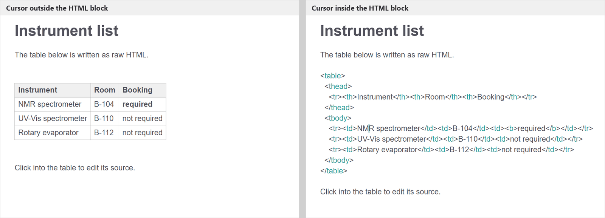

Left: the HTML block is rendered. Right: with source entry enabled by Auto Show Code or its HTML exception, clicking into the block shows its `<table>` source with syntax coloring.

In preview mode, with "Render pandoc divs and spans" turned on (Preferences, on by default), the editor renders HTML written in a Markdown document as described below. None of this applies when the editor shows raw Markdown or when the setting is off.

HTML blocks. A block of raw HTML is shown as its rendered, sanitized result. To reveal its source by cursor entry, turn on Auto Show Code or the HTML exception; see "Showing Markdown source while editing". This applies to blocks made of tables, links, images, line breaks, horizontal rules, lists, headings, block quotes, code, figure captions, collapsible details, and text formatting elements. A block that contains any other element, such as `script`, `iframe`, `style`, `form`, `video`, `embed`, `object`, or a custom element, stays in source form.

Inline elements. Inside a paragraph, `<br>` is shown as a line break, `` as the image (respecting its `width` and `height`, and never wider than the editor), and `<a href="…">` as link text in the accent color. Source display follows Auto Show Code and the HTML exception. Relative paths are resolved against the folder of the document.

Inline formatting tags. The opening and closing tags of the following elements are hidden and the enclosed text is shown with their formatting: `span`, `small`, `big`, `sup`, `sub`, `b`, `strong`, `i`, `em`, `u`, `ins`, `s`, `strike`, `del`, `mark`, `kbd`, `abbr`, `cite`, `q`, `var`, `samp`, and `dfn`; the block tags `div`, `p`, and `center` are treated the same way. Only the attributes `style`, `class`, `id`, `title`, `lang`, `dir`, and `align` take effect. For example, `<span style="color: red">warning</span>` shows the word "warning" in red.

Links. Hold Ctrl (Cmd on macOS) and click a rendered link to open its target; a plain click does not open it. Links may point to relative paths, Windows absolute paths, or addresses using `http`, `https`, `file`, or `mailto`. A link with any other protocol becomes plain, unclickable text inside an HTML block, and stays in source form when it is inline.

### Tables

While you edit a cell, the column widths stay fixed so the table does not reflow with every keystroke and the view does not drift. When the cursor moves to another cell or leaves the table, the columns are fitted to their content once, and the cursor keeps its position on the screen.

The Row submenu of the table context menu contains, after "Move row down" and a separator, two commands for copying whole rows:

- "Copy row" copies all cells of the row containing the cursor to the clipboard, both as tab-separated plain text and as a one-row HTML table, so the row can be pasted into Word, Excel, or another table.
- "Paste row" reads plain text from the clipboard, splits it into cells at tabs and into rows at line breaks, and writes the cells into the table starting at the cell containing the cursor, moving right and then down. Each cell is trimmed of surrounding spaces, and a `|` in the content is escaped as `\|`. Rows copied from Word or Excel paste the same way. With an empty clipboard nothing happens.

Neither command has a keyboard shortcut.

To copy a block of several cells instead of a whole row, drag across them and press Ctrl+C (see "Selecting text and cells by dragging"). The block is copied in the same two forms as "Copy row" and can be pasted back with "Paste row".

Known limitations:

- If a cell itself contains a tab or a line break, the copied plain text spills into the next cell or row.
- "Paste row" only overwrites existing cells. It never adds rows or columns, and clipboard cells beyond the right or bottom edge of the table are dropped without notice.
- "Paste row" reads plain text only; formatting from Word or Excel is not converted, and Markdown in the pasted text is written as it is.
- The header row can be a paste target.
- In a grid table, pasting content of a different length breaks the alignment of the source, just as typing in the cell does.
- A `|` that follows an escaped backslash (`\\|`) is mistaken for an already-escaped pipe and is not escaped again.

### Clicking into a table cell

While the cursor is outside a table cell, the cell shows its rendered content. Clicking the text of such a cell opens it for editing: the cell switches to its Markdown source, and the cursor lands at the spot in the source that corresponds to where you clicked. As in ordinary text, the cursor goes to the gap between characters nearest to the click. For example, if a cell shows "Yes for File, Yes for Session" and you click just before "File", the cursor stands just before "File" once the source appears.

Images are the exception. Clicking an image in such a cell opens the image in a viewer instead of opening the cell, and double-clicking opens the cell with that image's source selected; see "Viewing an image in a table cell". Clicking an image with Ctrl, Shift, Alt, or Cmd held down, or clicking an image that has not loaded, places the cursor as described in this section.

Characters that exist only in the source are skipped: the `**` around bold text, the backticks around inline code, the brackets and address of a link, and the tags and attributes of inline HTML. The cursor lands next to the character you clicked, and a click on a link's text places the cursor in the link text, even when the address repeats the same words.

In a cell that imitates a task list (see "Task checkboxes in table cells"), clicking the text of one line places the cursor in the same line of the source.

A click that lands inside the cell but not on its text (for example, in the cell's empty space) places the cursor at the start of the cell's source when the click is above the text or to its left, and at the end of the source otherwise.

Right-clicking a cell that is not being edited opens the table context menu and places the cursor in the cell by the same rules.

A press of the mouse button counts as a click as long as the mouse moves no more than 4 pixels before the button is released. Pressing the button and dragging further selects text in the cell or a block of cells instead; see "Selecting text and cells by dragging".

There is no setting, keyboard shortcut, or message for this behavior.

Known limitations:

- Where the rendered text does not appear in the source (for example, a citation shown as author and year, or the result of a bracketed formula), the cursor position is only approximate.
- In a cell that holds only images, a click that places the cursor puts it at the end of the cell's source.

### Selecting text and cells by dragging

Inside a table, dragging with the left mouse button selects either text within one cell or a rectangular block of whole cells, depending on whether the mouse leaves the cell where you pressed the button.

To select text in one cell, press the mouse button on the cell and drag without leaving it. The text from the press point to the mouse pointer is selected. If the cell was not being edited, it opens for editing the moment you press the button: it switches from rendered content to Markdown source, and the selection starts at the spot in the source that corresponds to the press location, by the rules described in "Clicking into a table cell". Because the source differs from the rendered text, the text may shift slightly at that moment; the end of the selection follows the mouse pointer over the source from that point on. When you press the button on an image in the cell, the cell opens only after the mouse has moved by 4 pixels, and the selection still starts at the spot where you pressed. In a cell that is already being edited, dragging inside the cell selects text just as in ordinary text.

To select a block of cells, press the mouse button in one cell and drag into another. All cells in the rectangle between the starting cell and the cell under the mouse pointer are highlighted with a translucent green background, and no cell is being edited while the block is selected. When the mouse pointer goes past the edge of the table, the block extends to the nearest row and column at that edge. It makes no difference whether the starting cell was being edited. If you drag back into the starting cell before releasing the button, the block disappears and text in the starting cell is selected again. Column widths stay fixed during the drag, so cells do not move under the mouse pointer.

While a block is selected, Ctrl+C (Cmd+C on macOS) copies it. The clipboard receives the cells in the same two forms as "Copy row" (see "Tables"): tab-separated plain text, with one line per row of the block and the Markdown source of each cell trimmed of surrounding spaces, and an HTML table. The block can therefore be pasted into Excel or Word, or back into a table with "Paste row". The block stays selected after copying.

Pressing Ctrl, Shift, Alt, or Cmd on its own while a block is selected does nothing. Delete and Backspace delete whole rows, whole columns, or the whole table, as described below. Any other key only ends the block selection: the key itself has no effect and the document is not changed, and the cursor returns to the cell where the drag started, which opens for editing. Clicking anywhere, inside or outside the table, also ends the block selection.

While a block is selected, press Delete or Backspace (without Ctrl, Shift, Alt, or Cmd):

- When the block covers all columns of the table but not all rows, those rows are deleted. If the header row is deleted and rows remain, the first remaining row becomes the new header and the separator line moves below it.
- When the block covers all rows but not all columns, those columns are deleted, including the matching cells of the separator line.
- When the block covers the whole table, the whole table is deleted. The cursor stands where the table began, and if there are blank lines before or after the table, only one of them is kept.
- When the block is neither whole rows nor whole columns, for example a partial block or a single cell, the document is not changed, the block stays selected, and no message appears.

In a table with a single column, one selected cell counts as a whole row; in a table with a single row, one selected cell counts as a whole column. Each deletion is one editing step, which Ctrl+Z undoes in one go, and the block selection ends after the deletion.

There is no setting or message for this behavior.

Known limitations:

- A selected block of cells can be copied, and whole rows or columns can be deleted with Delete or Backspace. It cannot be cut, partially deleted, or overwritten by pasting.
- Whole columns cannot be deleted in a grid table.
- Delete or Backspace pressed together with Ctrl, Shift, Alt, or Cmd does not delete.
- "Delete row" and "Delete column" in the context menu still act only on the row and column that hold the cursor, not on the whole block.
- Cutting whole rows or columns with Ctrl+X is not available.
- A block cannot be extended with Shift and a click, and it cannot be selected with the keyboard.
- The copied cells contain their Markdown source as written, for example `**bold**` or `<br>`, not the formatted text.

[Manual pending] A screenshot of a table with a block of cells highlighted by dragging is missing; producing it needs a running copy of the program, which this update could not start.

### Line breaks and arrow keys in table cells

While you edit a table cell, Enter does not leave the cell. It inserts a line break, written as `<br>`, at the cursor. If text is selected, the `<br>` replaces it. Shift+Enter moves the cursor to the start of the cell in the same column of the row above.

The cell being edited shows its Markdown source, and every `<br>` in it (also `<br/>` and `<br />`, in any letter case) ends a line. The text after each tag continues on a new line, so the source keeps the same lines the rendered cell shows. The tags themselves remain visible. After you press Enter, the cursor stands at the start of the new line.

The arrow keys first move the cursor inside the cell, across lines started by `<br>` and lines produced by wrapping long text. Only when the cursor cannot move any further in that direction does it leave the cell:

- Left, with the cursor before the first character, goes to the end of the cell on the left. From the first cell of a row it goes to the end of the last cell of the row above.
- Right, with the cursor after the last character, goes to the start of the cell on the right. From the last cell of a row it goes to the start of the first cell of the row below.
- Up, with the cursor on the first line of the cell, goes to the last line of the cell above in the same column. Down, with the cursor on the last line, goes to the first line of the cell below. The cursor lands as close as possible to its current horizontal position.
- The separator row between the header and the body (`|---|---|`) is skipped.

When there is no cell in that direction, the cursor leaves the table. Up from the first row and Left from the first cell go to the end of the line just above the table. Down from the last row and Right from the last cell go to the start of the line just below it. If the table is at the very start or end of the document, an empty line is added there first so the keyboard can always leave the table. Adding this line is an ordinary edit and can be undone.

With text selected, or with several cursors, the arrow keys keep their usual behavior and do not move to another cell.

There is no setting or message for this behavior.

Known limitations:

- Pasting text with several lines into a cell joins the lines with spaces; the line breaks do not become `<br>`.
- When Up or Down moves into another cell, the horizontal position is matched against the rendered text of that cell, so it is only approximate where the source differs from what the cell shows (for example, around formatting characters or links).

### Images in table cells

When the cursor is outside a table cell, images in that cell are displayed. This applies to Markdown images such as `` and to inline HTML images such as ``. A relative path is resolved against the folder that contains the document, just as for images outside tables; images given as `data:` URLs or as web addresses are loaded as written. Header cells behave the same way. When the cursor is inside the cell, the cell shows its Markdown source for editing.

A cell is redrawn only when its own content changes or when the file path of the document changes. Clicking a task checkbox, or any other change that refreshes the table, leaves the images in unchanged cells as they are: they are not loaded again, and animated GIFs keep playing without starting over. A cell you have just edited redraws when the cursor leaves it, which loads its images again.

Clicking an image in a cell that is not being edited opens the image in a viewer. Double-clicking selects its source for editing; see "Viewing an image in a table cell".

There is no setting for this behavior.

Known limitation:

- An image whose address in the cell is a Windows absolute path, such as `E:/a.png`, or a `file://` address is not displayed. Write the path relative to the document instead.

### Viewing an image in a table cell

In a table cell that is not being edited, clicking an image opens it in a viewer that covers the whole window. Double-clicking opens the cell for editing with the image's source selected. This works for Markdown images such as `` and for inline HTML images such as ``, in header cells and body cells alike.

To open the viewer, click the image once with the left mouse button without holding Ctrl, Shift, Alt, or Cmd. The viewer appears about 300 milliseconds after you release the button, because a second click within that time counts as a double click. The click itself does not open the cell for editing and does not move the cursor.

In the viewer:

- A dark, translucent background covers the window, and the image is centered on it. The image is first fitted into the window with a 32-pixel margin on every side. A larger image is scaled down, keeping its proportions; an image that already fits is shown at its natural size and is not enlarged. When the window changes size, the image is fitted into the new size again, undoing any zooming and moving.
- The viewer shows the same image file as the cell, and an animated GIF keeps playing.
- Turning the mouse wheel zooms in or out around the mouse pointer, so the part of the image under the pointer stays in place. Each wheel step enlarges or reduces the image by a factor of 1.25, within 5% to 2000% of its natural size.
- Dragging the image with the left mouse button moves it.
- Keys, the mouse wheel, and clicks do not reach the editor while the viewer is open. Typing does not change the document, and right-clicking does not open a context menu.

To close the viewer, press Esc, click the background outside the image, or click the `×` button at the top right, whose tooltip reads "Close image preview". Clicking the image itself does not close the viewer. Pressing the button on the background and moving the mouse by 4 pixels or more before releasing also does not close it. After the viewer closes, keyboard focus returns to where it was before, and the document and cursor are unchanged. If the image cannot be loaded into the viewer, the viewer closes by itself.

To edit the source of an image, double-click it. No viewer appears. Instead, the cell opens for editing and shows its Markdown source with the complete source of that image selected. For a Markdown image, this is everything from `!` to the closing parenthesis together with any attributes written directly after it, such as `{width=50%}`. For an HTML image, it is the whole `` tag. If the second click comes so late that the viewer has already opened, but your system still counts the two clicks as a double click and the second click arrives within 600 milliseconds after the viewer opened, the viewer closes at once and the source of the image is selected as described.

These presses keep their usual behavior:

- Pressing the button on an image and moving the mouse by 4 pixels or more before releasing selects text in the cell, or a block of cells once the mouse enters another cell (see "Selecting text and cells by dragging").
- Clicking an image with Ctrl, Shift, Alt, or Cmd held down, or clicking an image that has not loaded or could not be loaded, places the cursor in the cell (see "Clicking into a table cell").
- Right-clicking an image opens the table context menu.
- In a cell that is being edited, clicks work as in ordinary text.
- An image outside a table is selected by a click and shows its source on a double click; see "Selecting and resizing an image".

There is no setting or keyboard shortcut for the viewer, and it shows no messages.

Known limitations:

- Clicking an image that is wrapped in a link still opens the link.
- When a cell shows a different number of images than its source contains, double-clicking one of its images only places the cursor at the spot you clicked and does not select the source of the image.

[Manual pending] A screenshot of the image viewer opened from a table cell is missing; it has to be taken in the running program and copied into `Manual_Images/`, which this update could not do.

### Task checkboxes in table cells

A table cell cannot hold a real task list, but it can imitate one. Separate the lines of the cell with `<br>` and begin each line with `- [ ] ` for an open task, or with `- [x] ` or `- [X] ` for a done one. For example:

```
| Experiment | Steps |
|---|---|
| Synthesis | - [x] Weigh<br>- [ ] Dissolve<br>- [ ] Filter |
```

While the cursor is outside the cell, the rendered table shows each task prefix as a checkbox followed by the rest of the line, and every `<br>` starts a new line inside the cell. Lines in the same cell that do not start with a task prefix are shown as usual. Header cells are rendered the same way.

Clicking a checkbox, or anywhere within 6 pixels around it, toggles that one task in the document: `[ ]` becomes `[x]`, and `[x]` or `[X]` becomes `[ ]`. Every other character of the cell stays as it is. The click does not open the cell for editing, the view does not move, and the keyboard focus stays where it was. The toggle is an ordinary edit and can be undone. Over a checkbox the mouse pointer turns into a hand.

To change a task's text, click into the cell. The cell opens its existing Markdown editor, with the cursor on the line you clicked (see "Clicking into a table cell"). In that editor, task markers remain rendered as checkboxes unless source entry is allowed and the cursor reaches a marker. With Auto Show Code off, the enabled-by-default "Checkboxes in lists and tables" exception shows `[ ]`, `[x]`, or `[X]` only while the cursor is inside it. Turning that exception off keeps the checkbox rendered, and a rendered checkbox can still be clicked to toggle it. Changes to the exception also apply to a cell already being edited. To start a new task line, press Enter, which inserts a `<br>`, and then type `- [ ] ` (see "Line breaks and arrow keys in table cells"). Leaving the cell restores its rendered content.

The checkboxes exist only in the editor display; the document keeps the plain `- [ ]` and `- [x]` text. The "Render tasks" setting controls checkbox decorations while editing a cell, and the source-entry exception is under Preferences → Editor → "Auto Show Code". Table editing continues to work cell by cell, regardless of the source-entry switch.

Known limitations:

- Only `<br>`, `<br/>`, and `<br />`, in any letter case, separate the lines. A line that follows any other separator, such as a `<br>` with attributes (`<br class="…">`), is not recognized as a task, and a cell that uses such separators may show no checkboxes at all.
- Only `-` starts a task line; lines starting with `*` or `+` are not recognized. Any number of spaces or tabs may stand between the `-` and the `[`.
- When a task prefix is wrapped in formatting, as in `**- [ ] a**`, or a task marker stands inside inline code, the whole cell is shown without checkboxes.
- The 6-pixel area around a checkbox ends at the edge of the cell's content; the rest of the cell does not respond to it. While a cell is being edited, the checkboxes inside its editor respond only to clicks on the checkbox itself.

[Manual pending] A screenshot of a table cell with rendered task checkboxes beside its Markdown source is missing; producing it needs a running copy of the program, which this update could not start.

## Pasting and dropping images

### Pasting an image from the clipboard

Pressing Ctrl+V (Cmd+V on macOS) while the clipboard holds an image saves the image without asking and inserts a link to it:

1. The document must already be saved as a file; the image is stored in the folder `_Images` next to the document, which is created when it does not exist.
2. The image file is named after the first of these that applies: a name supplied by the source of the image (except the generic `image.png`); the base name of an image address or path, when the clipboard text looks like one; otherwise a name derived from the image content. Characters not allowed in file names are replaced by `-`, and the name receives the extension `.png` unless it already ends in `.png` or `.jpg`.
3. If a file of that name already exists in `_Images`, an identical image is reused, and a different image is saved as `name-1.png`, `name-2.png`, and so on.
4. The editor inserts ``, with `%` and parentheses in the name percent-encoded.

The context-menu command "Paste" also stores clipboard images in `_Images`; it inserts ``, with the file name as the alternative text and only spaces encoded as `%20`.

### Pasting or dropping image files

When you paste an image file copied in Windows Explorer, or drag an image file into the editor, the file is not copied. The editor inserts `` pointing to the file where it is.

Known limitation: on Windows the relative path written for a pasted or dropped image file uses backslashes and leaves spaces unencoded, which some other Markdown programs cannot resolve.

### Messages

| Message | Meaning |
|---|---|
| Please save the document before pasting an image. | The document has never been saved, so there is no folder to store the image in. Save it first. |
| Could not paste the image: The folder of the document was not found. | The document's folder no longer exists on disk. |
| Could not paste the image: The clipboard does not contain a readable image. | The clipboard content could not be read as an image. |
| Could not save the pasted image: … | Writing the image file failed; the rest of the message gives the reason. |

## Bracketed physical-quantity formulas

A calculation on physical quantities written between double square brackets, for example `[[235.90 g/mol × 0.0500 mmol/mL × 4 × 4.00 mL]]`, appears in the editor as its result: **【188.7 mg】**. The file stores the formula; the calculation happens only on screen. Click inside the result to see and edit the formula again; the result reappears when the cursor leaves. Table-cell formulas work the same way.

The calculation is always active in preview mode and has no setting of its own. When the editor shows raw Markdown, formulas appear as written.

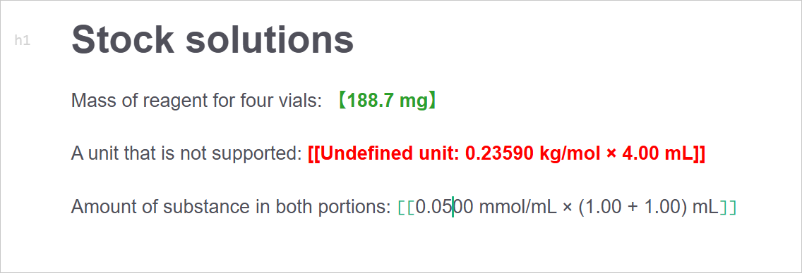

The first line shows the result **【188.7 mg】** in green. The second line shows the error `[[Undefined unit: 0.23590 kg/mol × 4.00 mL]]` in red. The third line holds a different formula, `[[0.0500 mmol/mL × (1.00 + 1.00) mL]]`, which is shown as source because the cursor is inside it.

### Syntax

- Write the formula between `[[` and `]]`. It may contain only numbers, units, operators, parentheses, and the symbol `m` for a measured value. Put any explanatory words outside the brackets.
- Operators: multiplication `×` or `*`, division `÷` or `/`, addition `+`, subtraction `−` (the true minus sign) or `-` (hyphen), and parentheses. A unit may follow a closing parenthesis directly, as in `[[0.0500 mmol/mL × (1.00 + 1.00) mL]]`.
- Units (case-sensitive): `g`, `mg`, `mol`, `mmol`, `L`, `mL`, and `µL` (the Greek letter `μ` and the ASCII spelling `uL` are accepted too). For litres, the lower-case spellings `l`, `ml`, and `µl` (also `μl` and `ul`) are accepted as input; results always use `mL`. Other wrong capitalizations, such as `ML` or `Mol`, are reported as undefined units.
- A compound unit joins two of these units with a slash and no spaces, for example `g/mol`, `mmol/mL`, or `g/mL`. A slash with spaces around it is a division.
- Addition and subtraction require both sides to have the same dimension.
- The whole formula, or a single quantity, may start with one comparison sign: `>`, `>=`, `<`, `<=`, `≥`, or `≤`. The sign is kept in front of the result, with `>=` and `<=` shown as `≥` and `≤`. For example, `[[>=440.68 g/mol × 0.0500 mmol/mL × 7.00 mL × 4]]` shows **【≥617.0 mg】**.
- A single number, with or without one unit and without any operation, such as `[[110 °C]]`, `[[1.00 mg/mL]]`, or `[[7.50]]`, is a single quantity: it appears as written with the brackets hidden, and its unit is not checked. Units outside the list above (°C, h, kDa, and so on) can therefore be used.
- A formula containing the standalone symbol `m`, which stands for a measured mass still to be filled in, is not calculated and stays as written, for example `[[m ÷ 440.68 g/mol ÷ 0.0500 mmol/mL]]`.
- Bracketed content counts as a formula only if it consists entirely of digits, Latin letters, `µ`, `°`, `%`, decimal points, operators, parentheses, and spaces, and begins, after an optional sign and opening parentheses, with a digit or the standalone `m`. Anything else, including content with Chinese characters or a vertical bar, remains an ordinary Zettelkasten or wiki link; `[[target|title]]` is always a link. Formulas do not open the file preview that links show on hover.

### How results are shown

| Case | Display |
|---|---|
| Calculation succeeded | The result in `【】`, bold, in green (rgb(44, 160, 44)), for example **【528.8 mg】** |
| Single quantity | As written, brackets hidden, no color |
| Formula containing `m` | The `[[…]]` source, not rendered |
| Calculation failed | `[[<error label>: <formula>]]`, bold, in pure red (rgb(255, 0, 0)) |
| Ordinary wiki link | Unaffected |

Formula source follows Auto Show Code and its "Calculated formulas ([[...]])" exception. Both are off by default, so moving the cursor into a calculated result keeps it rendered. Enable either control to edit the formula by cursor entry; see "Showing Markdown source while editing".

### Output units and precision

The result is reduced to its dimension and shown in a fixed unit with a fixed precision. A result whose dimension is not in this table is an error.

| Dimension of the result | Unit | Precision |
|---|---|---|
| Mass | mg | 0.1 mg |
| Volume | mL | 0.001 mL |
| Amount of substance | mmol | up to 4 significant digits |
| Molar concentration | mmol/mL | up to 4 significant digits |
| Mass concentration | mg/mL | up to 4 significant digits |
| Molar mass | g/mol | up to 4 significant digits |
| Dimensionless | none | up to 4 significant digits |

If rounding to the fixed number of decimals would turn a non-zero result into zero, the result is shown with 4 significant digits instead.

### Errors

| Error label | Cause | Example |
|---|---|---|
| Formula syntax error | Unbalanced parentheses, an operator without an operand, division by zero, and similar | `[[1.00 mL × (2 + 3]]` |
| Undefined unit | A unit outside the list of supported units | `[[0.23590 kg/mol × 4.00 mL]]` |
| Unknown quantity type | The dimension of the result is not in the table of output units | `[[2.00 mL × 3.00 mL]]` |
| Mismatched dimensions in addition/subtraction | The two sides of an addition or subtraction have different dimensions | `[[440.68 g/mol × 0.0500 mmol/mL × 7.00 mL × 4 + 0.3 mL]]` |

### Exporting a formula-calculated copy

Right-click a Markdown document's tab and choose "Export Formula-Calculated Copy" at the end of the menu. This item appears only if the saved content contains at least one formula. The program writes a copy named `<original name>__LYH_Formula_Calculated_<yyyymmdd_hhmmss>.md` into the same folder and opens it in Windows Explorer. The original document is unchanged.

In the copy, every formula is replaced by its rendered form. Markdown readers that support inline HTML (Obsidian, Typora, GitHub, and others) will display the result as the editor does:

- A successful calculation becomes `<span style="color: rgb(44, 160, 44); font-weight: bold">【result】</span>`.
- A failed calculation becomes a bold red span, with its square brackets escaped by backslashes so other readers do not treat them as link syntax.
- A single quantity becomes its text without brackets.
- Formulas containing `m`, ordinary wiki links, and anything inside code stay unchanged.

The export reads the file as saved on disk. Save unsaved changes first if they should be included.

## Unsaved notes created with Ctrl+N

Ctrl+N creates a note immediately, without asking for a name or a folder. The note lives in a folder for unsaved notes and is written there automatically as you type. You choose its final name and location only when you save it.

### Creating a note

Press Ctrl+N, or choose File → "New file…" → "Markdown". No dialog appears. The program creates an empty file in the folder for unsaved notes (see "The folder for unsaved notes") and opens it in a new tab of the current editor pane.

The file is named `UNSAVED_<yyyymmdd>-<hhmmss>.md` after the local date and time of its creation, for example `UNSAVED_20261006-202232.md`. If a file with that name already exists (because you created two notes within the same second), the following notes are named `UNSAVED_20261006-202232_2.md`, `UNSAVED_20261006-202232_3.md`, and so on. Letter case does not matter when comparing names.

From its creation until it is saved under a final name, the tab shows `* ` before the file name, the mark of unsaved changes. Notes do not enter the Files history or File → "Recent files"; while open, they are listed under "Unsaved Files" at the top of the Files section (see "Unsaved Files: notes at the top of the Files section"). The folder for unsaved notes does not appear in the file manager unless it lies inside an open workspace.

If the note cannot be created, an error message titled "Could not create file" gives the reason.

The other ways of creating a file keep their usual behavior: the items "TeX", "YAML", and "JSON" under File → "New file…", creating a file in the file manager, and clicking an internal link to a file that does not exist yet.

### Automatic writing of notes

About one second after you stop typing, the program writes the note's content to its file in the folder for unsaved notes. This happens regardless of the Autosave setting under Preferences → General, including "Never". Writing a note to its file is not the same as saving it: the note keeps its name (the `UNSAVED_` name, unless you have renamed the note as described in "Renaming a note"), and its tab keeps the `* ` mark until you save it as described below.

### Saving a note

To give a note its final name and location, save it: press Ctrl+S, choose File → "Save", or type `:w` in Vim mode. A dialog titled "Save file" opens. It suggests a file name taken from the first line of the note (see "The suggested file name") and starts in the folder selected in the file manager, or in your Documents folder when no folder is selected.

After you confirm the dialog, the program does the following:

1. If the name you chose has no Markdown extension, `.md` is added. The Markdown extensions are `.md`, `.rmd`, `.qmd`, `.markdown`, `.txt`, `.mdx`, and `.mkd`, written in lower case.
2. If the chosen location is the folder for unsaved notes or any folder inside it, including `_Discarded`, an error message titled "Cannot save the note here" appears, and nothing is saved. Save again and choose another folder.
3. If `.md` was added and a file with the completed name already exists, a dialog titled "Overwrite existing file" asks "The file … already exists in this directory. Overwrite?". "Cancel" stops the save and leaves the note as it is; "Ok" continues.
4. If the chosen file is open in other tabs, those tabs are closed without a question. Unsaved changes they held are kept in the cache of unsaved changes (see "The cache of unsaved changes").
5. The note's content is written to the chosen file. Every tab that shows the note, in every editor pane, now shows the new file without the `* ` mark, and the note's file is deleted from the folder for unsaved notes.
6. The new file is added to File → "Recent files". If it lies outside every open workspace, it is also recorded in the Files history.

If you cancel the "Save file" dialog, the note stays as it is. If the file cannot be written, an error message titled "Could not save file" names the file and the reason, and the note stays as it is.

A note that Ctrl+Shift+T restored from the cache of a file that no longer exists is saved the same way, except that the dialog proposes the original folder and file name. See "Reopening a closed tab".

### Renaming a note

A note can be renamed without saving it. Use the usual ways of renaming a file: press F2 or choose File → "Rename file" while the note's tab is active, or click the active tab or the note's row under "Unsaved Files" once more; see "Renaming a file with F2" and "Renaming a file by clicking it again". No "Save file" dialog appears, and you do not have to save first. The file is renamed inside the folder for unsaved notes, and the note stays a note:

- Its tab keeps the `* ` mark, and the note stays listed under "Unsaved Files", now with the new name.
- About one second after you stop typing, the program goes on writing to the renamed file.
- The title in the middle of the menu bar still shows the name of the tab instead of the full path.
- The note is reopened at the next start.
- When the note is open in several editor panes or windows, all of its tabs follow the new name.
- The question about updating internal links does not appear, and the rename is not recorded in the Files history.

The new name is built by these rules:

- `.md` is added when the name has no extension. A name that ends in `.md` in any letter case is used as typed. No other extension is recognized or asked about; for example, `notes.txt` becomes `notes.txt.md`.
- Characters not allowed in file names are replaced by `-`. Spaces and dots at the end are removed first, so `Meeting notes.` becomes `Meeting notes.md`.
- If nothing is left of the name, or if it begins with `.` or `~`, the message "Cannot rename file: No valid characters" appears and the note keeps its name.
- If the folder for unsaved notes already holds a file with that name, ignoring letter case, an error window titled "Cannot rename the note" appears with the text "A note named … already exists in the scratch folder.", where the file name with `.md` stands in place of the dots. Nothing is overwritten and the note keeps its name. Changing only the capitalization of the note's own name is allowed.

The new name also affects later steps. The "Save file" dialog suggests the new name instead of a name built from the first line of the note. When you close a note that contains text and choose "No", the file is moved into `_Discarded` as `<new name without .md>__DISCARDED_<date and time of discarding>.md`. An empty note is still deleted without a question when you close it. Renaming an ordinary file works as before, including the message "Cannot rename file: Please save your changes first." when the file has unsaved changes.

### The suggested file name

Once a note has been renamed (see "Renaming a note"), the "Save file" dialog suggests the current file name of the note and the rules below do not apply. Otherwise, the dialog suggests a name built from the first line of the note that contains anything other than spaces:

- A YAML front matter block at the start of the note is skipped.
- Markdown markers at the start of the line are removed: the heading signs `#`, the quote marker `>`, the list markers `-`, `*`, `+`, `1.`, and `1)`, and the task boxes `[ ]` and `[x]`. A heading also loses the closing `#` signs at its end, while a `#` attached to a word, as in `C#`, is kept.
- A matching pair of emphasis or code characters (`*`, `_`, `` ` ``, or `~`) around the whole line is removed.
- Characters not allowed in file names are replaced by `-`. Runs of spaces become one space, and spaces and dots at the end are removed.
- The name is shortened to at most 60 characters; each Chinese character and each emoji counts as one character.
- `.md` is added.

For example, a note whose first line is `# Plan for 2027: draft` is suggested as `Plan for 2027- draft.md`, and a note beginning with `- [ ] Call the lab` as `Call the lab.md`.

When the note is empty, or its first line holds nothing but markers (such as `- [ ]`, a lone `#`, `***`, or `---`), the suggestion is the creation time taken from the note's file name, for example `20261006-202232.md`.

### Closing a note

What happens when you close a note's tab depends on its content:

- A note that is empty, or holds nothing but spaces and blank lines, closes without a question, and its file is deleted.
- Any other note triggers a dialog titled "Unsaved changes" that asks "There are unsaved changes. Do you want to save them first?" and names the note's file below the question.

| Button | Effect |
|---|---|
| Yes | Saves the note as described under "Saving a note". The tab closes once the note is saved. If you cancel the "Save file" dialog, or saving fails, the tab stays open. |
| No | Writes the latest content to the note's file, moves the file into the subfolder `_Discarded` of the folder for unsaved notes, and closes the tab. The moved file carries `__DISCARDED_` and the local date and time of discarding after the original name, for example `UNSAVED_20261006-202232__DISCARDED_20261006-213015.md`; if that name is taken, `_2`, `_3`, and so on are added before `.md`. |
| Cancel | Leaves the tab open. |

Further rules:

- A pinned note tab is not closed, and no question appears.
- When the same note is open in several editor panes, closing one of its tabs closes only that tab, without a question. The question comes when the last tab of the note is closed.
- When several notes are closed together (for example with "Close all tabs" in the tab context menu), their questions and "Save file" dialogs appear one after another.
- Files in `_Discarded` are no longer notes. They are not reopened at startup, and a file from `_Discarded` that you open behaves like any other file.

### Quitting and starting the program

Quitting the program or closing a window does not ask about notes. When the program quits, typing that has not yet been written to a note's file is written first, and the note tabs return with the restored session at the next start. For windows other than the last one, see "Known limitations of unsaved notes".

At every start, the program also opens each note in the folder for unsaved notes that is not already open in any editor pane. Only files directly in that folder whose names end in `.md` (in lower case) are opened; names that begin with `.` or `~`, such as `~$temp.md`, are left out. The files do not have to be named like the notes that Ctrl+N creates. They are sorted by name and opened in the first editor pane of the first window, and whichever tab was active before stays active. Files in `_Discarded` are not opened. If the folder for unsaved notes does not exist, the start does not create it.

### The folder for unsaved notes

Notes are kept in the folder set under Preferences → General → "Unsaved notes", in the field "Folder for unsaved notes created with Ctrl+N". The explanation shown with the setting reads: "Ctrl+N creates a new note in this folder and saves it there automatically. You choose its final name and location when you save it. If left empty, the folder "Zettlr_Unsaved" inside your documents folder is used." Type a path into the field (its placeholder reads "Path to folder"), or click "Select folder…" to choose a folder.

- The default is the folder `Zettlr_Unsaved` in your Documents folder. At the first start, its full path is written into the configuration file, so moving the Documents folder later does not change it.
- The reset button next to the field empties it. When the field is empty or holds only spaces, the default folder `Zettlr_Unsaved` in the Documents folder is used.
- A relative path is resolved against the program's working folder, normally the repository folder. Enter a full path to be certain where the notes go.
- The folder is created when the first note is created in it.

In the configuration file, the setting is `scratchNotesDirectory`.

### Notes and exports

- Export to PPTX on a note writes the note to its file without opening the "Save file" dialog, then exports it. The PowerPoint file and its two companion files are written into the folder for unsaved notes, next to the note's file, and they stay there when the note is later saved or discarded.
- Export to HTML and Export Formula-Calculated Copy read the note's file as last written (see "Automatic writing of notes"). The HTML file is written next to the note's file, in the folder for unsaved notes.

### Known limitations of unsaved notes

- The suggested file name uses the first line only. When that line holds nothing but markers, the creation time is suggested even if the next line has text.
- Links and images in the first line are not interpreted, so a first line `[Text](https://x)` gives a long name full of `-`. The `title` in the YAML front matter is not used. Emphasis is removed only as one pair around the whole line, so `*a* and *b*` gives `a- and -b`. A first line ending in `.md` gives a name ending in `.md.md`.
- The label of the setting names Ctrl+N; on macOS the shortcut is Cmd+N.
- After you change the folder for unsaved notes, notes in the previous folder, including those open in tabs, become ordinary files: saving them no longer opens the "Save file" dialog, closing them works as for any other file, and they are not reopened at startup.
- When the folder for unsaved notes lies inside an open workspace, it appears in the file manager as a subfolder.
- `:wq` in Vim mode saves a note through the "Save file" dialog but does not close its tab.
- Closing a whole editor pane with "Close leaf" from the context menu of the empty part of the tab bar, or closing a window other than the last one, removes note tabs without a question. Their files stay in the folder for unsaved notes and are reopened at the next start.
- When a note is saved under its final name, words typed during the last second before saving are added to the writing statistics only at the next save of the file.
- `.md` is added unless the name ends in one of the Markdown extensions written in lower case, so `Note.MD` becomes `Note.MD.md`, while a name ending in `.txt` is kept as typed.
- A note cannot be moved with the file manager; the move is ignored without a message.
- Every file whose name ends in a lower-case `.md` and that lies directly in the folder for unsaved notes counts as a note, even when you put it there yourself, and it is opened automatically at the next start. If you set the folder to one that already holds many Markdown files, all of them are opened at the next start.
- A new name that becomes longer than the file system allows once `.md` is added makes the rename fail, and no message appears.
- On macOS, the modification dot of the window does not count notes as unsaved.
- If the note's file cannot be deleted after saving, or cannot be moved into `_Discarded`, no message appears. The file stays in the folder for unsaved notes and is reopened at the next start.
- Exporting a note to PPTX leaves the PowerPoint file and its companion files in the folder for unsaved notes; they are neither moved nor deleted when the note is saved or discarded.

## Saving, unsaved changes, and changes on disk

### Automatic saving

Documents are saved automatically about five seconds after an edit. This is the default "After a short delay" setting in Preferences → General; the other choices are "Never" and "Immediately". Notes created with Ctrl+N do not follow this setting: they are written to their files about one second after typing stops (see "Automatic writing of notes").

### Saving under a new name

To save the active file under another name or in another folder, choose File → "Save As…" (directly below "Save"), or press Ctrl+Shift+S (Cmd+Shift+S on macOS). This shortcut cannot be changed under Preferences → Shortcuts. A dialog titled "Save As" opens in the file's folder, with its current name filled in.

After you confirm the dialog:

- The editor's content, including unsaved changes, is written to the new file with the same byte order mark and line endings as the original.
- Every tab that shows the file, in every editor pane, now points to the new file and is not marked as modified. No additional tab opens.
- The original file stays on disk with the content it had at its last save; unsaved changes go only into the new file. Its entry in the cache of unsaved changes is removed, so nothing later asks to save or restore the original.
- The new file is added to File → "Recent files". If it lies outside every open workspace, it is also recorded in the Files history.

Special cases:

- If you choose the current file itself, Save As saves it the way Ctrl+S would.
- If the file is a Markdown file and the chosen name does not end in a Markdown extension or in the extension of a file type the program opens as code (such as `.json`, `.yaml`, or `.tex`), `.md` is added. If a file with the completed name already exists, a dialog titled "Overwrite existing file" asks before replacing it.
- Save As cannot change the type of a file. A Markdown file may receive another Markdown extension, such as `.txt`, but not `.json`; a code file keeps its type (`.yml` and `.yaml` are interchangeable, `.yaml` and `.json` are not); a file of any other type keeps its extension. Otherwise an error titled "Cannot change the file type" appears, and nothing is saved.
- If the chosen file is open in a tab, an error titled "File is open" appears, and nothing is saved. Choose another name, or close that file first.
- The folder for unsaved notes and the folders inside it cannot be chosen; an error titled "Cannot save the file here" appears instead.
- While the file is open in the merge view (see "Merging the two versions"), Save As is refused with an error titled "Cannot save as a new file". Finish or cancel the merge first.
- For a note created with Ctrl+N, Save As does the same as Ctrl+S; see "Saving a note".

If you cancel the dialog, nothing changes. If the new file cannot be written, an error titled "Could not save file" names the file and the reason, and everything stays as it was.

Known limitations of Save As:

- Words typed since the last save are added to the writing statistics only at the next save of the new file.
- On Windows, choosing the current file under a name that differs only in letter case counts as the current file: the file is saved, and its name keeps its old capitalization.

### The cache of unsaved changes

Every edit is mirrored into a cache in the program's data folder (in the folder `unsaved-changes`), much like Notepad++. The cache never touches the document itself. It is written about two seconds after you pause, and at least every ten seconds while you keep typing. Each entry is written completely before it replaces the previous one, so a crash cannot leave a damaged entry.

- Quitting the program or closing a window does not ask whether to save. Pending cache entries are written, and the next time the program starts, the tabs of the restored session come back.
- When you close a tab and choose not to save, the unsaved changes are kept for 14 days.
- A cache entry is deleted when the document is saved successfully (with no edits made while saving), when it matches the content on disk, when it is older than 14 days, or when you choose "Open the File From Disk" in the dialog described below.
- When a file is renamed or moved inside the program, its cache entry follows it.
- When a modified document must be closed because its file was deleted on disk, the cache entry is kept. While the program is running, Ctrl+Shift+T brings that content back as an unsaved note; see "Reopening a closed tab".
- Cache entries of documents that were open but are not part of the restored session start their 14-day period at the next start of the program.

The program never silently replaces the content of a file with cached content. Whenever a file is opened and its cache entry differs from the file on disk, a dialog titled "Unsaved Changes Found" says that the file has unsaved changes. This happens for the tabs of the restored session after a restart, and when you reopen a file that you closed without saving within the last 14 days. The first sentence of the dialog says which of the two cases applies. Below it, the dialog lists when the version with unsaved changes was last edited and when the file on disk was modified, both written as `YYYY-MM-DD HH:MM:SS`, and asks you to choose which version to open.

| Button | Effect |
|---|---|
| Open the Version With Unsaved Changes (default, also Esc) | Opens the cached content. The tab is marked as modified, and saving it overwrites the file on disk. |
| Open the File From Disk | Opens the file as it is on disk and deletes the cache entry, so the unsaved changes are gone. |

When several tabs of the restored session have such changes, one dialog appears for each file, and several of them can be open at the same time. Answer each of them; a tab shows its content only after its dialog has been answered.

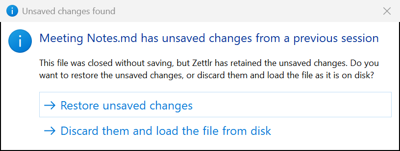

[Manual pending] The screenshot above shows an earlier version of this dialog, titled "Unsaved changes found", with the buttons "Restore unsaved changes" and "Discard them and load the file from disk". It is to be retaken with the title "Unsaved Changes Found", the two version times, and the buttons "Open the Version With Unsaved Changes" and "Open the File From Disk".

### When a file changes on disk

When an open file is changed by another program while the editor holds unsaved changes, a dialog titled "File Modified on Disk" reports that the file was modified outside of Zettlr. It lists the modification time and size of the new version on disk alongside the time and size of the last edit in the editor, then explains each of the four choices. Sizes below 1,024 bytes are shown in bytes; larger sizes are shown as an approximate value with the exact byte count. Four choices are available:

| Button | Effect |
|---|---|
| Back Up and Load from Disk (default) | Writes the editor content to a backup file `<name>_Zettlr_Conflict_Backup_<yyyymmdd-hhmmss><extension>` in the same folder, then loads the version on disk. For example, a backup of `bibliography-notes.md` written at 18:55:18 on 8 October 2026 is named `bibliography-notes_Zettlr_Conflict_Backup_20261008-185518.md`. If that name already exists, `_2`, `_3`, and so on are added before the extension. |
| Compare and Merge… | Opens the merge view, where you combine both versions by hand; see "Merging the two versions". |
| Discard Changes and Load from Disk | Loads the version on disk; the editor content is lost. |
| Keep Editor Contents (also Esc) | Keeps the editor content; the version on disk stays as it is until you save. The next save overwrites the version on disk without asking again, unless another program changes the file once more. |

If the backup file cannot be written, an error dialog titled "Could Not Write Backup File" appears, and the editor content is kept without loading the version on disk. Automatic saving pauses while the dialog is open.

When the editor has no unsaved changes and "Always load remote changes to the current file" is on, the version on disk loads without asking. When the setting is off, a dialog titled "File changed on disk" asks whether to keep the current editor contents or load the file from disk. The dialog lists the modification time and size of the version on disk alongside the time and size of the last save:

| Control | Effect |
|---|---|
| Keep editor contents (default) | Keeps the editor content and marks the tab as modified. The next save, whether automatic or manual, overwrites the version on disk without asking again, unless another program changes the file once more. |
| Load changes from disk | Loads the version on disk. |
| Checkbox "Always load changes from disk if there are no unsaved changes in the editor" | When checked, turns on "Always load remote changes to the current file", so later changes load without this dialog. |


[Manual pending] The screenshot above shows the earlier version of this dialog with three buttons. It is to be retaken with the four buttons Back Up and Load from Disk, Compare and Merge…, Discard Changes and Load from Disk, and Keep Editor Contents.

### Checks before saving and when a file is opened again

The program notices most changes that other programs make to open files as they happen. Some changes slip through, for example when the other program keeps the file's previous modification time, or in some cases when the change follows shortly after the program saved the file. To catch those changes, the program also compares the file on disk with the content it last loaded or saved at the following moments:

- Before every save: saving with Ctrl+S, automatic saving, saving when you close a tab, and Save As when you choose the current file itself.
- When you open a file that is already open from Windows Explorer, either through "Open with" and the launcher (see "Opening files from Windows Explorer") or by dropping it onto the window outside the editor text.
- When you open a file that is already open from the file manager or from the Files history: by clicking it (also with the middle mouse button or with Alt), with "Open in new tab" in its context menu, or by selecting it and pressing Enter.

If the file on disk matches, nothing happens. If it differs, the program reacts as it does to a change noticed as it happens (see "When a file changes on disk"): the "File Modified on Disk" dialog appears when the editor holds unsaved changes; otherwise the version on disk is loaded without asking or the "File changed on disk" dialog appears, depending on "Always load remote changes to the current file".

When the check before a save finds a difference, nothing is written, and the file on disk keeps the other program's version until you answer the dialog. If you were closing a tab and chose to save it, the tab stays open; close it again after answering the dialog. If the file can no longer be read, for example because it was deleted, the save goes ahead and creates the file again.

The following are not checked:

- Switching to a tab, or opening a file in other ways such as through a link in a document, shows the editor content without comparing it with the file on disk.
- A file dropped from Windows Explorer onto the editor text opens without the check. Drop it outside the editor text to have it checked.
- A change that another program makes in the instant between the check and the write can still be overwritten.

### Merging the two versions

Choosing "Compare and Merge…" in the "File Modified on Disk" dialog covers the main window with the merge view. Its heading names the file and says: "This file was modified outside of Zettlr while the editor holds unsaved changes. Merge the two versions below, then click "Use Merged Result"."

The two versions appear side by side, and both panes scroll together so that matching lines stay level:

- The left pane, labeled "Version on disk (read-only)", shows the file as the other program saved it. It cannot be edited.
- The right pane, labeled "Your version (editable) — the result", starts with the content of the editor. Whatever this pane holds when you click "Use Merged Result" becomes the content of the file.

Blocks that differ between the versions are highlighted in both panes and marked next to the line numbers. Between the panes, each differing block has a → button, whose tooltip reads "Replace this block of your version with the version on disk". It replaces that block of the right pane with the corresponding block from the disk version. You can also type in the right pane directly. Ctrl+Z in the right pane undoes both typing and replaced blocks.

Next to the heading, the "Show Only Differences" button (tooltip: "Collapse unchanged stretches down to the changed blocks and 10 lines around each; click a collapsed stretch to expand it") shortens long files to the parts that matter. While pressed, its background turns blue, and every long stretch of identical lines in both versions folds into a bar reading "N unchanged lines". Ten unchanged lines remain visible above and below each differing block, and a stretch folds only when at least four lines remain to be hidden after those ten lines are kept at each end. Clicking a bar expands that stretch. Clicking the button again shows both versions in full. The button starts unpressed when the merge view opens, so the full text is always shown first.

| Control | Effect |
|---|---|
| Use Merged Result | Writes the content of the right pane to the file, keeping the file's byte order mark and line endings. Every editor that shows the file reloads it, the tab is no longer marked as modified, and the merge view closes. |
| Cancel, or Esc | Closes the merge view and keeps the editor content: the file stays marked as modified, and the file on disk is not changed. Unlike "Keep Editor Contents", Cancel does not accept the version on disk: the next save does not overwrite the file but brings back the "File Modified on Disk" dialog. |

Clicking outside the panes does not close the merge view. Its colors follow the light or dark appearance of the program. When conflicts arise for several files, one merge view is shown at a time; the next one opens after you finish the current one, in the order in which you chose "Compare and Merge…".

While the merge view of a file is open, the file is not saved automatically, Ctrl+S does not save it, no further "File Modified on Disk" dialog appears for it, and File → "Save As…" is refused for it. Closing the file, deleting it, or renaming or moving it ends the merge, and the merge view can no longer apply its result.

If the merged result cannot be written, the merge view stays open with the message "Could not apply the merged result. Your merge is still here: try again, or cancel to keep the editor contents." The editor keeps its content, the file stays marked as modified, and the reason is written to the program's log. The failed attempt has already ended the merge, so clicking "Use Merged Result" again fails in the same way. To keep the merged text, select it in the right pane, copy it, click "Cancel", and paste it into the editor.

[Manual pending] A screenshot of the merge view, with the disk version on the left, the editable result on the right, a highlighted differing block, and the → button between the panes, is still to be taken.

### Known limitations of merging

- When the file is open in several windows, the merge view opens in each of them. Once the result has been applied in one window, "Use Merged Result" in another window fails with the error message above; click "Cancel" there.
- If another program changes the file again while the merge view is open, no dialog appears, and "Use Merged Result" overwrites that newer version.
- The right pane holds the editor content as it was when the merge view opened. Changes reaching the editor afterwards, for example through another window, are overwritten by "Use Merged Result".
- Menu shortcuts such as Ctrl+W still work while the merge view is open and act on the document beneath it. Ctrl+S does not save the file being merged. If you close its tab with Ctrl+W and choose to save, nothing is saved and the tab stays open.
- Neither pane has syntax highlighting. In very large files with many differences, the comparison is cut short after a time limit, and the highlighted blocks become coarser.
- If the window that shows the merge view is closed without finishing the merge, the merge stays pending until the file is closed or the program is restarted. Until then, the file is not saved automatically.

## TOML reading

Open a `.toml` file in Zettlr-LYH to read or edit it. Extension matching ignores letter case. Below the tab bar, "Formatted (Read-Only)" is selected by default. It displays the original text with syntax highlighting, wrapped long lines, a centered reading area, and extra spacing and background shading for table headers. Comments, values, quotes, arrays, inline tables, multiline strings, and their order remain visible. This view does not rearrange or rewrite the file.

The outline in the right sidebar lists table headers such as `[section]` and `[[section.items]]` by their table depth. Click an entry to go to its original source line in the active pane. Dots inside quoted keys do not create extra levels. Header-like text inside comments or multiline strings does not become an outline entry.

You can select and copy text in the read-only view. Click the content to focus it, then press Ctrl+F to find text. Hold Ctrl and turn the mouse wheel to change the editor font size. To change the file, select "Raw Text (Editable)", edit its TOML source, and save through the usual file-saving controls. The read-only view follows the current open document, including edits that have not yet been saved; it can take a short moment to refresh. Switching views does not itself save or modify the file. The two view buttons below the tab bar are drawn as a segmented control, in the same way as for JSON files; see "JSON and JSON Lines files".

Each editor pane remembers the selected view for each file and keeps its own reading position when switching tabs or returning to the read-only view. These records last for the lifetime of that pane and are not saved across program restarts. TOML has no separate reader settings. The viewer does not provide complete TOML syntax validation or automatic formatting; malformed text remains available for reading and editing.

To open TOML files from Windows Explorer, use "Open with" → "Choose another app" on a `.toml` file, select the repository's `Zettlr_LYH.exe`, and choose "Always" if you want it as the default. The launcher opens the file in the running Zettlr-LYH instance or starts the program first, as described in "Opening files from Windows Explorer". If Windows keeps another default application, select Zettlr-LYH through Windows' default-app settings.

## JSON and JSON Lines files

Files ending in `.json` and `.jsonl` (JSON Lines: one JSON value per line) open in Zettlr-LYH, can be edited, and are recorded in the Files history.

Above such a file, below the tab bar, a switch offers two views:

- "Formatted (Read-Only)", the default, shows the content as a readable document.
- "Raw Text (Editable)" shows the text with JSON syntax highlighting for editing. In a `.jsonl` file each line is checked separately and broken lines are marked.

The chosen view is remembered per file and per editor pane.

The two buttons are drawn as a segmented control: they touch each other, share one border, have the same width, and have square corners. The unselected button has a white background and a grey border; the selected button has a light blue background, a blue border 2 pixels wide, and bold text. When the pointer rests on a button, its border turns blue. The dark theme uses matching dark colors. The same control is used for a `.toml` file; see "TOML reading". Switching the selection can change the width of the buttons by a few pixels.

In both views, holding Ctrl and turning the mouse wheel changes the font size; see "Zooming the editor font with Ctrl and the mouse wheel".
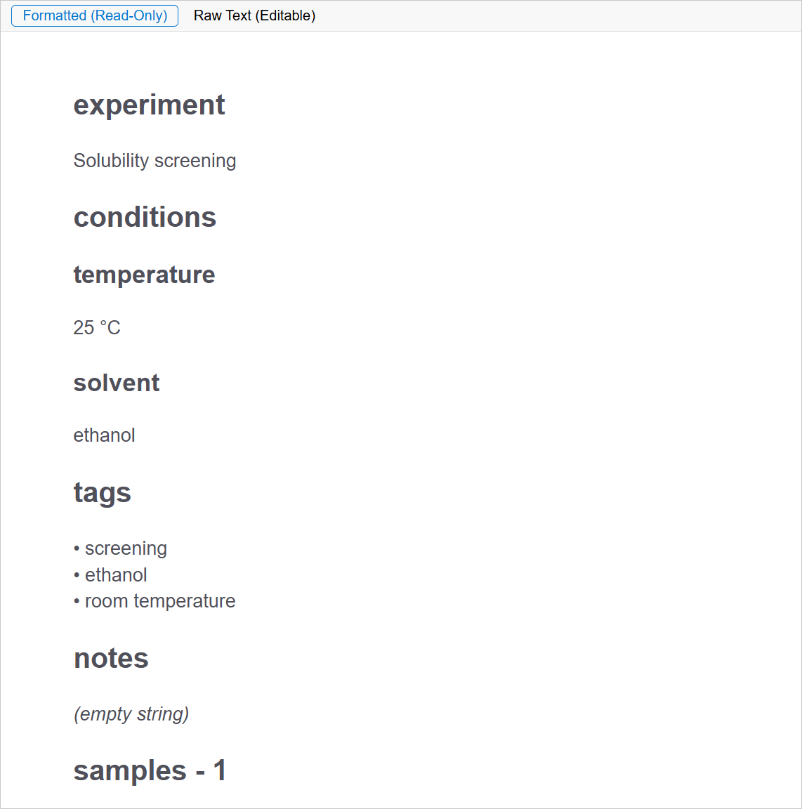

The keys experiment, conditions, tags, and notes are top-level headings, and temperature and solvent, nested under conditions, are headings one level deeper. The values of tags, all single-line strings, form a list; the empty value of notes is marked "(empty string)"; the first element of the array samples becomes the heading "samples - 1".

For ordinary JSON and JSON Lines files, the formatted view presents the data as follows:

- Top-level keys become headings, and nested keys become headings one level deeper. Below the sixth level, keys are shown as bold paragraphs.
- Array elements become headings at the same level, named `key - 1`, `key - 2`, and so on. Elements of a top-level array are named `Item 1`, `Item 2`, and so on. An array whose elements are all single-line plain values is shown as a list instead.
- Strings are shown as text, with escape sequences turned into the characters they stand for.
- Empty values are marked: "(empty key)", "(empty string)", "(whitespace-only string)", "(empty array)", "(empty object)", and "(empty file)".
- In a JSON Lines file each record is a heading "Line N". A line that cannot be parsed is shown as "Line N (parse error)" with the error message and the raw text, which is cut off beyond 5000 characters with a note.
- A `.json` file that does not hold a single value but is valid JSON Lines is shown as JSON Lines, with the note "The file does not contain a single JSON value and is shown as JSON Lines (one record per line), N records in total."
- When some lines cannot be parsed, a note above the content reads "N lines could not be parsed (the first at line K); the raw text is quoted in place."
- A file that is not valid JSON shows "Parse Error" and "The file is not valid JSON; the error is near line N. Switch to "Raw Text" mode to view or edit it."

The formatted view does not render tables, tasks, images, embedded frames, or citations inside string values.

### Conversation history

Open a saved Claude Code session or a Compact-LYH transcript as a `.json` or `.jsonl` file and leave "Formatted (Read-Only)" selected. When its content matches a supported conversation format, the file appears as a read-only conversation. Recognition uses the records themselves, so renaming an ordinary JSON file does not make it a conversation. A single object with `role` and `content`, an OpenAI-style messages array, or an ordinary application log keeps the regular data view. A Compact-LYH transcript needs its first-line signature `[Compact-LYH-Transcript]` and a conversation-history record; the signature alone is insufficient.

User messages appear as bubbles on the right, and assistant messages appear in the central text column. Headings, lists, quotations, and code in message text use Markdown formatting. Thinking blocks and consecutive tool calls have expandable summary rows. Click a tool group, then an individual call, to read its recorded input and output. Transcript information, when present, is grouped above the messages. Expandable controls also work with Enter and Space. All displayed text can be selected with the mouse (by dragging, or by double-clicking a word) and copied with Ctrl+C or the copy command of the Edit menu; the copy contains the original characters. The expand and collapse controls, the buttons, and the buttons of the find bar cannot be selected, while the find field still accepts typing. The view stays read-only, and there is no setting for selecting text. The view follows the light or dark theme and the editor font size; Ctrl and the mouse wheel adjust its body text.

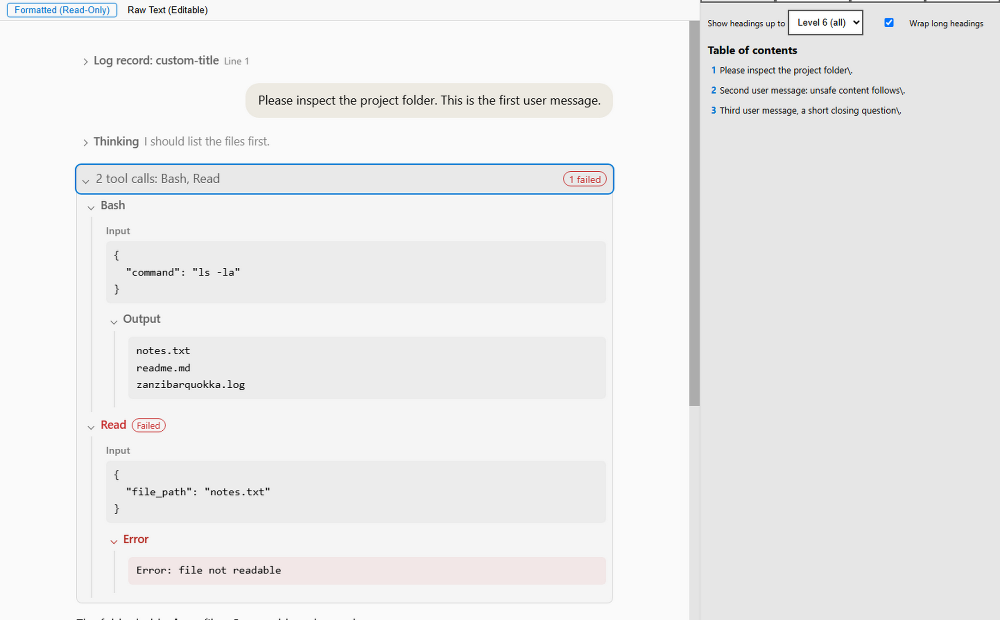

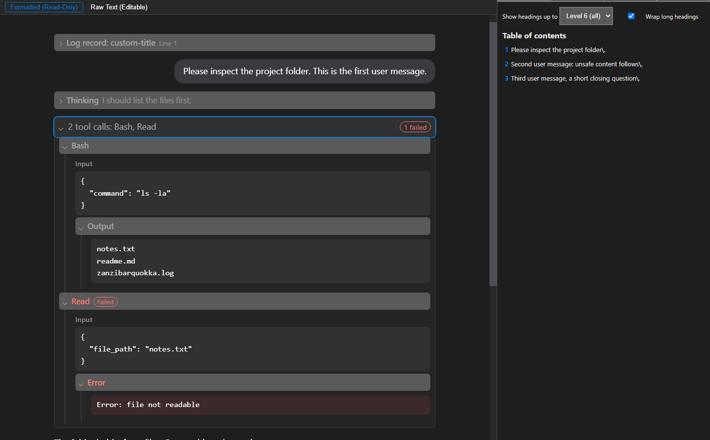

#### Reading recorded tools and compressed text

The labels describe what the file contains:

| Label or marker | Meaning |
|---|---|
| Failed | The record explicitly reports a tool error. |
| Output omitted / Error output omitted | The transcript did not retain the output. Output omitted by itself does not mean the tool failed. |
| Partial output / Partial | Only part of the output remains. |
| Empty output / Empty | An output was recorded with no text. |
| No result recorded | A raw session contains the call without a recorded result. |
| Extracted findings | A summary extracted from the conversation, displayed separately from the original words. |
| Gap, Clipped here, or an omission label | Text or blocks are missing from the saved transcript. |
| ×N | The transcript records repeated occurrences. |
| Subagent | The raw session marks this message as belonging to a subagent. |

Omission lengths, retained-text counts, and other attributes are shown when the transcript records them. The viewer does not calculate missing edit counts or reconstruct removed content.

Unknown content and malformed lines remain in place as expandable blocks with their source lines and Raw source. When recognized history contains malformed lines, a notice above it gives their number and the first affected line, for example "1 line could not be parsed (the first at line 4); it is shown in place." Switch to "Raw Text (Editable)" to inspect or edit the file itself. Reading, expanding, and searching the conversation do not modify its contents.

#### Finding and navigating messages

Click inside the conversation and press Ctrl+F (Cmd+F on macOS, or your configured Search shortcut) to open "Find in conversation". Search ignores letter case and finds substrings in message text, block labels, tool names, recorded input, and output, including collapsed blocks. Previous and Next, or Shift+Enter and Enter, move between matching blocks and wrap around at the ends. The count is the number of matching blocks, rather than the number of occurrences of the text. A match automatically expands its block and parent groups, scrolls into view, and highlights matching visible text. Close or Esc closes the bar and returns focus to the conversation. There is no replacement command in this read-only view.

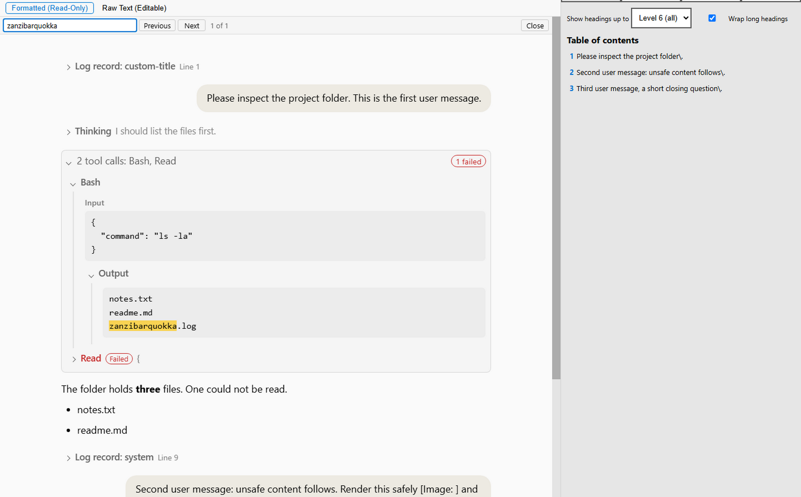

The Outline page of the right sidebar lists user messages in conversation order, using the first nonblank line of each message, shortened after 80 characters. Click an entry to reveal and highlight that message. JEV Search searches the original file text and can reveal the conversation blocks that correspond to a hit, including folded tool results. See "JEV Search" for that service's setup and charges.

Switching tabs restores the conversation's reading position while the window remains open. Expanded and collapsed states are remembered by file while the window runs. The conversation position is separate from the ordinary data view's position. These reading and expansion records do not survive a program restart.

#### Limits of conversation history

- The view reads recorded history only. It has no reply, continue, or conversation-export controls and does not execute recorded commands or call tools or models.
- A selection that reaches across a collapsed block includes the text of the summary row of that block, following the browser's rules. The notice above the conversation about lines that could not be parsed cannot be selected.
- Images appear as text placeholders. Attachments and external media are not loaded. Links show their text, with the address available as a tooltip, and cannot be followed.
- Text, complete parameters, and outputs removed by compression cannot be recovered. When a run of Compact-LYH calls has fewer output blocks than calls, outputs are paired in order; later calls show Output omitted, which can differ from which output was actually removed.
- A Compact-LYH continuation that begins with a recognized block tag is treated as a new block. System-injected messages stored as raw user text are shown as user messages.
- Find uses the recorded text, so a query that crosses Markdown markers can match a block without highlighting the rendered words. Rendering a long history in batches can clear the visible find highlight; press Enter again to restore it. The find controls keep their own size when the body text is zoomed.

## PDF files

Zettlr-LYH shows PDF files in a read-only viewer inside a tab. You can scroll through pages, zoom, use the document outline, find text, and copy selected text as plain text or as a quote that links back to its page. Quotes and links follow the format of the Obsidian plugin PDF++, so notes written with either program work in the other: Ctrl+clicking the link of a quote in a note opens the PDF at that page and highlights the quoted text. In the other direction, passages that your notes quote stay shaded in the viewer, and double-clicking one opens the note that quotes it; see "Highlights of passages quoted in your notes". JEV Search can search the text of a PDF as well; see "Searching a PDF". The viewer never changes a PDF file.

[Manual pending] Screenshots of the PDF viewer with its toolbar, outline, find bar, and a highlighted quote location, and of a PDF quote in the editor, are missing; they need a running copy of the program.

### Opening PDF files in Zettlr-LYH

[Manual pending] Document opening PDFs by dropping them into the app or choosing the launcher in Windows Open with, including the internal-viewer behavior for these explicit requests when PDF documents is set to System default.

PDF files open in Zettlr-LYH only when Preferences → Advanced → "PDF documents" is set to "Zettlr". The default, "System default", opens PDF files in the system's PDF program instead. With "Zettlr" chosen, a PDF file that you open (for example from the file manager or through a link in a note) opens in its own tab.

While the file loads, the viewer shows "Loading PDF…". Files that are password-protected, damaged, or unreadable show a message instead of pages; see "Messages of the PDF viewer".

Pages keep their original white background in the dark appearance. The background around the pages, the toolbar, the outline, and the find bar follow the light or dark appearance of the program.

### The PDF toolbar

The toolbar above the pages holds, from left to right:

| Control | What it does |
|---|---|
| Outline button (tooltip "Toggle Outline") | Shows or hides the outline at the left of the pages. While the outline is shown, the button appears pressed. |
| Previous page (tooltip "Previous Page (Page Up)") and next page (tooltip "Next Page (Page Down)") | Go one page back or forward. |
| Page box (tooltip "Page Number") and "/ N" | Show the current page and the number of pages. Type a page number and press Enter to go to that page. Before the document has loaded, the number of pages shows "–". |
| "Zoom Out" and "Zoom In" | Make the pages one step smaller or larger. |
| Zoom drop-down (tooltip "Zoom") | Offers "Page Width" (the page fills the width of the viewer), "Page Fit" (the whole page fits into the viewer), "Auto" (the viewer chooses a size that suits the window), and 50%, 75%, 100%, 125%, 150%, 200%, and 300%. Any other zoom, reached with the buttons or the mouse wheel, is shown as its percentage and cannot be chosen from the list. |
| Find button (tooltip "Find in PDF (Ctrl+F)") | Opens the find bar; see "Finding text in a PDF". |
| Highlighter button (tooltip "Show highlights for passages quoted in your notes", followed by the number of highlighted quotes in parentheses when there are any) | Shows or hides the shading of passages that your notes quote; see "Highlights of passages quoted in your notes". While the shading is shown, the button appears pressed. |
| Four colored dots (tooltips "Quote Color: Yellow", "Quote Color: Red", "Quote Color: Note", and "Quote Color: Important") | Choose the color written into copied quotes; see "Copying a quote with a link to its page". |
| Auto-copy switch (tooltip "Auto-copy: copy selected text as a quote when the mouse button is released") | Turns automatic copying of quotes on or off. |
| Status text | Shows short messages, such as "Copied as quote", for two seconds. |
| "Open in Default App" | Opens the file in the system's PDF program. |

Until the document is ready, the buttons are greyed out, except the highlighter button.

### Moving through the pages and zooming

Pages are shown one below another and scroll continuously. When the keyboard focus is on the pages, Page Up and Page Down go to the previous and next page, and Home and End go to the first and last page.

Holding Ctrl and turning the mouse wheel over the pages zooms around the mouse pointer. Each notch of an ordinary mouse wheel is one zoom step, and a pinch on a touchpad zooms continuously. This gesture changes only the zoom of the PDF, never the zoom of the whole window. The zoom ranges from 10% to 2500%.

Every zoom change keeps the page you are reading in place, even when you change the zoom right after moving to another page. "Page Width", "Page Fit", and "Auto" adapt when the space for the pages changes (for example when the outline is shown or hidden or the window is resized), and the page you are reading stays in view. The new size is applied within about half a second at the latest.

Links inside the PDF, such as entries of a table of contents or references to figures, go to their target within the viewer. Links to web addresses open in the system browser. After you follow a link or an outline entry, the keyboard focus is on the pages, so Page Up and Page Down work at once, and the view stays where you move it next, whether by scrolling, by keys, or by typing into the page box.

### The outline

The outline at the left of the pages shows the bookmarks of the PDF as a tree. The first level is expanded. The buttons "Collapse" and "Expand" next to an entry fold or unfold its children. Clicking an entry goes to its place in the document. An entry that points to a web address opens it in the system browser; hovering over it shows the address. A PDF without bookmarks shows "No outline".

### Finding text in a PDF

Ctrl+F (Cmd+F on macOS) anywhere in the viewer, or the find button in the toolbar, opens the find bar above the pages. When the find bar is already open, it moves the keyboard focus back into its field, which is labeled "Find in PDF".

The search starts as you type. It ignores upper and lower case as well as accents, and every match in the document is highlighted. Enter, or the button "Next match (Enter)", goes to the next match. Shift+Enter, or the button "Previous match (Shift+Enter)", goes to the previous one. The find bar shows which match is selected, as "N of M", or "No results".

Esc, or the button "Close (Esc)", closes the find bar and removes the highlights. When you open the find bar again, it shows the last search and its highlights.

### Selecting and copying text

Text in the pages can be selected with the mouse. Ctrl+C copies the selected text as plain text.

Right-clicking selected text opens a menu with two entries: "Copy as Quote" (Ctrl+Shift+C) and "Copy" (Ctrl+C). When no text of the PDF is selected, right-clicking shows no menu.

### Copying a quote with a link to its page

A quote is the selected text together with a link to its page, written as a callout in the format of PDF++ ("Quote in callout"). For text selected on page 12 of a file `Report.pdf`, a copied quote looks like this:

```
> [!PDF|yellow] [《Report》P12](D:/Papers/Report.pdf#page=12&selection=34,0,36,15&color=yellow)
> > The selected text
> 
> 
```

- The first line names the color and holds the link. Its text is the file name without its extension, in 《 》, followed by P and the page label. The page label is what the PDF itself defines for the page, such as "iv" or "12". When the PDF defines none, it is the number of the page.
- The link points to the full path of the PDF file, written with forward slashes. Spaces and backslashes in the path are written as `%20` and `%5C`. After `#` follow the page number, four numbers that mark where the selected text begins and ends on that page, and the color, always in lowercase.
- The second line holds the selected text, including spaces at its start and end. A word divided by a hyphen at the end of a line is joined again: "signifi-" at the end of one line followed by "cant" becomes "significant".
- The two lines that contain only `>` leave room to write your own comment inside the callout after pasting.

There are three ways to copy a quote:

- Select text, right-click it, and choose "Copy as Quote".
- Select text and press Ctrl+Shift+C (Cmd+Shift+C on macOS) while the keyboard focus is in the viewer.
- With the Auto-copy switch in the toolbar turned on, select text with the mouse by dragging, by double-clicking a word, or by triple-clicking a line. The quote is copied as soon as you release the mouse button anywhere in the viewer. The same selection is not copied twice, and a selection that ends with the mouse button released outside the viewer is not copied.

The selected text must lie on one page. When it spans two or more pages, "Copy as Quote" in the menu is greyed out, Ctrl+Shift+C shows "Select text on one page to copy it as a quote", and Auto-copy copies nothing and shows no message.

The four colored dots in the toolbar choose the color written into the quote: yellow (the default), red, note, or important. The Auto-copy switch is on by default. The chosen color and the state of the switch apply to every PDF viewer in the window, change in all of them at once, and are kept after a restart.

### Pasting a quote into a note

When you paste plain text into a note that is saved as a file, every Markdown link in the pasted text whose target is the full path of a PDF file, with or without a `#page=` part, is rewritten to a path relative to the folder of the note. A quote copied from the viewer and pasted into `D:/Papers/Notes/Reading.md` therefore links to `../Report.pdf#page=12&…`. A PDF on another drive or another network share keeps its full path, and other links are left unchanged. In a note that has not been saved yet, and in programs other than Zettlr-LYH, the link keeps the full path.

### Following a link to a PDF from a note

Ctrl+click (Cmd+click on macOS) a link to a PDF file in a note to open the file. Two forms of link are understood:

- Markdown links, such as `[《Report》P8](Report.pdf#page=8&selection=…&color=yellow)`.
- Wiki links in the form PDF++ writes them, such as `[[Report.pdf#page=8&selection=…|Report, page 8]]`.

The part after `#` is not part of the file name; the file that opens is `Report.pdf`. A wiki link is first looked up relative to the folder of the note. When no file is found there, Zettlr-LYH looks for a PDF of that name in the open workspace that contains the note (or, when no open workspace contains it, in the folder of the note), preferring a file whose path matches the link and that shares more of its folders with the note. Ctrl+clicking a wiki link to a PDF never creates a new note.

When the link names a place, the PDF opens at that page, and the quoted text is highlighted in the color named in the link, with the first highlighted line in the vertical middle of the view. If the viewer is still loading, the highlight appears as soon as the document is ready. Going to a place works only when PDF files open in Zettlr-LYH (see "Opening PDF files in Zettlr-LYH"). With "System default", the link only opens the file in the system's PDF program.

When the line below the link holds the quoted text, as in a quote copied from the viewer (`> > The selected text`), the text is used to check the place. If the numbers in the link do not match the text of the page, as happens with links that older versions of PDF++ wrote, the viewer looks for the one place on that page whose text equals the quote and highlights it there. When the quote is not found on the page, or found more than once, the numbers of the link decide.

A link to a PDF on the web, such as `www.example.com/a.pdf`, opens in the system browser.

### PDF quotes in the editor

In preview mode, with Preferences → Editor → "Render admonitions" turned on (the default), a quote whose first line starts with `> [!PDF|<color>]` is shown as a quote block with a colored bar at its left edge:

- Yellow, red, note, and important each have their own bar color, a little darker than the highlight color of the same name. Any other color name gives an amber bar, and a quote without a color name is shown as yellow. Upper and lower case in `PDF` and in the color name do not matter, and spaces around the color name are ignored.
- The marker `[!PDF|<color>]` is hidden while the quote is rendered, and the link after it stays visible and can be Ctrl+clicked. With Auto Show Code on, touching the first line reveals the marker. With that switch off, the "Admonitions and PDF quote callouts" exception must be enabled and the moving selection end must enter the marker's source. Otherwise it stays hidden; see "Showing Markdown source while editing".
- Lines starting with `> > ` are shown as a quote nested inside the block, and empty `>` lines at its end do not change how it looks.

In source mode, or with "Render admonitions" turned off, the marker stays visible and there is no bar; only the text of the marker takes the color of the bar. When a document is exported, such a quote is exported as an ordinary quote block.

### Highlights of passages quoted in your notes

Every passage of a PDF that one of your notes quotes is shaded in the viewer with a translucent background, so you can see while reading what you have already quoted and where. The shading stays as long as the PDF is open, and moving the mouse over it shows which notes quote the passage.

[Manual pending] A screenshot of a PDF page with shaded quoted passages, the pop-up listing the notes that quote one of them, and the pressed highlighter button in the toolbar is missing; producing it needs a running copy of the program, which this update could not start.

**Which links count.** A passage is shaded when a note contains a link to it with a `selection=` part, as in a quote copied from the viewer. Markdown links, wiki links in the form PDF++ writes them, and embedded links (with a `!` in front) all count. Links inside code blocks, inline code, the YAML header at the top of a note, and HTML comments do not count. The PDF a link refers to is found the same way as when you Ctrl+click the link; see "Following a link to a PDF from a note".

**Colors.** The color of a passage comes from the `&color=` part of its link. When the link has none and appears on the first line of a `> [!PDF|<color>]` callout, the callout's color is used; otherwise the passage is yellow. Yellow, red, note, and important are shaded in the PDF++ colors of the same names; any other color name is shaded amber. Where passages overlap, their colors add up and the shading becomes darker. A passage that a link has just jumped to (see "Following a link to a PDF from a note") is drawn above this shading.

**The pop-up.** When the mouse rests on a shaded passage for about 0.3 seconds, a pop-up lists the notes that quote it, one item for each line of a note that links to the passage, sorted by note and line:

- The first line shows the file name of the note and `line N`, the line of the note that holds the link.
- The second line shows the quoted text below the link, or the link text when there is none, joined into one line and cut off after 300 characters.
- When the place of the passage could not be checked against the quoted text below the link, the item adds "Position not verified against the quoted text."

When there are more than six items, the list scrolls. Click an item, or move to it with Tab and press Enter, to open its note. The pop-up disappears about 0.1 seconds after the mouse leaves the passage and the pop-up, and at once when the pages scroll.

**Going to the note.** Double-click a shaded passage to open the note that quotes it. The note opens in an editor pane next to the PDF: in the pane that already shows the note, otherwise in the first other pane. When the PDF is the only pane in the window, a new pane is opened on its right. The PDF stays open. The note jumps to the line with the link and places the cursor at its start, without selecting any text. When several notes quote the passage, the double-click opens the first item that the pop-up lists. Double-clicking a shaded passage does not select a word, and Auto-copy copies nothing.

**Turning the shading on and off.** The highlighter button in the toolbar shows or hides the shading. Its tooltip shows the number of quotes shaded in the current PDF. The shading is on by default. Turning it off or on applies to every PDF and is kept after a restart.

**When the shading is updated.** Only saved Markdown notes in the open workspaces are read; unsaved changes in the editor do not count until the note is saved. The shading follows about half a second after notes stop changing on disk. Notes larger than 5 MB are skipped. The first time a PDF is opened after the program starts, the shading appears once all notes have been read.

Limitations:

- A Markdown link whose path is a full Windows path with a drive letter, such as `D:/Papers/Report.pdf#page=12&selection=…`, does not shade its passage. Use a path relative to the note, which is what pasting a quote into a saved note on the same drive produces (see "Pasting a quote into a note").
- Links that name only a page, or a rectangle with `rect=`, shade nothing.
- When a wiki link gives only a file name and several PDFs of that name exist, the passage is shaded only in the PDF that is ranked first, the same one that Ctrl+clicking the link opens.
- Scanned PDFs without a text layer cannot be shaded.

### The remembered reading position

For every PDF file, the viewer remembers the page and the zoom at which you left it and shows the file that way the next time it opens. A file that has never been opened starts at page 1 with a zoom of 120%. Positions are kept for the 200 most recently used files, including after a restart; there is no setting for this. A file is recognized by its full path, so its position is lost when the file is moved or renamed. "Page Width", "Page Fit", and "Auto" are remembered as the percentage they produced at the time, so the file opens at that percentage the next time.

### Known limitations of the PDF viewer

- A PDF that changes on disk while it is open is not reloaded. Close its tab and open the file again to see the new version.
- A password-protected PDF cannot be opened; the viewer offers no way to enter a password.
- The viewer cannot fill in forms, edit annotations, print, rotate pages, or show two pages side by side.
- Quotes can be copied only from text on one page; a scanned PDF without a text layer offers no text to select.
- The reading position of a file is lost when the file is moved or renamed.
- The shading of quoted passages reads only saved notes in the open workspaces, skips notes larger than 5 MB, and ignores Markdown links with a full Windows path that starts with a drive letter, links that name only a page or a rectangle, and scanned PDFs. See "Highlights of passages quoted in your notes".
## Pandoc PPTX preview and export

Zettlr-LYH can show a live preview of how each page will look as a PowerPoint slide, displayed next to a Pandoc slide document written in Markdown, and can export the document to a `.pptx` file. Both require the programs listed under "Additional requirements for the PPTX features" and work on Windows only.

### Opening and closing the preview

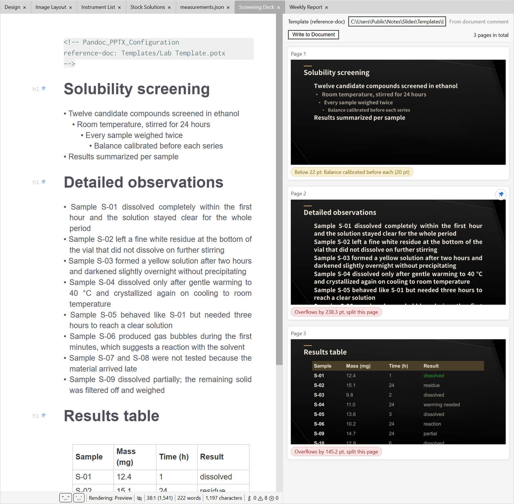

The configuration comment at the top of the source names the template `Templates/Lab Template.potx`; the template field shows its resolved absolute path, the label next to it reads "From document comment", and the status reads "3 pages in total". Page 1 carries the amber badge "Below 22 pt: Balance calibrated before each (20 pt)", and pages 2 and 3 carry the red badges "Overflows by 238.3 pt, split this page" and "Overflows by 145.2 pt, split this page". The pin at the top right of page 2 is shown because the pointer is over that card; the pins next to the first-level headings in the editor are shown while the preview is open.

Click "MD → PPTX" in the toolbar while a Markdown document is active. The editor pane splits: the Markdown source stays on the left, and the preview on the right lists the rendered pages from top to bottom. You can drag the divider between the two; double-click it to return to the initial 55/45 split. Click "MD → PPTX" again to close the preview.

While MD → PPTX is selected for the active document, the toolbar also shows Insert Div, Insert Span, Insert Two Columns, Attributes, Sync Scroll, and Export to PPTX. Closing that document's preview or switching to a document without an open preview hides those six buttons and the export result text. MD → PPTX itself stays available, and Auto Show Code remains a separate editing control. Hiding the buttons preserves the Attributes panel's open state and the Sync Scroll choice.

- The preview belongs to the document. Switching to another document hides it, and switching back shows it again. If the same document is open in two editor panes, both show the preview, and they share one conversion.
- Distraction-free mode hides the preview.
- Open previews are not remembered across restarts: after a restart, all previews are closed.

### What the preview shows

The top of the preview is a row with the template field (see "Choosing a template") and a status text:

| Status | Meaning |
|---|---|
| Starting preview… | The conversion is starting. |
| Updating N pages… | N pages are being converted. |
| N pages in total (or "1 page in total") | All pages are up to date. |
| Conversion failed: … | The conversion could not run; the rest of the message gives the reason. |

Below it, each page of the document has a card labelled "Page N" with its rendered image. When pandoc turns one page of the Markdown into several slides, the card reads "Page N (split into M slides)" and shows all of them. A page whose conversion failed shows the error message in a red box instead of an image, for example a message beginning with "pandoc failed:". Pages are converted in groups, so one failed page can cause the others in its group to show the same error. A page that has never been rendered shows "Generating…". When the document contains nothing that becomes a page, the preview says "The document currently contains no pages to preview."

Two kinds of badges point out layout problems on a page card:

- A red badge "Overflows by X pt, split this page" means text runs past the bottom of the slide; split the page in the Markdown source.
- An amber badge "Below 22 pt: … (X pt)", with an excerpt of the text in place of the ellipsis, means the renderer shrank some text below 22 points.

### When the preview updates

The preview updates about 0.6 seconds after you stop typing; typing itself is never slowed down. Only pages whose Markdown changed are converted again, and changes that touch nothing but blank lines or ordinary HTML comments cause no new conversion at all. While a page is being converted again, its previous image stays visible under a blur with the label "Rendering…".

The preview converts the editor content when the document has unsaved changes, and the file on disk otherwise.

Every rendered page is kept in a cache in the program's data folder, keyed by the page content, the template, and the images the page uses, so returning to an earlier state of a page shows it at once. A page is rendered again when one of the image files it uses changes. When the cache grows beyond 3000 images, the oldest are deleted until 2000 remain.

As a guide, the first opening of a six-page document takes about four seconds, and updating one page about two seconds. The first pages appear before the rest of a long document has finished converting.

### Choosing a template

Slides are rendered against a PowerPoint template (a `.potx` file, which pandoc calls the reference document). Without further action the built-in default template is used. To use another template for one document:

1. Enter the path of the `.potx` file in the "Template (reference-doc)" field at the top of the preview. The path can be absolute or relative to the folder that contains the document.
2. Click "Write to Document". The field's text is written exactly as entered into a configuration comment at the very top of the document. If the comment does not exist yet, it is created.

```markdown
<!-- Pandoc_PPTX_Configuration
reference-doc: Templates/My_Template.potx
-->
```

When the preview converts the document, it resolves a relative path in the comment against the folder that contains the document and uses an absolute path as written. Export to PPTX resolves the comment the same way.

After the preview renders, the field no longer shows the comment text but the absolute path of the template actually in use. For example, if a document in `C:\Users\Public\Notes\Slides` has the comment `reference-doc: Templates/Lab Template.potx`, the field shows `C:\Users\Public\Notes\Slides\Templates\Lab Template.potx`, as in the screenshot under "Opening and closing the preview". If the document names no template, the field shows the path of the default template. The preview does not overwrite the field while you are typing in it.

Because "Write to Document" writes whatever the field holds, clicking it without editing the field replaces a relative path in the comment with the absolute path shown. It also writes the default template's path into a document that has no comment yet. To keep a relative path, type it into the field before clicking, or edit the comment by hand.

To return to the default template, clear the field and click "Write to Document"; this removes the template line, together with the comment when nothing else remains in it. You can also write or edit the comment by hand. Pandoc ignores HTML comments, so the comment never appears on a slide.

Next to the field, a label tells where the template comes from: "From document comment" or "Using default template". When the field is empty, its placeholder reads "Leave empty to use the default template". After clicking "Write to Document", the preview reports one of these messages:

- Written to the top of the document
- The document already uses this template
- The document changed in the meantime; please click again
- Writing failed: …

"The document already uses this template" means clicking would not change the document, so nothing is written. Either the field already holds the path written in the comment, or the field is empty and the document names no template (for example, because it has no configuration comment at all).

If the template named in the document does not exist, no conversion starts, the row at the top of the preview turns red, and the status reads "Conversion failed: The template named in the document could not be found: …", followed by the resolved absolute path. If the default template is missing, the status reads "Conversion failed: Template file not found: …", followed by the path of the default template. Export to PPTX uses the same template as the preview.

### Synchronized scrolling and pins

With MD → PPTX selected for the active document, turn on "Sync Scroll" in the toolbar to scroll the editor and the preview together: scrolling either side moves the other to the matching position. The switch is off when the program starts and applies to all documents at once. Hiding its button by closing a preview or switching documents keeps the choice.

Pins align the two sides once, whether or not Sync Scroll is on:

- Each page card has a pin in its top-right corner, visible on hover, that scrolls the editor so the first line of that page is at the top.
- While the preview is open, each first-level heading in the editor has a pin, "Scroll the PPTX preview to this page", which scrolls the preview to the card of that page.

### Inserting fenced divs, spans, and columns

Select MD → PPTX for the active document to show Insert Div, Insert Span, and Insert Two Columns. "Insert Div" and "Insert Span" open a small dialog below the button, titled "Pandoc Fenced Div" or "Pandoc Bracketed Span". The dialog has three fields: an identifier (`#identifier`), classes (`.classes`), and further attributes (`key=value`). The confirm button "Insert Fenced Div" wraps the selected lines in `::: {…}` and `:::`; "Insert Bracketed Span" wraps the selected text as `[text]{…}`.

"Insert Two Columns" turns the selected lines into a two-column layout for slides:

- The selection is extended to whole lines, and blank lines at its start and end are left out.
- If some selected lines contain nothing but an image, those image lines go into the right column, all other lines into the left column, and the columns get the widths 65% and 35%.
- Without image lines, all lines go into the left column, the columns get 50% each, and the cursor is placed into the empty right column.
- With nothing selected, an empty two-column skeleton is inserted.

The result has this form:

```markdown
:::: {.columns}
::: {.column width="65%"}
Text of the slide
:::
::: {.column width="35%"}

:::
::::
```

"Insert Div" and "Insert Span" can be hidden only through the configuration file (`showPandocDivSpanButton` under `displayToolbarButtons`, on by default); the preferences offer no checkbox for them.

### Editing Pandoc attributes

The renderer reads attributes that control the look of text, images, columns, tables, blocks, and pages. Zettlr-LYH lets you edit them without remembering their syntax, in two places.

The Attributes panel. With MD → PPTX selected for the active document, click "Attributes" in the toolbar to open the "Pandoc Attributes" panel; click it again to close it. The panel works for every Markdown document, and hiding its toolbar button preserves its open state. It shows one section for each object at the cursor or selection that can carry attributes, innermost first. Each section heading names the object in bold, followed in grey by the kind of object, which decides what keys the section offers:

| Section heading | Kind (in grey) | Object |
|---|---|---|
| Text Span | Text | The bracketed span around the cursor or selection |
| Selected Text | Text | A plain selection within one paragraph; applying an attribute wraps it in a bracketed span |
| Image | Image | The image at the cursor |
| Column | Column | The column of a two-column layout around the cursor |
| Table | Table | The table around the cursor, through its `table` directive comment |
| Paragraph, List, Heading, or Table Style | Block | The paragraph, list, heading, or table around the cursor, through its `style` directive comment |
| Page | Page | The slide around the cursor, through its `page` directive comment |

Drag the panel by its title ("Drag to move the panel") to reposition it. It stays where you put it and opens below the button again after you close and reopen it. When nothing at the cursor can carry attributes, the panel reads "Nothing at the cursor has Pandoc attributes to edit." When the selection is plain text, it notes "Applying wraps the selection in a bracketed span."

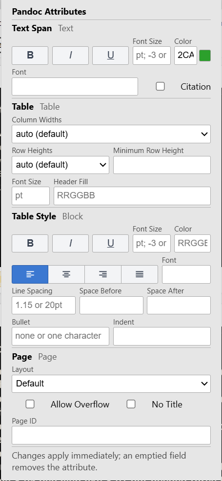

The cursor is inside `[dissolved]{color=2CA02C}` in a table cell, so the panel shows, innermost first, the span (Text), the table (Table), the table's block style (Block), and the page (Page).

Bold, italic, and underline are buttons with three states: Default (neutral; the renderer decides), On (blue), and Off (red and struck through). The tooltip, for example "Bold: Default (click to change)", names the current state, and each click moves to the next. Alignment is a row of four buttons for left, center, right, and justified; the highlighted button is the current value, and left, the renderer's default, is highlighted when nothing is set. Citation, Allow Overflow, and No Title are checkboxes. Keys with a fixed list of values are drop-down lists whose first entry is the renderer's default, shown as "Default" or as the value followed by "(default)", for example "auto (default)"; choosing it removes the key. No Upscale offers Default, Yes, and No. The Column Widths list also has "Custom…", which opens a "Custom" field for point values. Text fields take effect when you press Enter or leave the field, and a color field shows a swatch once it holds six hexadecimal digits. Every change is written into the document at once. Emptying a field removes its key; the note at the bottom of the panel reads "Changes apply immediately; an emptied field removes the attribute."

The Pandoc context-menu section. While the preview of the current document is open, the editor's context menu contains a Pandoc section with one submenu per object at the cursor: "Text Attributes", "Image Attributes", "Column Attributes", "Table Attributes", "Block Style", and "Page Attributes". Each submenu sets single keys directly and ends with "Edit All…" for the full panel.

Attributes are written into the Markdown source in the renderer's syntax. Keys that the editor does not know are left exactly as written. For an image, the panel and the context menu change the first braces directly after the image and never add another set of braces.

| Object | Where the attributes are written | Keys |
|---|---|---|
| Text (selected text or an existing bracketed span) | Braces after the span: `[text]{size=19}` | `size` (font size in points; `-3` or `+2` is relative), `color` (RRGGBB), `bold`, `italic`, `underline` (true/false), `font`, and the class `.citation` |
| Image | Braces after the image: `{w=300pt}` | `w` (width) and `h` (height) in pt, cm, or % of the box; `x` (left) and `y` (top), measured from the page corner; `no-upscale` (true/false) |
| Column | The column's braces: `::: {.column width="55%"}` | `width` (for example 55%) |
| Table | A directive comment before the table: `<!-- table: col-widths=equal -->` | `col-widths` (`auto`, `equal`, `source`, or point values such as `244,144,179`), `row-heights` (`auto` or `equal`), `row-height` (minimum row height), `font-size` (pt), `header-fill` (RRGGBB) |
| Block (the paragraph, list, heading, or table around the cursor) | A directive comment before the block: `<!-- style: … -->` | the text keys `size`, `color`, `bold`, `italic`, `underline`, `font`, plus `line-spacing` (for example 1.15 or 20pt), `space-before`, `space-after`, `align` (left, center, right, justify), `bullet` (none or one character), `indent` |
| Page | A directive comment before the first block of the slide, normally its heading: `<!-- page: … -->` | `layout` (Title Slide, Title and Content, Section Header, Two Content, Comparison, Content with Caption, or Blank), `allow-overflow`, `no-title`, `id` |

### Export to PPTX

Select MD → PPTX for the active Markdown document, then click "Export to PPTX" in the toolbar to convert it into a PowerPoint file. The export button and its result text are visible while that document's preview is open.

1. If the document has unsaved changes, it is saved first. If saving fails, the export stops, and the result text shows "Export cancelled: the document could not be saved" (see "Messages of Export to PPTX"). A note created with Ctrl+N is written only to its file in the unsaved-notes folder, without the "Save file" dialog, so the results of step 3 go into that folder (see "Notes and exports").
2. The external conversion script converts the document, using the template named in the document's configuration comment, or the default template.
3. The results are written next to the document: `<name>.pptx`, and the two companion files `<name>.pptx.style_manifest.json` and `<name>.pptx.slide_ids.json`.

When the document contains tracked changes, both the export and the preview use the text with all changes accepted; the document itself is not changed (see "Tracked changes in exports").
While the export runs, the button reads "Exporting…" and the result text shows "Saving the document…" and then "Exporting PPTX…". Only one export of the same document can run at a time, and an export is stopped after ten minutes. The outcome appears to the right of the button, preceded by the file name, and also becomes the button's tooltip; before the first export the tooltip reads "Save the document, then convert it with the conversion script into a PPTX next to it".

A successful export reports either "Exported `<name>.pptx`: no overflow, no undersized text" or "Exported `<name>.pptx`: N overflow finding(s) (K authorized), M undersized text run(s)". Authorized overflow findings are those on pages marked with `allow-overflow`. Failure messages are listed under "Messages and troubleshooting".

### How the renderer treats the slides

These are visible results of the conversion, in the preview and in exported files alike:

- Inline math `$…$` and display math `$$…$$` become native PowerPoint equations, which you can edit in PowerPoint by double-clicking. Equations always use the font Cambria Math and do not follow the size, color, or font set on a surrounding span. Inside table cells, math stays as TeX text.
- Table column widths follow `col-widths`: `auto` (the default) picks widths that make the table as short as possible; `equal` makes all columns the same width; `source` follows the number of dashes in each column of the Markdown separator row; a comma-separated list sets the widths in points.
- Table row heights follow `row-heights`: `auto` (the default) or `equal`, which makes all rows except the header row the same height. When `row-height` is also given, the larger value applies.
- The indentation of second-level bullet points comes from the template's slide master (its second-level paragraph settings). If a slide layout of the template overrides that setting, change the layout. The indentation of numbered lists is fixed by the renderer and does not follow the template.
- Text that shrinks below 22 points is reported as undersized text; text that runs past the bottom of the slide is reported as overflow, unless the page carries `allow-overflow`.

### Known limitations of the PPTX features

- The preview and the export work on Windows only and require desktop PowerPoint, the Anaconda Python installation at the location the program expects, pandoc, and the external conversion script.
- Preview and Sync Scroll are both off after every restart.
- The Pandoc Extensions settings in the Import and Export section of the preferences ("Mark extension" and "Alerts extension") have no effect on the preview or on Export to PPTX.

## Export to HTML

Export to HTML turns a Markdown document into a single, self-contained HTML file that looks like the document in the editor. As long as all images can be embedded, the file can be shared or opened anywhere without extra files.

### How to start it

- Click the export button in the toolbar (tooltip "Export to HTML") while a Markdown document is active.
- Right-click the tab of a Markdown document and choose "Export to HTML".
- Choose File → "Export to HTML" (below Print) for the active Markdown document.
- In Zettlr's Export… dialog, choose one of the formats HTML, HTML4, or HTML5. The dialog then uses this export and hides its choice of export folder.

No dialog asks for options.

### What it produces

- The file `<name>.html` is written into the folder of the document. If a file of that name already exists and was not produced by this export, the new file is named `<name>__LYH_HTML_<yyyymmdd_hhmmss>.html` instead, so foreign files are never overwritten. An earlier export of the same document is replaced.
- The export uses the document as saved on disk. Save unsaved changes first if they should be included.
- When the preference "Automatically open successfully exported files" is on, the file opens in the default browser. Otherwise it is shown in Windows Explorer.
- When some local images could not be embedded, a warning lists them after the file has been written (see "Images in the HTML file"). If "Automatically open successfully exported files" is also on, the file opens only after you close this warning, so the browser window cannot cover it.

### What the HTML file contains

- Local images are embedded into the file; see "Images in the HTML file" for the exceptions.
- Images are at most as wide and as high as the two "Image size" settings allow, by default as wide as the text column and half as high as the browser window; see "Configuration reference".
- When the document contains math, the math fonts are embedded as well.
- Mermaid diagrams are included as finished drawings. A diagram that cannot be drawn shows "Could not render Graph:" followed by the error.
- Code blocks are syntax-highlighted.
- A single line break inside a paragraph is kept as a line break.
- Task checkboxes are shown but cannot be changed.
- HTML blocks containing scripts are left out.
- Zettelkasten links and tags appear as plain text.
- The YAML front matter is not shown; its `title` becomes the title of the web page.
- The alignment of table columns is kept.
- The text column is at most 47em wide, centered in the window. In a window or on a screen wider than 700 pixels it is justified and has 50 pixels of padding on each side; at 700 pixels and below it is left-aligned and the padding is narrower (see "Reading the HTML file on a phone"). Top-level paragraphs that contain only images are centered at every width.
- Colors, font, font size, and the light or dark appearance follow the theme and settings in use at the time of export. The font size is the editor font size at that moment, including any size set with Ctrl and the mouse wheel, and headings and footnote markers keep their proportions to it (see "Zooming the editor font with Ctrl and the mouse wheel"). In a window or on a screen of at most 700 pixels, this font size is capped at 18 pixels and the whole document scales down with it (see "Reading the HTML file on a phone").
- Bold, italic, and strikethrough next to Chinese, Japanese, or Korean characters appear as they do in the editor; see "Bold, italic, and strikethrough next to Chinese, Japanese, and Korean text".
- While Show Revisions is on, tracked changes appear in color with a tooltip naming the author and time; while it is off, the file contains the text with all changes accepted. See "Tracked changes in exports".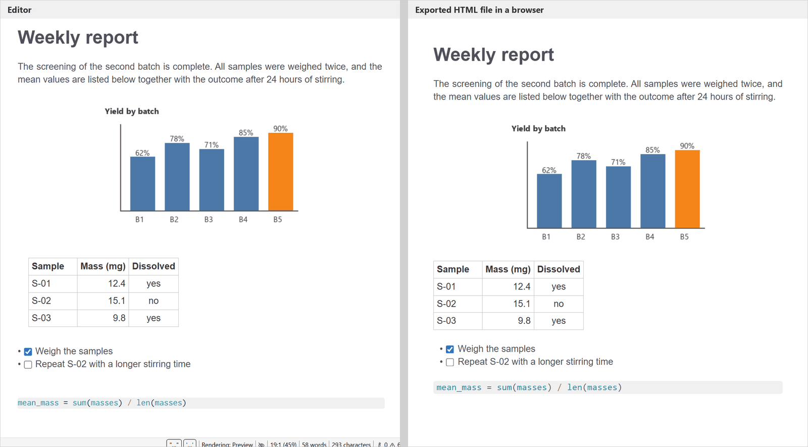

Left: the document in the editor. Right: the exported file opened in a browser, with the same justified paragraph, centered chart, right-aligned and centered table columns, task checkboxes, and highlighted code.

### Reading the HTML file on a phone

The same exported file works in both computer and phone browsers. It adapts to the width of the window or screen, so nothing has to be chosen at export time, and a file exported long ago adapts just as well.

- In a window or on a screen of at most 700 pixels, the font size is capped at 18 pixels. A document exported while the editor font was larger (for example 28 pixels after zooming with Ctrl and the mouse wheel) is shown at 18 pixels on a phone, and headings, line height, and spacing between blocks shrink in the same proportion, so the page keeps the look it has on a computer. A document exported with an editor font smaller than 18 pixels keeps its own size; the cap never enlarges anything.
- At the same width, body text is left-aligned instead of justified. This covers paragraphs, list items, block quotes, definition lists, and the footnotes at the end of the file, so that short lines are not stretched into wide gaps between words. Paragraphs that contain only an image stay centered.
- At the same width, the smallest width a table cell may have drops from 96 to 64 pixels, so that a table of a few narrow columns fits on the screen instead of requiring sideways scrolling.
- In a window or on a screen of at most 480 pixels, the space to the left and right of the text is narrowed once more, leaving more of the screen to the text itself.
- Phone browsers do not enlarge the text on their own. Safari on iOS, in particular, keeps the font size when the phone is turned from portrait to landscape and back.
- A table, a code block, a raw HTML block, or a displayed formula that is too wide for the screen scrolls sideways inside its own frame, while the page as a whole is never wider than the screen. On a touchscreen, scrolling such a frame to its left or right end does not trigger the browser's own back gesture.
- In a window wider than 700 pixels nothing changes: the file still uses the font size it was exported with, justified text, table cells of at least 96 pixels, and 50 pixels of padding on each side. A tablet held in landscape is usually wider than 700 pixels and therefore looks the same as on a computer.


Left: the exported file in a phone-sized window, with the font capped at 18 pixels, the paragraph left-aligned, and a three-column table fitting on the screen. Right: the same file in a computer window, with the exported font size, justified text, and wider table cells.

### Images in the HTML file

Local images (files stored on your computer) are embedded into the HTML file, so it can display them without the original image files. Images with a web address are left as links and loaded from the web when the file is opened.

A local image that cannot be embedded is linked instead. This happens when the image file does not exist, cannot be read, or has an extension other than png, jpg, jpeg, gif, webp, svg, bmp, ico, avif, tif, or tiff. The link is the image's path relative to the HTML file's folder, which is always the document's folder. For example, when the document is in `Manuscript` and the image `Fig 1#a.svg` is in the neighboring folder `Figures`, the link reads `../Figures/Fig%201%23a.svg`.

In such a link, only characters that would break it are percent-encoded: the percent sign, `#`, `?`, `&`, quotation marks and apostrophes, angle brackets, the backtick, the colon, spaces and other whitespace, and control characters. All other characters, including Chinese and other non-Latin letters, are kept as they are, so the path stays readable in the HTML source.

When the image is on a different drive from the HTML file, or one of the two is on a network share, no relative path exists. The image is then linked by its absolute file address (`file:///…`).

When at least one local image could not be embedded, the HTML file is still written, and a warning titled "Export to HTML" appears afterwards. If one image failed, the message reads "1 image could not be embedded into the HTML file"; if several failed, it reads "N images could not be embedded into the HTML file". The details say the HTML file was written but that the listed images could not be read, so they will be missing if the HTML file is opened elsewhere or uploaded on its own. Below the message is one line per image: its path relative to the document's folder, written with forward slashes and without percent-encoding, and the reason in parentheses. When no relative path exists, the line shows the image's absolute path instead. An image referenced several times is listed once. The only button is Ok.

For example, when the document is in `Manuscript` and the image `Figure 1.png` is missing from the neighboring folder `Figures`, the warning shows the line `• ../Figures/Figure 1.png (file not found)`, while the link in the HTML file reads `../Figures/Figure%201.png`.

| Reason | Meaning and remedy |
|---|---|
| file not found | No file exists at the referenced path. Correct the path in the document, or put the image back, and export again. |
| unsupported image format | The file's extension is not one of those listed above, so the image cannot be embedded. This reason is shown even when the file does not exist. Convert the image to one of the listed formats and export again. |
| file could not be read | The file exists, but reading it failed. Check that the file can be opened, then export again. |

The warning lists at most 20 images. Any remaining ones are summarized in a last line "…and N more (see the log for the full list)". The program's log names every image that could not be embedded, using its original image address rather than the path shown in the warning, and records after each export the number of embedded and linked images.

[Manual pending] A screenshot of the warning that lists the images which could not be embedded is missing; producing it needs a running copy of the program, which this update could not start.

Known limitations:

- The export reads the saved file, so unsaved changes are not included.
- An image that could not be embedded is only linked, so the HTML file shows it only while the image file exists at the linked location. Moving the HTML file to another folder, or sending it on its own, breaks relative links.
- The warning lists at most 20 images that could not be embedded. The complete list is only in the program's log.
- The reason in the warning is determined after the file has been written. If an image is moved, deleted, or changed while the export runs, the reason shown may differ from the actual cause of the failure.
- Images with a web address are not checked. The warning never mentions them, even when they cannot be loaded.
- When the exported file cannot be opened, the problem is written to the program's log and is not shown as a message.

## JEV Search

JEV Search finds passages in the current document, a Markdown file, a file opened as code, or a PDF file, that match a description written in ordinary language. It divides the document into chunks, asks the Jev model of the online service TypeSafe how likely each chunk is to match the description, and lists the chunks that reach 30% confidence, most likely first. Resting the pointer on a hit scrolls the editor to that passage and highlights it as a preview; clicking the hit keeps it highlighted.

JEV Search needs an internet connection and a TypeSafe API key. The text of the document and the description are sent to TypeSafe's servers, and TypeSafe charges for the amount of text it judges. Do not use JEV Search on documents whose text must not leave your computer.

[Manual pending] Screenshots of the JEV Search panel showing a list of hits, a selected hit, and the matching passage highlighted across only the screen lines it touches, with a continuous block of shading and an amber bar on its left, are missing. A screenshot of a hit marked "Changed since the search" is also missing. The screenshots taken during testing show a sample document with test markers and are not suitable for the manual.

### Setting up the API key

Enter your TypeSafe API key under Preferences → Advanced, in the group "JEV Search" (between "Iframe rendering whitelist" and "Watchdog polling"), in the field "TypeSafe API key". The group description reads "The JEV Search sidebar asks the TypeSafe Jev model which parts of the active document match a search description."; the note below the field reads "If empty, the TYPESAFE_API_KEY environment variable is used. The key is stored in plain text in the Zettlr configuration file."

- The key is shown in plain text in the field and stored in plain text in `config.json`.
- Leading and trailing spaces are ignored. If the field is empty or holds only spaces, the environment variable `TYPESAFE_API_KEY` is used instead. Set the environment variable before you start the program; a variable set while the program is running will not be seen.
- The key is read fresh for every search, so a changed key takes effect at the next search without a restart.
- If no key exists in either place, nothing is sent. The panel shows "No TypeSafe API key. Enter it in Preferences → Advanced → JEV Search, or set the TYPESAFE_API_KEY environment variable."

[Manual pending] A screenshot of the group "JEV Search" under Preferences → Advanced is missing; this update did not run the program to take it.

### Opening and closing the panel

Click "JEV Search" at the right end of the toolbar, directly left of "Toggle Sidebar". A panel about 340 pixels wide appears to the right of the editor (to the left of the sidebar, when the sidebar is open), and the editor becomes narrower. Click the button again to close the panel; the editor returns to its full width. The button is green while the panel is open.

- In distraction-free mode the panel is hidden. It returns when you leave distraction-free mode.
- Each window has its own panel. The panel is closed every time the program starts.
- Closing the panel removes the highlight from the editor but does not cancel a running search.

### Running a search

1. Make the document you want to search the active tab of the editor pane you used last. JEV Search works on Markdown files, on files the program opens as code (such as JSON or YAML), and on PDF files shown in the PDF viewer (see "Searching a PDF"). It cannot search images or other file types.
2. Type what you are looking for into the field "Describe what you are looking for".
3. Click "Search", or press Ctrl+Enter (Cmd+Enter on macOS) in the description field. "Search" is disabled while the description is empty or the active file cannot be searched.

The search covers the entire text of the document as it appears in the editor, including unsaved changes. While it runs, the status line reads "Reading the document…" and then "Judging batch N of M…", and "Search" turns into "Cancel". When the search finishes, the status line gives a summary such as "7 hits in 85 chunks".

- "Cancel" stops the search. The status line reads "Search cancelled.", and the list area reads "No results. Press Search to try again."
- A new search of the same document replaces the results of the previous one.
- If the document contains nothing but blank space, the status line reads "The document contains no text to search."
- If any part of the search fails, the panel shows only the error message, in red, and no partial list; the list area reads "No results. Press Search to try again." The messages are listed under "Messages of JEV Search". When you search again, chunks that were already judged are not sent again (see "How long results are kept").
- When TypeSafe reports that too many requests are arriving or that it is overloaded, the program waits 2, 4, 8, and 16 seconds and tries again, at most four times, before showing an error. Each request is abandoned after 120 seconds without an answer.

The description field keeps its text when you close the panel or switch to another tab. All documents share the same description.

The field "Max characters per chunk" sets the largest chunk size in characters (see the next section). It accepts whole numbers from 200 to 8000, and its arrows change the value in steps of 100. A value outside that range is clamped to the nearest limit, a fraction is rounded to a whole number, and an entry that is not a number returns to 1000, the default. Smaller chunks point to shorter passages; larger chunks give fewer and longer hits. The value applies to every document and is kept across restarts.

### How the document is divided into chunks

- Paragraphs separated by blank lines are joined into one chunk as long as the chunk, measured in the original text from its first to its last character, stays within "Max characters per chunk".
- Every heading written with `#` signs begins a new chunk. The text below the heading can join its chunk.
- A fenced code block and the YAML front matter at the start of the document each count as one paragraph, even when they contain blank lines.
- A paragraph longer than the limit is cut at sentence ends and at line breaks. A sentence ends after `。`, `！`, `？`, or `；`, or after `.`, `!`, `?`, or `;` followed by a space or the end of the line. Closing quotation marks and brackets directly after the end of a sentence stay with that sentence. A single sentence still longer than the limit is cut at the limit.
- Parts that contain only blank space do not form chunks.

### The list of hits

Above the list, "Results for: …" names the description the results belong to; a long description is shortened with an ellipsis. Each hit shows:

- the confidence that the chunk matches the description, such as "93%";
- "Line N", the line where the chunk begins, or, in a PDF, "p. N", the page of the chunk;
- about the first 200 characters of the chunk, with line breaks and runs of spaces shown as single spaces and an ellipsis when the chunk is longer. Markdown marks such as `##` are shown as written.

Only chunks with at least 30% confidence are listed. They are sorted by confidence, highest first; hits of equal confidence keep their order in the document.

When there is nothing to list, the list area says why:

| Text | Situation |
|---|---|
| Open a document to search it. | No file is open in the editor pane you used last. |
| JEV Search works on Markdown, code and PDF files. | The active file is of another type, such as an image. |
| This PDF has no text layer. Run OCR first. | The active PDF contains no text, as with a scanned PDF that has not been processed by text recognition (OCR). Nothing is sent to TypeSafe. |
| No results for this document yet. Describe what you are looking for and press Search. | The document has not been searched in this window since the program started. |
| The hits will appear here when the search is done. | A search is running. |
| No results. Press Search to try again. | The last search was cancelled or failed. |
| No passage reached 30% confidence. | The search finished, but no chunk reached 30% confidence. |

### Going to a hit

A hit can appear in the editor in two ways: resting the pointer on it previews the passage, and clicking it selects the hit.

To preview a hit, rest the pointer on it for about 120 milliseconds. The editor scrolls the passage to the middle of the view and highlights it, but the hit is not selected. Moving the pointer to another hit previews that one after the same short pause; passing quickly over a hit previews nothing. Moving from one hit to another does not count as leaving the list.

When the pointer leaves the list of hits after a preview:

- If a hit is selected, the highlight returns to that hit. The editor does not scroll, so the passage you previewed stays in view and you can go on reading it.
- If no hit is selected, the highlight disappears.

To select a hit, click it, or move to it with Tab and press Enter or Space. The editor scrolls the passage to the middle of the view and highlights it. The selected hit is tinted amber in the list, with an amber bar on its left, and the highlight stays on it after the pointer leaves the list. Only one hit can be selected at a time.

The highlighted passage is shaded across the full width of the screen lines its text touches. Those lines form a continuous block of even width without gaps between them, like paragraph shading in a word processor. If a hit covers only part of a long paragraph, the other screen lines of that paragraph are left unshaded. The first and last shaded screen lines are still shaded across their full width, even when the hit starts or ends partway through them. The shading is a very light warm grey (RGB 246, 246, 240) in the light theme and a faint, translucent warm white in the dark theme; in both themes an amber bar runs down the left edge of the block. If the passage is taller than the view, its beginning is shown. Only one passage is highlighted at a time. Neither a preview nor a selection moves the cursor or puts keyboard focus into the editor.

Before highlighting, for a preview as well as for a selection, the program looks for the passage in the current text of the document, including unsaved changes:

- If the passage is unchanged, it is highlighted where it is.
- If the passage moved because text before it was edited, the nearest place with the same text is highlighted, and "Line N" of the hit is updated.
- If the text of the passage itself was changed, the hit turns grey and is marked "Changed since the search", and the status line reads "This passage has changed since the search. Search again to update the results." If this was the selected hit, it is no longer selected and its highlight disappears. If the text is restored later, previewing or clicking the hit works again. The message in the status line disappears as soon as a hit is highlighted successfully.

The highlight appears only while the searched document is the active tab of the editor pane you used last. Pressing the mouse button in an editor pane, for example to place the cursor, removes the highlight and clears the selection of the hit. Pressing on the editor's scrollbar does not, so you can scroll through the document while the passage stays highlighted. The highlight is also removed when you start a new search, close the panel, enter distraction-free mode, or switch to another tab; switching tabs also clears the selection. After you switch back, the list is still there; rest the pointer on the hit or click it again to highlight it.

In formatted conversation history, a hit reveals the blocks that overlap its source lines, expanding folded content. In an ordinary formatted JSON Lines file, the hit highlights the corresponding records. A single-value JSON data view cannot map the hit back to its data outline; switch that file to "Raw Text (Editable)" to see the highlight (see "JSON and JSON Lines files").

### Searching a PDF

When the active tab shows a PDF file in the PDF viewer (see "PDF files"), JEV Search searches the PDF's text. The search works as it does for a Markdown file, with these differences:

- Before judging, the panel reads the PDF's text page by page. The status line reads "Reading the PDF…", then "Reading page X of Y…", then "Judging batch N of M…". Switching to another tab while the pages are being read stops the search, and the status line reads "Stopped reading the PDF because another tab became active. Press Search to start again." "Cancel" also stops the reading. If the PDF cannot be read, the status line shows "Could not read this PDF: " followed by the reason, in red.
- Each page is divided into chunks on its own, following the same paragraph and sentence rules as a Markdown document and the same "Max characters per chunk"; a chunk never spans two pages. A word divided by a hyphen at the end of a line is joined again in a hit's preview text.
- Each hit shows "p. N" instead of "Line N", where N is the page label that the PDF defines for the page, such as "iv" or "12", or the page number when the PDF defines none.
- Resting the pointer on a hit to preview it, clicking a hit to select it, and returning to the selected hit when the pointer leaves the list all work as they do for a Markdown file, but act on the PDF viewer: the viewer goes to the page and highlights the hit's text with its first line in the vertical middle of the view. Pressing the mouse button in the pages of the PDF clears the hit selection.
- A PDF without a text layer, such as a scanned PDF that has not been processed by text recognition (OCR), cannot be searched. The list area reads "This PDF has no text layer. Run OCR first.", and nothing is sent to TypeSafe.

The text read from a PDF is kept in memory for the three most recently searched PDF files, so a new search of the same file with a different description starts judging at once. When the file changes on disk, its pages are read again.

### How long results are kept

- Results are kept separately for each document. They remain when you close and reopen the panel, or when you switch to another tab and back.
- The program remembers the confidence of every chunk it has judged, together with the description it was judged against, until the program quits. A chunk with the same text and the same description is not sent to TypeSafe again, in any document and in any window. At most 100,000 such results are remembered; beyond that, the oldest are forgotten first. Within one request, chunks with identical text are sent only once.
- Changing "Max characters per chunk" changes the chunks, so the next search sends them again.
- After a restart, the results, the description, and the remembered confidences are gone, and every search is sent and charged again. "Max characters per chunk" and the API key are kept.

### Known limitations of JEV Search

- Only the active document of the editor pane you used last can be searched, and only if it is a Markdown file, a file opened as code, or a PDF file shown in the PDF viewer.
- In a PDF, a chunk never spans two pages, so a paragraph that continues on the next page is judged as two separate chunks.
- Hits in a PDF are not checked against changes of the file: they are never marked "Changed since the search". After a PDF has been replaced by another version, search it again.
- A PDF without a text layer cannot be searched.
- The text of the document and the description are sent to TypeSafe and charged by TypeSafe. Searching again after a restart is charged again.
- The list may contain passages that are only loosely related to the description, sometimes with high confidence. The most relevant passages are usually at the top.
- The 30% threshold cannot be changed.
- If any part of a search fails, no partial results are shown.
- Closing the panel does not cancel a running search.
- Switching to another tab or clicking in an editor pane removes the highlight and the hit selection. A single-value JSON data outline cannot show the highlight; formatted JSON Lines records and conversation history can.
- A preview scrolls the editor, but the editor does not scroll back when the pointer leaves the list.
- The shading covers whole screen lines touched by the hit. If the hit starts or ends partway through a screen line, the rest of that screen line is shaded too; the highlight does not mark the exact first or last character. Other screen lines of the same long paragraph are left unshaded.
- Tables and other content that the editor renders as a block are not shaded.
- In a code block, the block's own grey background may cover the shading, leaving only the amber bar on the left visible.
- The API key is shown and stored in plain text.
- When TypeSafe limits the rate of requests or is overloaded, a search can wait up to 30 seconds for retries, on top of up to 120 seconds for each request.

## Configuration reference

### Defaults that differ from Zettlr

| Setting | Where | Zettlr-LYH default | Zettlr default | Effect |
|---|---|---|---|---|
| File name display (`fileNameDisplay`) | Preferences → File Manager | "Filename only" (`filename`) | Title and first heading (`title+heading`) | Tabs, the file manager, and the window title show file names. |
| Autosave (`editor.autoSave`) | Preferences → General | "After a short delay" (`delayed`) | "Never" (`off`) | Documents are saved about five seconds after an edit. |
| Shortcut of "Filter files" (`shortcuts.ui.filter-files`) | Preferences → Shortcuts → "Filter files" | Ctrl+Shift+E (Cmd+Shift+E on macOS) | Ctrl+Shift+T (Cmd+Shift+T on macOS) | Moves the keyboard focus to the filter field above the file manager. Ctrl+Shift+T reopens closed tabs instead. A shortcut you set yourself is kept. |

### Settings added by this branch

| Setting | Where | Default | Effect |
|---|---|---|---|
| Auto Show Code (`display.editCodeWhenClicked`) | Toolbar and Preferences → Editor → "Auto Show Code" | Off | Shows source when a cursor or selection touches a rendered element. The two controls share a saved setting. See "Showing Markdown source while editing". |
| Source-entry exceptions (`display.codeEditingExceptions`) | Preferences → Editor → "Auto Show Code" | Math, Inline code, and Checkboxes in lists and tables on; all other types off | With the main switch off, enabled types reveal source only when the cursor or moving selection end is inside them. The complete list is in "Showing Markdown source while editing". |
| Rendered-element copying (`display.copyVisibleTextCategories`) | Preferences → Editor → "Copy rendered elements" | Inline code, Headings, Bold, Italic, and Code blocks on; Lists, Math, and Images off | Copies selected visible content of one enabled hidden-syntax object; mixed selections keep Markdown. Math copies LaTeX and Images copies PNG data when enabled. See "Copying rendered elements". |
| Folder for unsaved notes created with Ctrl+N (`scratchNotesDirectory`) | Preferences → General → "Unsaved notes" | The folder `Zettlr_Unsaved` in the Documents folder, written as a full path at the first start | The folder in which Ctrl+N creates notes and from which notes are reopened at startup. An empty value means the default folder. See "The folder for unsaved notes". |
| Shortcut of "Reopen Closed Tab" (`shortcuts.ui.reopen-closed-tab`) | Preferences → Shortcuts → "Reopen Closed Tab" | Ctrl+Shift+T (Cmd+Shift+T on macOS); the configuration file stores an empty value, which means this default | Reopens the most recently closed tab. See "Reopening a closed tab". |
| TypeSafe API key (`jevSearch.apiKey`) | Preferences → Advanced → "JEV Search" → "TypeSafe API key" | Empty | The key that JEV Search sends to TypeSafe. When empty, the environment variable `TYPESAFE_API_KEY` is used. Stored in plain text. See "Setting up the API key". |
| Max characters per chunk (`jevSearch.maxChunkCharacters`) | The JEV Search panel → "Max characters per chunk" | 1000 | The largest size of a chunk in JEV Search, from 200 to 8000 characters. See "Running a search" and "How the document is divided into chunks". |
| Show headings (`window.tocMaxHeadingLevel`) | Right sidebar → Outline | Level 6 (all) | Shows headings up to the chosen level, from 1 to 6, for all documents. Saved across restarts. See "The document outline". |
| Wrap Headings (`window.tocWrapHeadings`) | Right sidebar → Outline | On | Wraps long titles; off shows one line with an ellipsis and a complete-title tooltip. Saved across restarts. |
| Editor margins (`display.editorMarginSingle`, `display.editorMarginSplit`) | Toolbar → "Margin", by dragging only | 50 pixels each | The left and right margins of the text in Markdown editors, one value for a single pane and one for two or more panes, from 0 to 2000 pixels. See "Adjusting the editor margins". |
| Track changes (`editor.trackChanges`) | Toolbar → "Track Changes" and Preferences → Editor → "Track changes" → "Track changes" | Off | Records insertions and deletions as tracked changes with the author name. The two controls share a saved setting that applies to all editors. See "Tracking changes". |
| Show revisions (`display.showRevisions`) | Toolbar → "Show Revisions" and Preferences → Editor → "Track changes" → "Show revisions" | On | Shows tracked changes in color; when off, the editor and Export to HTML show the text with all changes accepted. See "How tracked changes are shown". |
| Revision author (`editor.revisionAuthor`) | Preferences → Editor → "Track changes" → "Revision author", or the dialog that Track Changes opens | Empty | The author name recorded with every tracked change. While empty, the toolbar button asks for it and suggests your account name, and changes recorded in the meantime carry "Unknown author". |
| Indentation of blockquotes (`display.blockquoteIndent`) | Preferences → Editor → "Blockquotes" → "Indentation on each side (in em)" | 2 | How far rendered blockquotes are indented on each side, from 0 to 10 em. See "Blockquotes". |
| Background of blockquotes in light mode (`display.blockquoteBackgroundLight`, `display.blockquoteBackgroundLightTransparent`) | Preferences → Editor → "Blockquotes" → "Background color" → "Light mode" | `#f3f3f3`, "Transparent" off | The background color of rendered blockquotes in light mode, or no background when "Transparent" is ticked. See "Blockquotes". |
| Background of blockquotes in dark mode (`display.blockquoteBackgroundDark`, `display.blockquoteBackgroundDarkTransparent`) | Preferences → Editor → "Blockquotes" → "Background color" → "Dark mode" | `#2b2b2b`, "Transparent" off | The background color of rendered blockquotes in dark mode, or no background when "Transparent" is ticked. See "Blockquotes". |

### Other settings that affect the features of this branch

These settings keep Zettlr's defaults.

| Setting | Where | Effect in Zettlr-LYH |
|---|---|---|
| Render pandoc divs and spans (`display.renderPandoc`), on | Preferences | Also switches the rendering of HTML blocks, inline HTML elements, and inline formatting tags. |
| Render images (`display.renderImages`) | Preferences | Also switches the centering of lines that contain only images, and whether a rendered image can be selected with a click and resized by dragging. |
| Showing syntax when the cursor is adjacent (`display.previewModeShowSyntaxWhenCursorIsAdjacent`) | Preferences → Editor → "Markdown rendering" | With Auto Show Code on, decides whether a cursor beside an element reveals its source, including images and their attributes. Exception mode requires the moving selection end to be inside the element. |
| "Restrict width to N %" (`display.imageWidth`), 100, and "Restrict height to N %" (`display.imageHeight`), 50 | Preferences → Editor → "Image size" | Apply only to Export to HTML: images in the exported file are at most N% of the text column wide and at most N% of the browser window high. A width of 0 counts as 100, and a height of 0 or 100 sets no height limit. They have no effect on images in the editor, although the description of the section reads "Restrict images to a percentage of the available editor width and height." |
| Show Markdown file extensions (`display.markdownFileExtensions`), off | Preferences | Whether file names in tabs and the file manager carry their extension. |
| Always load remote changes to the current file (`alwaysReloadFiles`) | Preferences | When on, files changed on disk are reloaded without asking unless the editor holds unsaved changes. |
| Automatically open successfully exported files (`export.autoOpenExportedFiles`) | Preferences | Decides whether an HTML export opens in the browser or is shown in Windows Explorer. |
| Pandoc Extensions: "Mark extension" (`export.forceEnableExtensions.mark`) and "Alerts extension" (`export.forceEnableExtensions.alerts`), both on | Preferences → Import and Export | Have no effect on the PPTX preview, Export to PPTX, or Export to HTML, including when an HTML format is chosen in Zettlr's Export… dialog. The other exports of the Export… dialog use them as in Zettlr. |
| `showPandocDivSpanButton` under `displayToolbarButtons`, on | Configuration file only | Shows or hides "Insert Div" and "Insert Span". |
| "Display Pomodoro timer" (`displayToolbarButtons.showPomodoroButton`), on | Preferences → Appearance → Toolbar buttons | Has no effect: the toolbar has no Pomodoro timer. See "The toolbar". |
| Font size (`editor.fontSize`), 18 | Preferences → Editor → "Font size" | Is also changed by holding Ctrl and turning the mouse wheel over the editor, within 8 to 72 pixels, and sets the font size of files made with Export to HTML. See "Zooming the editor font with Ctrl and the mouse wheel". |
| Zoom behavior (`system.zoomBehavior`), "Resizes the whole GUI" (`gui`) | Preferences → Advanced | Decides whether View → "Zoom in" and "Zoom out" scale the whole window or change the editor font size. It has no influence on zooming with Ctrl and the mouse wheel. |
| Open PDF files with (`files.pdf.openWith`), "System default" (`system`) | Preferences → Advanced → "PDF documents" | Only with "Zettlr" do PDF files open in the PDF viewer of Zettlr-LYH, and only then does a Ctrl+click on a link to a PDF go to the linked place. See "Opening PDF files in Zettlr-LYH". |
| Render emphasis (`display.renderEmphasis`), on | Preferences → Editor | Also decides whether blockquotes are shown with the bar, the indentation, and the background set under "Blockquotes". See "Blockquotes". |
| Render admonitions (`display.renderAdmonitions`), on | Preferences → Editor | Also decides whether quotes copied from a PDF are shown with a colored bar and a hidden `[!PDF\|<color>]` marker. See "PDF quotes in the editor". |
| Check for updates (`system.checkForUpdates`), on, and beta releases (`checkForBeta`), off | Configuration file only | Have no effect: Zettlr-LYH does not check for updates. See "Updates". |

### What is remembered across restarts

- The Sync Scroll switch and the set of documents with an open PPTX preview are reset at every start.
- The tabs restored at startup are added to the Files history, so their files appear in the Files section.
- The eye buttons in the Files history and the choice between the formatted and raw view of JSON files are remembered.
- Show headings and Wrap Headings are saved for all documents. Conversation reading positions and expansion states last only while the window runs.
- Notes created with Ctrl+N that were open when the program quit return with the restored session, and notes left in the folder for unsaved notes are reopened at every start.
- The editor remembers font size, including any size set with Ctrl and the mouse wheel.
- The two editor margins set with "Margin", for a single pane and for split panes, are saved.
- Track Changes, Show Revisions, and the revision author are saved.
- Auto Show Code and every source-entry exception are saved. Configuration files missing these settings receive the defaults while keeping the other display choices.
- The list of closed tabs that Ctrl+Shift+T reopens is empty after every start, and a note restored from the cache no longer knows where its original file was.
- The JEV Search panel is closed at every start. Its results, description, and previously judged confidences are lost. "Max characters per chunk" and the TypeSafe API key are kept.
- The PDF viewer remembers the page and zoom of the 200 most recently used PDF files. It also remembers the quote color, the Auto-copy switch, and whether passages quoted in your notes are shaded.
- The size of the Windows dialog and the widths of its columns are remembered, one setting shared by all main windows.

## Messages and troubleshooting

### Notices and the error log

Unexpected errors that occur while the program runs are recorded silently; no dialog interrupts your work. This applies to:

- errors in a window that nothing in the program handled, including "ResizeObserver loop completed with undelivered notifications.";
- the same kinds of errors in the background part of the program. Electron's dialog "A JavaScript error occurred in the main process" does not appear, and the program keeps running;
- a window whose content crashed.

Each error is written as a line to the daily log, which Help → View logs opens. Errors reported by a window start with `[Runtime Error]`. Each error is also written to the error log `runtime-errors\runtime-errors.jsonl` in the data folder. For the running instance that is `resources\test-cfg\runtime-errors\runtime-errors.jsonl` inside the repository folder. The folder is created when the first error is recorded. The program keeps only the 30 newest daily logs but never deletes the error log. When the same error repeats within one run, only its first 50 occurrences are recorded, followed by one line saying that further occurrences are not recorded. When the error log is larger than 5 MB, the program stops adding to it and writes a warning starting with `[Runtime Error Log]` to the daily log; recording resumes once the file is smaller again.

These errors do not show a full-window development error overlay either. Compilation errors and warnings can still appear in that overlay. On Windows, this error page starts below the window's title controls, so its Dismiss button remains accessible. In full-screen mode, it starts at the top of the screen. Dismiss closes only the error page; it does not close Zettlr-LYH or fix the reported error.

A dialog still appears when an operation you started did not complete. Its title is "Zettlr", its text is the message itself, and it has one OK button. These messages are:

- "Could not save Auto Show Code. The setting was not changed."
- "Could not save Track Changes. The setting was not changed."
- "Could not save Show Revisions. The setting was not changed."
- "Could not save the revision author or Track Changes. Track Changes was not turned on."
- "Could not save the margin. The setting was not changed."
- the messages of a failed image copy (see "Copying rendered elements").

The same message opens a dialog at most once per program run, and only one such dialog is open at a time. Every occurrence, whether shown or not, is written to the daily log as a warning; these messages are not written to the error log. Dismissing the dialog does not repeat the operation.
"Could not save Auto Show Code. The setting was not changed." means the toolbar could not confirm the requested saved value. Its button reflects the actual saved setting. Check the log for details before trying again.

"Could not save the margin. The setting was not changed." means the margin chosen by dragging "Margin" could not be saved. The editors return to the previously saved margin. The message also appears when the program has been updated but not quit completely and started again since; restart it and drag again.

### Messages of Export to PPTX

Each message appears in the result text next to "Export to PPTX", preceded by the file name.

| Message | Meaning and remedy |
|---|---|
| Export failed: The conversion script was not found at … | The external conversion script is not installed at the expected place, whose path ends the message. Install it there. |
| Export failed: The template named in the document was not found: … | The configuration comment names a template that does not exist; the message ends with the resolved path. Correct the path or clear it with "Write to Document". |
| Export failed: Could not start Python: … | The Anaconda Python installation the program expects is missing or cannot start. |
| Export failed: An export of this document is already running | Wait until the running export finishes. |
| Export failed: The conversion script took too long and was stopped | The conversion ran longer than ten minutes. |
| Export failed: pandoc failed (exit code N): … | pandoc rejected the document; the first line of its error follows. |
| Export failed: The conversion script failed: … | The conversion script stopped with an error; its last output line follows. |
| Export failed: The conversion script exited with code N | The conversion script ended with an error but gave no message. |
| Export cancelled: the document could not be saved | Saving the document before the export failed, so nothing was exported. |
| Export failed: the export command did not answer; see the log | The export did not report back; the program's log has the details. |

### Messages of the PPTX preview

| Message | Meaning and remedy |
|---|---|
| Conversion failed: … | The preview could not convert the document. Check that PowerPoint, Python, and pandoc are installed as required. |
| Conversion failed: The template named in the document could not be found: … | The configuration comment names a template that does not exist at the resolved absolute path that ends the message; no conversion starts. |
| Conversion failed: Template file not found: … | The default template is missing from its fixed location, whose path ends the message; restore it there. |
| Conversion failed: Could not read the document: … | The preview could not get the text of the document, for example because the file no longer exists at its path or cannot be read; the reason follows, and no page is converted. Check that the file is still in place. The preview tries again at the next change to the document, or when you close and reopen the preview. |
| Conversion failed: The preview worker could not be started: … | The Python process that renders the preview could not start, ended before it reported that it was ready, or did not report ready within two minutes; the reason follows. "Could not start the worker process: …" points to the Python installation at the location the program expects. "The worker process exited before becoming ready (code N)" means that the worker script stopped while loading, which happens when the `pywin32` or `python-pptx` package or the external conversion script cannot be loaded; the program's log records the error output of the worker. Check the items under "Additional requirements for the PPTX features". The next update of the preview starts the worker again. |
| An error message in a red box in place of a page image | The conversion of this page, or of another page converted together with it, failed; the message gives the reason. Check the Markdown of the pages concerned. |
| Overflows by X pt, split this page | The text of the page runs past the slide; split the page. |
| Below 22 pt: … (X pt) | Text on this page was shrunk below 22 points. |

### Messages of Export to HTML

| Message | Meaning and remedy |
|---|---|
| 1 image could not be embedded into the HTML file (or "N images could not be embedded into the HTML file") | The HTML file was written, but the local images listed in the warning are not embedded in it; they appear only while their image files stay at the linked locations. Each line names the reason; see "Images in the HTML file" for the meaning and remedy of each reason. |

### Dialogs about unsaved changes and changes on disk

| Dialog | Meaning |
|---|---|
| Unsaved Changes Found | The cache holds unsaved changes of a file being opened that differ from the file on disk, either from the last session or from a tab closed without saving. Choose "Open the Version With Unsaved Changes" or "Open the File From Disk"; see "The cache of unsaved changes". |
| Unsaved changes (with Save, Don't Save, Cancel, Keep All, and Discard All Changes) | "Close window(s)" in the Windows dialog is closing several files, and the file named below the question has unsaved changes. See "Managing open documents with the Windows dialog". |
| File Modified on Disk | Another program changed a file that has unsaved changes in the editor. The change was noticed as it happened, before a save, or when the file was opened again. Choose one of the four buttons Back Up and Load from Disk, Compare and Merge…, Discard Changes and Load from Disk, and Keep Editor Contents; see "When a file changes on disk" and "Checks before saving and when a file is opened again". |
| File changed on disk | Another program changed a file that has no unsaved changes in the editor, and "Always load remote changes to the current file" is off. "Keep editor contents" keeps the editor content, and the next save overwrites the version on disk; "Load changes from disk" loads the version on disk. See "When a file changes on disk". |
| Could Not Write Backup File | The backup of the editor content could not be written, so the version on disk was not loaded. |
| Could not apply the merged result. Your merge is still here: try again, or cancel to keep the editor contents. | Shown at the bottom of the merge view when "Use Merged Result" fails, for example because the file could not be written or the result has already been applied in another window. Trying again fails in the same way; copy the text of the right pane if you need it, then click "Cancel". See "Merging the two versions". |

### Messages of Save As

| Message | Meaning and remedy |
|---|---|
| Cannot change the file type | The full message reads "Save As cannot change the type of … Please choose a name ending in …", with the file name and its extension. Choose a name of the same file type; see "Saving under a new name". |
| File is open | The full message reads "… is currently open for editing. Please choose a different name, or close that file first." Nothing was saved. |
| Cannot save the file here | The full message reads "Files cannot be saved inside the scratch folder … Please choose another folder.", with the path of the folder for unsaved notes. Choose another folder. |
| Cannot save as a new file | The full message reads "… is being compared and merged. Please finish or cancel the merge first." Close the merge view, then choose "Save As…" again. |
| Could not save file | The full message reads "Could not save file …: …", with the name of the new file and the reason. Nothing was changed. |

### Messages about unsaved notes

| Message | Meaning and remedy |
|---|---|
| Could not create file | Ctrl+N could not create a note in the folder for unsaved notes; the message gives the reason. Check the folder set under Preferences → General → "Unsaved notes". |
| Cannot save the note here | The full message reads "Notes cannot be saved inside the scratch folder … Please choose another folder.", with the path of the folder for unsaved notes. The chosen location is that folder or a folder inside it. Save again and choose another folder. |
| Could not save file | The full message reads "Could not save file …: …", with the file name and the reason. The note was not saved and stays as it was. |
| Unsaved changes | Appears when you close a note that contains text. "Yes" saves it, "No" moves it into `_Discarded`, and "Cancel" keeps it open; see "Closing a note". |
| Overwrite existing file | `.md` was added to the name you chose, and a file with the completed name already exists. "Ok" overwrites it; "Cancel" leaves the note unchanged. |
| Cannot rename file: Please save your changes first. | A file with unsaved changes cannot be renamed, neither with F2 nor by clicking its name again. Save the file first. This message does not appear for notes created with Ctrl+N, which can be renamed without saving. |
| Cannot rename file: No valid characters | Nothing is left of the new name of a note once characters that are not allowed are replaced and spaces and dots at the end are removed, or the name begins with `.` or `~`. Enter another name; see "Renaming a note". |
| Cannot rename the note | The full message reads "A note named … already exists in the scratch folder.", with the new file name. The folder for unsaved notes already holds a file with that name, ignoring letter case. Nothing was overwritten, and the note keeps its name. Enter another name. |

### Messages about reopening closed tabs

The first three messages are system notifications titled "Reopen Closed Tab".

| Message | Meaning and remedy |
|---|---|
| … no longer exists. Its content has been restored from the backup as an unsaved note. | The file of the reopened tab is gone, so its unsaved changes from the cache now form an unsaved note. Save the note to keep the content; the "Save file" dialog proposes the original location. |
| Skipped a closed tab: … no longer exists and has no backup. | The file of a remembered tab is gone and nothing of it is in the cache, so it cannot be reopened. The next remembered tab is reopened instead. |
| Skipped N closed tabs whose files no longer exist and have no backup: … | As above, for several tabs at once; their file names follow. |
| Could not reopen the closed tab | An error dialog: the unsaved note for a vanished file could not be written; the message names the file and the reason. Check the folder for unsaved notes under Preferences → General → "Unsaved notes", then press Ctrl+Shift+T again. |

### Messages of the PDF viewer

The following messages replace the pages of the viewer when a PDF cannot be shown:

| Message | Meaning and remedy |
|---|---|
| Loading PDF… | The file is being read. Large files take a moment. |
| This PDF is password-protected and cannot be shown. | The file is encrypted with a password. The viewer cannot open it; use "Open in Default App" or set "PDF documents" back to "System default". |
| This file is damaged or is not a valid PDF. | The file is not a readable PDF document. |
| The PDF could not be read. It may have been moved, deleted, or be inaccessible. | The file could not be read from the disk. Check that it still exists at its place and that you have permission to read it. |
| The PDF could not be opened: … | Another error occurred while opening the document; the reason follows. |
| The PDF viewer could not be started: … | The viewer itself failed to start; the reason follows. Close the tab and open the file again. |

The following messages appear for two seconds in the status text of the toolbar when you copy a quote:

| Message | Meaning |
|---|---|
| Copied as quote | The quote is on the clipboard. |
| Select text on one page to copy it as a quote | The selected text spans more than one page; quotes can be copied only from one page. |
| Select text in the PDF to copy it as a quote | No text of the PDF is selected. |
| This page has no text to quote | The page with the selection contains no text that can be quoted. |
| Could not copy the quote to the clipboard | The clipboard refused the quote. Try again. |

### Messages of JEV Search

Each message appears in the status line of the JEV Search panel; error messages are shown in red.

| Message | Meaning and remedy |
|---|---|
| No TypeSafe API key. Enter it in Preferences → Advanced → JEV Search, or set the TYPESAFE_API_KEY environment variable. | No key is set, so nothing was sent. Enter the key; see "Setting up the API key". |
| TypeSafe returned HTTP N: … | TypeSafe refused the request with the status code N. The beginning of its answer, at most 300 characters, follows the colon; without an answer text, the message ends after the code. Check the API key and your TypeSafe account. When TypeSafe reports too many requests or an overload, this message appears only after four retries. |
| Could not reach TypeSafe: … | The program could not connect to TypeSafe; the reason follows. Check the internet connection. |
| The TypeSafe request timed out after 120 seconds | TypeSafe did not answer within 120 seconds. Search again. |
| TypeSafe returned a response that is not JSON | TypeSafe's answer could not be read. Search again. |
| TypeSafe returned a response without answers | TypeSafe's answer contained no judgments. Search again. |
| TypeSafe returned no valid probability for chunk_N of the request | TypeSafe's answer lacked the judgment of one chunk. Search again. |
| The batch is too large for one request: about N estimated tokens, the limit is 60000 | The description is extremely long. Shorten it. |
| Could not read the document: … | The program could not get the text of the active document; the reason follows. |
| The document contains no text to search. | The document contains nothing but blank space. |
| Reading the PDF… and Reading page X of Y… | The panel is reading the text of the active PDF before judging it; see "Searching a PDF". |
| Stopped reading the PDF because another tab became active. Press Search to start again. | Another tab became active while the pages of the PDF were being read, so the search stopped. Switch back to the PDF and search again. |
| Could not read this PDF: … | The text of the PDF could not be read; the reason follows. |
| This passage has changed since the search. Search again to update the results. | The text of the hit you clicked or rested the pointer on was changed after the search; see "Going to a hit". |
| The jev-search command did not answer; see the log. | The search did not report back. The program's log has the details. Search again. |
| The jev-search command returned no usable probabilities. | The search reported back without usable results. Search again. |
| The search description is empty, or The chunks to search must be a list of texts | Internal errors that do not occur when you search through the panel. |

### Common problems

- The program does not start, or the launcher keeps waiting: another program is using port 3000. Close it and start again.
- Settings changed by hand in `config.json` are lost: the file was edited while the program was running. Close the program before editing it.
- A checkbox under Preferences → Appearance → Toolbar buttons has no effect: the buttons "Open settings", "New file", "Previous file", "Next file", the word/character counter, and the Pomodoro timer do not exist in this toolbar.
- The Pomodoro timer or the indicator of long-running tasks cannot be found: the toolbar has neither. See "The toolbar".
- "MD → PPTX" does nothing: the active file is not a Markdown file.
- "Export Formula-Calculated Copy" is missing from the tab menu: the saved file contains no formula. Save the document first if the formulas were added only in the editor.
- An image does not show in an exported HTML file: the image could not be embedded and is only linked, and the image file is not at the linked location. The warning shown after the export names each affected image and the reason. When more than 20 images are affected, the complete list is in the program's log. See "Images in the HTML file". Images with a web address are not checked.
- Changing "Restrict width to N %" or "Restrict height to N %" under Preferences → Editor → "Image size" does not change the images in the editor: these settings apply only to Export to HTML. To change the size of an image in the editor, write a width after it or drag its handles; see "Image sizes in the editor" and "Selecting and resizing an image".
- The Zettlr-LYH windows show the Electron icon on the taskbar: quit Zettlr-LYH completely, close its console window if it is still open, and start it again through `Zettlr_LYH.exe`. If a pinned taskbar button still shows the Electron icon, unpin it and pin the new window; see "Taskbar icons on Windows".
- A PDF opens in another program instead of a tab, or Ctrl+clicking a quote's link opens the PDF without jumping to the quoted place: PDF files are set to open with the system's default program, which is the default. Set Preferences → Advanced → "PDF documents" to "Zettlr"; see "Opening PDF files in Zettlr-LYH".
- Ctrl+clicking the link of a PDF quote opens the PDF at the wrong place in an old note: the numbers in the link do not match the page. Keep the quoted text on the line below the link (`> > …`), so the viewer can find the quoted place by its text; see "Following a link to a PDF from a note".
- Ctrl+S on a note opens the "Save file" dialog: this is how a note created with Ctrl+N gets its final name and location; see "Saving a note".
- A note comes back after a restart although its tab was gone: the tab was removed with "Close leaf" or together with a window other than the last one, so the file stayed in the folder for unsaved notes. Close the tab of the reopened note to save or discard it.
- Notes no longer open the "Save file" dialog and are not reopened at startup: they are in a folder other than the one currently set under Preferences → General → "Unsaved notes".
- A file whose name contains `_Zettlr_Conflict_Backup_` appeared next to a document: it holds the editor content as it was when you chose "Back Up and Load from Disk" after another program changed the document. Compare it with the document and delete it once you no longer need it; see "When a file changes on disk".
- The text in the editor suddenly became larger or smaller: you held Ctrl while scrolling the mouse wheel over the editor. Hold Ctrl and turn the wheel the other way, or type the size under Preferences → Editor → "Font size". See "Zooming the editor font with Ctrl and the mouse wheel".
- Saving has no effect, and "File Modified on Disk" or "File changed on disk" appears: another program changed the file after the editor loaded or last saved it, and the check before saving stopped the save so that the other program's version is not overwritten unseen. Choose in the dialog. See "Checks before saving and when a file is opened again".
- After you chose to save while closing a tab, the tab is still open: the check before saving found that another program changed the file. Answer the dialog that appeared, then close the tab again.
- JEV Search shows "No TypeSafe API key…": enter the key under Preferences → Advanced → "JEV Search", or set the environment variable `TYPESAFE_API_KEY` and restart the program. See "Setting up the API key".
- The JEV Search list contains passages that have little to do with the description, some with a high confidence: the model counts a passage as matching when any part of it is related. The most relevant passages are usually at the top.
- The highlight of a JEV Search hit disappeared: you pressed the mouse button in an editor pane, switched to another tab, started a new search, closed the panel, or entered distraction-free mode; or you only previewed the hit and then moved the pointer off the list without clicking it. Click the hit to select it again.
- The editor scrolls to another passage while the pointer is over the JEV Search list: resting the pointer on a hit previews it. Move the pointer off the list; the editor stays where it is, and the highlight returns to the selected hit, if there is one. See "Going to a hit".
- Clicking a JEV Search hit in a single-value JSON data outline highlights nothing: switch it to "Raw Text (Editable)". Formatted JSON Lines records and recognized conversation history support source-line highlighting.

## Known limitations

- Zettlr-LYH runs from its source folder in development mode on Windows. There is no installer, and only one instance can run per repository folder.
- No packaging or build command may be run in the repository folder while the program is running.
- Zettlr-LYH does not check for updates, so new versions and security fixes of Zettlr are not announced. See "Updates".
- Clearing the recent files history cannot be undone. See "Clearing the history".
- "Unsaved Files" in the Files section lists only the notes of its own window. See "Unsaved Files: notes at the top of the Files section".
- The Pandoc PPTX preview and Export to PPTX require Windows, desktop PowerPoint, the Anaconda Python installation at the location the program expects, pandoc, and the external conversion script; the default template is fixed.
- The PPTX preview and Sync Scroll are off after every restart.
- "Insert Div" and "Insert Span" can be hidden only in the configuration file.
- The shortcut of Revise Comment, Ctrl+R (Cmd+R on macOS), cannot be changed in the preferences and does nothing while the focus is outside the editor. Files are renamed with F2. A bracket that ends in a comment is never part of a reference link. See "Marking text for revision".
- Moving a tab into a new window by dragging it out of every Zettlr-LYH window takes about a quarter of a second, ignores minimized or hidden windows, and has been checked only on Windows. See "Moving a tab into a new window".
- The outline in the right sidebar does not show which document it belongs to, and the outlines of formatted JSON files and conversation histories have no highlight. See "The document outline".
- Attribute blocks that repeat the first block after an image are hidden only in the editor; Export to HTML and exports made with Pandoc show them as text. See "Image sizes in the editor".
- Keeping the line above a block in place when the block switches between rendered display and source does not work in typewriter mode or in table cells. See "A stable view while you work".
- Track Changes does not record paragraph breaks, line-start markers, table separators, some Markdown syntax characters, or edits in table cells, and has no keyboard shortcut. Cutting part of a tracked change while Track Changes is off breaks its markup, and with Track Changes on and Show Revisions off, the first Backspace behind a hidden deletion only moves the cursor. Custom export commands receive the tracked changes unprocessed. See "Known limitations of tracked changes".
- The file title in the menu bar appears only in the main window on Windows, does not show the full path on hover, and is no longer centered when the window is very narrow. See "The file title in the menu bar".
- The editor margins can be changed only by dragging "Margin" with the mouse, not with the keyboard or in the preferences. They do not apply to code files or to distraction-free mode. See "Adjusting the editor margins".
- The toolbar checkboxes for "Open settings", "New file", "Previous file", "Next file", the word/character counter, and "Display Pomodoro timer" have no effect.
- The Pomodoro timer cannot be used, and the progress of long-running tasks, such as indexing the files after a workspace is opened or closed or an export from Zettlr's Export dialog, is not shown.
- The Files history keeps only the 200 most recently opened files; when it is full, some of the tabs restored at startup may not be added to it.
- The Windows dialog shows size and modification time from the disk, not from unsaved edits, does not close pinned tabs, and lists only the tabs of its own window. It cannot be moved, does not remember its sort order, and has no command to return to its default size and column widths. See "Managing open documents with the Windows dialog".
- Renaming a file by clicking its name again waits a fixed half second regardless of the Windows double-click speed, and does not work for files with unsaved changes. See "Renaming a file by clicking it again".
- Lines that contain only images are centered line by line in the editor but paragraph by paragraph in Export to HTML, and a space between an image and its attributes prevents centering.
- Only Markdown images rendered in the editor can be selected and resized by dragging; images in table cells and inline HTML `` elements cannot. Dragging always writes a percentage of the text column, and an image stays selected when keyboard focus leaves the editor.
- The "Image size" settings in Preferences apply only to Export to HTML, even though their description mentions the editor.
- The "Blockquotes" settings do not apply to quotes copied from a PDF or to exports, and while you select text by dragging the mouse, the selection highlight inside a blockquote is hidden by the background.
- Right after the program starts, the cursor in the first editor that opens can appear slightly to the right of its actual position until you move it once.
- "Paste row" never adds rows or columns, and cells containing tabs or line breaks do not copy cleanly.
- You can copy a block of table cells selected by dragging and delete whole rows, whole columns, or the whole table with Delete or Backspace, but you cannot cut, partially delete, or overwrite cells by pasting. Whole columns cannot be deleted in a grid table. You cannot extend the block with Shift and a click, you cannot select a block with the keyboard, and the block copies as Markdown source rather than formatted text.
- Task checkboxes in table cells need each task line to start with `-` and the lines to be separated by plain `<br>` tags. If the task prefixes are wrapped in formatting or inline code, the checkboxes won't render.
- Images in table cells do not display when their address is a Windows absolute path or a `file://` address.
- In a table cell, clicking an image wrapped in a link still opens the link. Double-clicking an image only places the cursor when the cell shows a different number of images than its source contains.
- After clicking into a rendered table cell, the cursor position is only approximate when the clicked text does not appear in the source, such as a citation or the result of a bracketed formula. In a cell that holds only images, clicking to place the cursor puts it at the end of the cell's source. Pasting several lines of text into a table cell joins them with spaces instead of `<br>` line breaks, and moving into another cell with Up or Down keeps the horizontal position only approximately. Image files pasted or dropped from disk are linked with backslashes and unencoded spaces on Windows.
- Export to HTML and Export Formula-Calculated Copy read the saved file, not unsaved changes in the editor.
- Local images that Export to HTML cannot embed are only linked, so they won't appear once the HTML file is moved to another folder or shared on its own. The warning after the export lists at most 20 of them, and images with a web address are not checked.
- Ctrl and the mouse wheel change the font size only in the editor and in the formatted view of JSON files, and only between 8 and 72 pixels. The status bar of the editor, the buttons of the search and replace panel, tooltips, and the autocomplete list keep their size.
- Underscores inside a word do not produce emphasis, also between Chinese, Japanese, or Korean characters.
- The Pandoc Extensions settings ("Mark extension" and "Alerts extension") have no effect on the PPTX preview, Export to PPTX, or Export to HTML.
- Bracketed formulas know only the units g, mg, mol, mmol, L, mL, and µL and the result dimensions listed in their table.
- The file name suggested for a note created with Ctrl+N comes from its first line only and ignores links, images, and the YAML `title`. Closing an editor pane with "Close leaf", or closing any window other than the last one, removes note tabs without asking, and their files reopen at the next start. After the folder for unsaved notes is changed, notes in the previous folder behave as ordinary files. Exporting a note to PPTX places the PowerPoint files in the folder for unsaved notes. Every lower-case `.md` file in the folder for unsaved notes counts as a note and is opened at the next start. See "Known limitations of unsaved notes".
- Folder buttons after Windows paths appear only for complete paths in inline code or in running text of the main editor, not in table cells, links, code blocks, or the formatted view of JSON files, and they cannot be reached with the keyboard. See "Folder buttons after Windows paths".
- Scrolling the cursor line to one third of the visible height after an edit happens only when the line was completely out of view, and edits without a keyboard or input event use the last measured view. See "Scrolling back to the cursor after an edit".
- Ctrl+Shift+T remembers at most 30 closed tabs and only until the program quits. Closing an editor pane with "Close leaf", moving a tab, and closing a window are not remembered, and a tab reopened outside its former editor pane does not return to its former position. See "Reopening a closed tab".
- Preferences, then Shortcuts shows default shortcuts written with Ctrl as `⊞` on Windows, even though the shortcuts use Ctrl.
- The "Split editor right" toolbar button and View → "Split Editor Right" switch between one and two panes and merge any existing multi-pane layout into one pane. Splitting downwards is available in the View menu. The split commands have no keyboard shortcuts. See "Known limitations of the split view".
- The merge view for files changed on disk and Save As have their own limitations. See "Known limitations of merging" and the end of "Saving under a new name".
- Switching to a tab and dropping a file from Windows Explorer onto the editor text do not compare the file with the version on disk. A change that another program makes between the check before saving and the actual write can still be overwritten. See "Checks before saving and when a file is opened again".
- JEV Search sends the document text to TypeSafe, which charges for the request. Results are lost on every restart, so searching again after a restart incurs another charge. It searches only the active Markdown, code, or PDF file of the editor pane you used last, divides a PDF into chunks page by page, does not mark hits in a PDF as changed, may list loosely related passages with high confidence, uses a fixed threshold of 30%, shows no partial results when part of a search fails, and does not cancel a running search when its panel is closed. Switching tabs or clicking in the editor removes the highlight, and the editor does not scroll back after a preview. In the editor, the highlight covers whole screen lines touched by the hit, including the unused parts of its first and last screen lines. Rendered tables are not shaded, code blocks may show only the amber bar, and a single-value JSON data outline cannot show the highlight. Formatted JSON Lines records and conversation history support source-line highlighting. The API key is stored in plain text. See "Known limitations of JEV Search".
- PDF files open in the PDF viewer only after "PDF documents" in Preferences → Advanced is set to "Zettlr". The viewer is read-only: it does not reload a PDF changed on disk, cannot open password-protected files, and cannot fill in forms, edit annotations, print, rotate pages, or show two pages side by side. Quotes can be copied only from one page, and the reading position of a file is lost when the file is moved or renamed. Passages quoted in notes are shaded only for saved notes in the open workspaces and not for links with a full Windows path that starts with a drive letter. See "Known limitations of the PDF viewer".
- The launcher may fail to bring the Zettlr-LYH window to the front while a window that stays on top of all others holds the foreground.
- Pinning a Zettlr-LYH window to the taskbar pins the launcher `Zettlr_LYH.exe`, according to Microsoft's documentation, though this has not been confirmed in practice. A taskbar button pinned earlier may keep the Electron icon until it is unpinned and pinned again.
